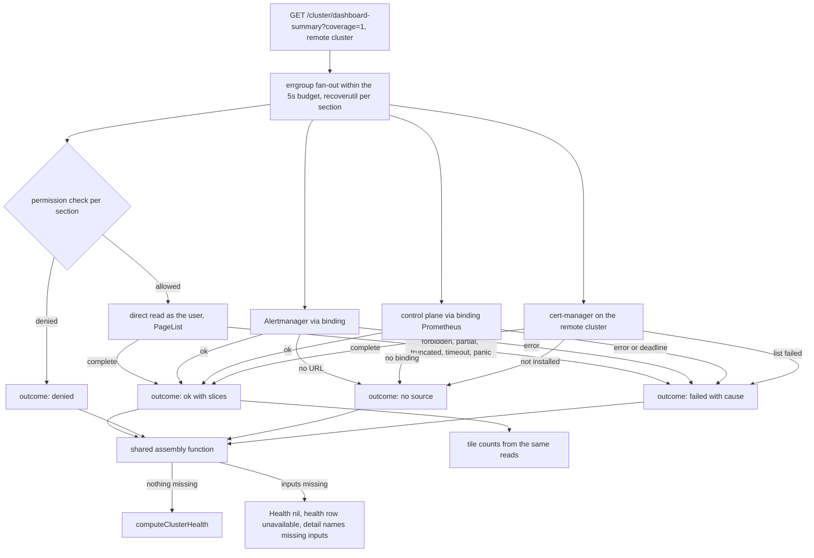
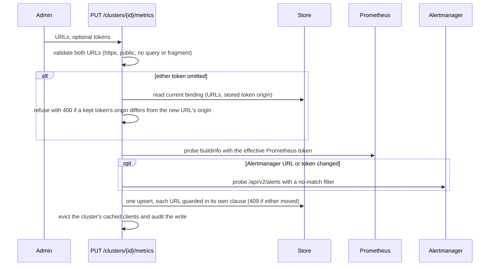
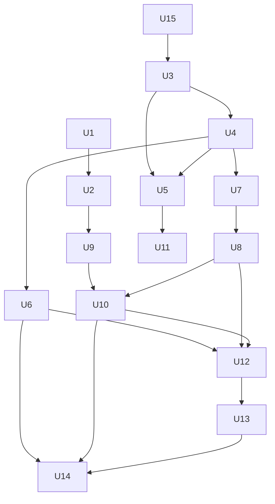

# Remote Alerts, Health Score and Mesh Metrics - Plan

## Goal Capsule

- **Objective:** With a remote cluster selected, an operator sees that cluster's own alert counts, health score, mesh golden signals and mTLS metric cross-check, or a plain statement of why one cannot be shown. No card ever shows local data under the remote cluster's name.
- **Means:** Extend the PR 4a per-cluster metrics binding with an Alertmanager token and client (KTD1, KTD2), route the mesh handlers through the binding's Prometheus (KTD6), and assemble the remote health score through the same pure assembly function the local score uses (KTD4).
- **Authority:** Requirements (R-IDs) win on product behavior; KTDs win on mechanism; units carry only unit-local detail. Project rules in `CLAUDE.md` apply throughout (impersonation, remote direct reads, recoverutil, fixed client messages, capability parity, 7-day package cooldown).
- **Stop conditions:** Stop and ask if a unit would need a new third-party dependency, would weaken a token-host guarantee (R10, R11), or would change a local response shape or local health score.
- **Execution profile:** Deep. Phased per `CLAUDE.md` rule 2 (at most five files per phase, verification between phases). U1 is a separate cleanup commit before U2 (rule 1).
- **Finishing:** `ce-work` implements and verifies locally; the standard shipping flow (review, PR against `main`, CI with e2e) follows.

---

## Product Contract

### Summary

Issue #608 makes every dashboard widget work for a remote cluster selection. PRs 1 to 4a shipped. This plan finishes the Prometheus and Alertmanager backed sources. Remote alert counts come from the cluster's own Alertmanager, and the remote health score is computed with the local scoring rules over reads of the remote cluster. Mesh golden signals and the mTLS cross-check read the cluster's bound Prometheus. The metrics binding gains a separate Alertmanager token, and the binding form moves into its own component.

### Problem Frame

Today a remote selection shows alert counts and the health score as unavailable, golden signals as unsupported, and an mTLS posture that skips its metric cross-check. The binding already stores an Alertmanager URL that nothing reads. Operators who manage several clusters from one k8sCenter cannot see whether a remote cluster is healthy or alerting without switching tools, which is the gap #608 exists to close.

### Requirements

**Remote alert counts**

- R1. On a remote selection, the dashboard summary's alert counts come from the cluster's bound Alertmanager, counting active alerts that are not silenced, inhibited or unprocessed, with critical counted by `severity="critical"`.
- R2. Always-firing heartbeat alerts (`Watchdog`, `DeadMansSwitch`, `InfoInhibitor`) are excluded from the remote tile and from the remote health input.
- R3. A cluster with no Alertmanager URL in its binding reports alerts as not configured, never as zero.
- R4. Any failure to read the Alertmanager (refused, redirected, unreachable, oversized or malformed answer) reports alerts unavailable with a fixed message that names the cause class, never a partial count and never upstream text.

**Remote health score**

- R5. A remote cluster gets a health score computed by the same scoring rules as the local cluster, over the same signals.
- R6. A signal the local path would skip or omit (a permission check denied, cert-manager not installed, no alert source configured, no Prometheus binding for the control plane) is skipped or omitted the same way remotely.
- R7. When any read that the permission checks allowed does not complete (refused by the API, unreachable, partial, truncated, timed out, panicked), the remote score is unavailable and the coverage detail names every missing input; no partial score is drawn.
- R8. The tile counts and the health inputs on one response come from the same reads.

**Mesh metrics**

- R9. Remote golden signals read the cluster's bound Prometheus; without a binding the answer says metrics are not configured, and a bound Prometheus that cannot be read says so distinctly.
- R16. Remote mTLS posture runs its Prometheus cross-check against the cluster's bound Prometheus; without a binding the posture is still served and the cross-check is reported not configured.

**Metrics binding**

- R10. The binding stores an optional Alertmanager bearer token, separate from the Prometheus token, encrypted at rest and never returned, logged or audited.
- R11. A stored Alertmanager token is only ever sent to the origin it was entered for. An edit that moves the Alertmanager URL to another origin requires the token again, clearing the URL clears the token, and a token whose stored origin no longer matches the URL is treated as absent everywhere, including by a pod running the previous release.
- R12. Saving a binding whose Alertmanager URL or token changed proves the Alertmanager answers its alerts API with that token; a failure is a fixed 502 naming the Alertmanager.
- R13. The binding form lets an admin set, keep or clear the Alertmanager token, and warns when an Alertmanager URL change will require re-entering it.

**Parity and declarations**

- R14. The capability rows, the README "Remote cluster support" table and the frontend declarations agree on what remote now supports.
- R15. With a remote selection, the dashboard alerts card does not link to the Alerts page, whose feeds stay local.

### Key Decisions

- **Remote health is drawn only from complete reads, under the local scoring rules.** The per-signal mapping is KTD4. Governs R5, R6, R7. (session-settled: user-approved — chosen over leaving remote health unavailable: a partial score must never look confident, but a complete one is worth showing)
- **The Alertmanager gets its own token, with the same re-entry rule.** Governs R10, R11. (session-settled: user-approved — chosen over reusing the Prometheus token: that token was entered for the Prometheus host)
- **Alerts are fetched on each dashboard request.** A count cache is a considered non-goal. Governs R1. (session-settled: user-approved — chosen over a cached count: freshness first, cost measured before adding a cache)

### Acceptance Examples

- AE1. **Covers R3.** Given a remote cluster bound to Prometheus only, when the dashboard summary loads, then the alerts row reads not configured with advice to add an Alertmanager URL, and the alert counts are absent rather than zero.
- AE2. **Covers R6, R7.** Given a tenant who may not list PodDisruptionBudgets on the remote cluster, when the summary loads and every other read completes, then a score is drawn without the PDB signal, exactly as the local path would.
- AE3. **Covers R7.** Given a remote cluster with more than 5,000 pods, when the summary loads, then health is unavailable and the detail says the pod read was truncated.
- AE4. **Covers R11.** Given a binding with Alertmanager token T on `https://am-a.example`, when an admin saves `https://am-b.example` without a token, then the save is refused before any request reaches either host.
- AE5. **Covers R11.** Given a pod running the previous release moves the Alertmanager URL to a new origin and leaves the old token row in place, when a new pod reads the binding or an admin saves the new URL without a token, then the token is never sent, the form shows no stored token, and alerts report the token must be re-entered.
- AE6. **Covers R9.** Given a remote cluster with no binding, when golden signals load, then the response is 200 with reason `metrics_not_configured`, and the local Prometheus receives no request.

### Scope Boundaries

**Considered and not built**

- **A cache of remote alert counts.** Per-request fetching was chosen at scoping. Evidence that would change it: the debug-logged section durations (KTD11) show the Alertmanager read pushing the summary past its budget, or a remote Alertmanager reports load from dashboard polls.
- **A remote health score for clusters whose lists exceed the remote list cap** (more than 5,000 pods, or any truncated list). These clusters always report health unavailable with a truncation detail (AE3). Evidence that would change it: operator reports from large clusters, which would justify a count-only or field-selected read for health.
- **Bypassing `HTTPS_PROXY` for binding clients.** With a proxy in the backend's environment, the public-only check applies to the proxy rather than the bound host. This is inherited from PR 4a and the API-server transport. Evidence that would change it: a deployment that sets a proxy while relying on the SSRF guard. The README binding note states the limitation.
- **Refusing a keep-token save that races a binding delete (insert branch).** It resurrects the binding without its token, which leaks nothing. Evidence that would change it: an admin report of a removed binding reappearing.
- **Normalizing default ports in origin comparison** (`https://h` vs `https://h:443`). The mismatch only forces a needless re-entry, which is the safe direction.
- **Mimir or Cortex `X-Scope-OrgID` headers and basic auth for Alertmanager.** Bearer-only matches the Prometheus binding. Evidence that would change it: an operator needing a multi-tenant Alertmanager.
- **A cluster label filter for shared Alertmanagers or Prometheus queriers.** The binding must point at the cluster's own Alertmanager and Prometheus; this is documented, as for PR 4a.

**Deferred to Follow-Up Work**

- Mobile copy for golden signals reasons `metrics_not_configured` and `unreachable` (`mobile/lib/features/mesh/golden_signals_tab.dart`, `mobile/lib/api/remote_failure.dart`). The 200-with-reason shape is mobile-safe; only the copy degrades to the generic card.
- Local health skips on generic cert-manager errors and control-plane Prometheus timeouts, which the comment in `frontend/lib/dashboard/coverage.ts` says should not exist (see KTD4).
- Hubble flows and status, and per-cluster compliance history (the next #608 slice).
- The Alerts page active and history feeds stay local.

### Sources

- Issue #608 and PR #612 (the metrics binding this plan extends).
- Alertmanager HTTP API v2 (`/api/v2/alerts` parameters and alert `status.state`), upstream OpenAPI spec at `prometheus/alertmanager` `api/v2/openapi.yaml`.
- `docs/solutions/backend-resilience-conventions.md`, `docs/solutions/go-typed-nil-interface.md`, `docs/solutions/postgres-test-harness-conventions.md`.

---

## Planning Contract

### Key Technical Decisions

- KTD1. **The store owns the Alertmanager token's origin and enforces it on every read.** Migration 000028 adds `alertmanager_token` (encrypted, like `prometheus_token`) and `alertmanager_token_origin`. `store.Get`, which both the binding API and the resolver go through, returns the token only when the current Alertmanager URL is non-empty and its origin equals the stored origin. An empty or NULL origin or URL means no token, and `HasAlertmanagerToken` follows the same rule. When a token row exists but its origin no longer matches the current URL, `Get` also reports `AlertmanagerTokenStale`, so the handler, the resolver and the binding GET can say the token must be re-entered instead of treating the binding as never having had one. The next write by this release drops a token whose origin no longer matches. Writer-side guards alone fail during a rolling update or rollback, because a previous-release pod can move or clear the URL without knowing the token columns exist (AE5). Chosen over checking only in the resolver, which leaves the PUT path able to keep and probe a mismatched token. The Prometheus token needs no origin column: `cluster_monitoring` was first written by PR 4a, whose writers already carry the keep guard.
- KTD2. **A small hand-rolled Alertmanager client, no new dependency.** It lives in `backend/internal/monitoring` beside the Prometheus client and reuses the strict public-only transport, the host-scoped bearer round tripper and the no-redirect client. It issues `GET <url>/api/v2/alerts` with `active=true&silenced=false&inhibited=false&unprocessed=false`, joining the URL path so a path prefix works. It caps the body at 16 MiB, rejects non-JSON or a non-array, filters `status.state == "active"` client-side, and maps decode failures to a fixed class without wrapping the decoder error, which can quote body bytes. Chosen over the upstream go-swagger client, which drags in a large module graph and bypasses the transport guards.
- KTD3. **One cache entry per cluster holds both clients, each with its own state.** `ClientResolver` builds the Prometheus client and, when a URL is bound, the Alertmanager client from one binding read, cached under the existing TTL, epoch and `Evict`. A missing Alertmanager URL (`ErrNoAlertmanager`) or a token needing re-entry is per-client state in that entry and never fails `PrometheusFor`, which also serves utilization, control plane, mesh and the query proxy. The no-database resolver returns `ErrNoMetricsBinding` from `AlertmanagerFor`, as from `PrometheusFor`. Chosen over a separate Alertmanager cache entry, whose second epoch could split from the first on evict.
- KTD4. **Local and remote health share one pure assembly function; only the mapping of reads to outcomes differs.** U2 extracts the per-signal shaping and an assembly function over per-signal outcomes: `ok` with slices, `denied`, `no source`, `unavailable` carrying the local reason and status (unknown or skipped), or `failed` with a cause class. Only the remote mapper emits `failed`, which withholds the score. The local mapper emits `unavailable` for its existing degrade-but-score states (cache syncing, an alert query error, a cold certificate cache, a control-plane timeout), so the local score stays byte-identical. The assembly function returns `HealthInputs` plus the missing inputs. The workloads-gated-on-nodes rule and the zero-node rule live in it. A permission denial follows the local outcome: nodes, pods and all workload kinds denied give unknown, and a subset of workload kinds is omitted. PDB, storage and alerts are skipped. So are certificates, whether the permission check is denied or any cert-manager list returns Forbidden. Any other allowed read that does not complete fails the score (R7).

  Remote differs from local in four places, each visible in the remote mapper:
  1. A certificate read error other than Forbidden fails remote health where local skips it. That includes a non-Forbidden failure of an Issuer or ClusterIssuer list that a certificate references, since thresholds would otherwise fall back silently.
  2. A control-plane query error or timeout with a binding present fails remote health where local skips it.
  3. StorageClasses are read as the user, so a denied StorageClass check skips storage remotely, while local reads StorageClasses as service-account metadata.
  4. Local alerts come from k8sCenter's webhook store and exclude `Watchdog` and `DeadMansSwitch` from health and nothing from the tile. Remote alerts are every unsilenced active alert on the bound Alertmanager, excluding R2's three names from both. The local path is not changed.

  Chosen over a strict "every input must be read" rule, which would refuse tenants a score that local gives them, and over an exact copy of local, whose two error skips fail open.
- KTD5. **Unavailable remote health keeps the current response shape.** `Health` stays nil and the `health` coverage row is `unavailable`. The reason code is `forbidden` only when every failure is a denial, and otherwise the code of the first failing input in fixed signal order. The detail lists every missing input by name and cause class, with no error text. When every read completes and zero nodes are visible, the response carries `Health{unknown}` with an ok row, mirroring local; the frontend already refuses to draw it. Chosen over a `Health{status: unavailable}` object, since `shouldRenderHealth` and the legacy shape already handle a nil score.
- KTD6. **The mesh handler takes a narrow resolver interface wired in `server.New`.** `servicemesh.Handler` gains a field typed as a one-method interface over `PrometheusFor`. `server.New` assigns it only when the shared resolver is non-nil, which covers the no-database path and avoids a typed nil. `promClientOverride` stays as the local-only test seam, so tests can prove remote never touches the local Prometheus. Chosen over wiring in `main.go` (nil without a database) and over the concrete resolver type, whose unexported transport cannot be faked from servicemesh tests.
- KTD7. **Golden signals keep the 200-with-reason shape.** Remote without a binding answers 200 with reason `metrics_not_configured`. A bound Prometheus whose queries all fail answers 200 with reason `unreachable`. A binding-store failure answers 503 through the target-error writer, never "not configured". The dual-mesh 400 is not a remote refusal (it also happens locally), so it moves from `UNSUPPORTED_STATUSES` to its own frontend declaration, and `REMOTE_BEHAVIOUR["mesh-golden-signals"]` becomes `binding`, with the binding category's documentation extended to cover an in-body reason. Chosen over the 404 `metrics_not_configured` that the monitoring routes use, because mobile already handles 200 plus a reason and a 404 would surface as an error there; the endpoints differ on purpose.
- KTD8. **Two-token keep logic compares against the stored token's origin and guards each URL in its own clause.** The PUT reads the current binding when either token is omitted. The Alertmanager re-entry check compares the request URL's origin with the stored token origin (KTD1), not with the stored URL. The Prometheus check is unchanged. Both checks run before any probe, and each probe's token comes only from its check. The upsert's conflict branch requires `(Prometheus token supplied, or stored Prometheus URL equals keptFrom) and (Alertmanager token supplied, or stored Alertmanager URL equals keptAMFrom)`, as one statement. The Alertmanager URL is compared even when no Alertmanager token was stored at read time, so a concurrent save's token cannot follow this save's host. Keeping the Alertmanager token also requires a non-empty stored Alertmanager URL, so a token a previous-release pod left behind after clearing the URL is written as NULL. Clearing the Alertmanager URL clears its token and origin in the same statement. An Alertmanager token without an Alertmanager URL is a 400. Both URLs reject a query string or fragment.
- KTD9. **The Alertmanager probe calls the real read path.** `GET /api/v2/alerts` with a filter that matches nothing, expecting a JSON array, runs only when the Alertmanager URL or token is new or changed, after both re-entry checks. Chosen over `/-/ready` and `/api/v2/status`: proxies often do not expose them, and the status body carries the full Alertmanager configuration.
- KTD10. **New coverage reason `alerts_not_configured`, outside the capability set.** It is added to `k8s.ReasonCode`, mirrored in `dashboard_remote.go`, pinned by the parity test, and given its own frontend message telling the admin to add an Alertmanager URL to the cluster's metrics binding. Like `metrics_not_configured`, it stays out of `validReasonCodes` and the frontend `REASON_CODES`, so the cross-tree capability check and the exhaustive switches are untouched. Refused, redirected, unreachable and unreadable Alertmanager answers use `unreachable` with fixed per-class details. `credentials_invalid` is not used, because it names the cluster's own credentials.
- KTD11. **Every remote health input shares the one 5s summary budget.** The control-plane query and the Alertmanager read use the request's budget, not the local 1s control-plane sub-budget. A deadline is its own "timed out" cause class. The remote certificate read serves a same-identity snapshot up to 90s old, following the local `peekStaleness` precedent, because the 30s remote cache would otherwise always be expired at the dashboard's 60s refresh. Only a cluster with no recent snapshot pays the cold fetch, which makes that one poll's health unavailable while the detached fetch fills the cache for the next. Section durations are logged at debug so the alert-count cache trigger can be measured. Chosen over per-input sub-budgets, which would add tuning knobs without making the score arrive more often.

### High-Level Technical Design

Remote dashboard summary with health, after this plan:

Binding save with two tokens:

### Implementation Constraints

- No new Go or npm dependency (KTD2).
- Every new goroutine uses `internal/recoverutil`, with result errors pre-seeded so a panic reads as a failed input (`docs/solutions/backend-resilience-conventions.md`).
- Optional collaborators are wired as true nil interfaces (`docs/solutions/go-typed-nil-interface.md`).
- Tokens and Alertmanager or Prometheus response bodies never appear in a response, log line or audit entry. Addresses may appear in operator warning logs, as in PR 4a, and never in a client response.
- One origin helper, in a leaf package the store, the handler and the resolver all import, computes every stored and compared origin.
- Local responses and the local health score stay byte-identical. The characterization tests from U2 pin this.

### System-Wide Impact

- **Mobile:** the mobile dashboard is unaffected, because it calls the summary without `?coverage=1` and keeps getting the legacy 400. Remote golden signals change from `unsupported_platform` to `metrics_not_configured` or `unreachable`, which mobile shows as the generic unavailable card until the deferred copy ships. The mTLS warning key `prometheus-cross-check` is kept, with new text only. Mobile does not read `/capabilities`.
- **Capability matrix:** `mesh.golden_signals` becomes supported, and `mesh.mtls` and `dashboard.summary` lose "Partial". The README table, the partial allowlist, the e2e spec and the frontend mirror move together in U14. The capability reason codes do not change (KTD10).
- **Shared resolver:** one cache entry per cluster feeds the query proxy, utilization, control plane, mesh and alert counts. One `Evict`, on a binding edit or cluster delete, clears all of them. Staleness up to the TTL across replicas is inherited from PR 4a.
- **Remote dashboard load:** about twelve sections share the 5s budget. Each tile degrades on its own, but the score needs every input, so its availability follows the slowest one (KTD11). Each poll adds six list calls with their permission checks and one Alertmanager read to the remote cluster.
- **Remote differs from local:** the four deliberate places in KTD4 (certificate errors, control-plane errors, StorageClass permission, alert source), plus large clusters that never score remotely (Scope Boundaries).
- **Store:** migration 000028 adds two nullable columns. A previous-release pod cannot cause a stale token to be sent, because the origin check runs at read time (KTD1).

### Risks

- **Mixed-version rollout or rollback.** A previous-release pod writes the binding without the token columns. Mitigated by KTD1 and the U3 tests that run the previous release's upsert against schema 28. The rollback procedure is in U15.
- **Rollback to schema 27 while new pods run.** A new pod's binding read names the dropped columns and fails for Prometheus too. Mitigated by the NOTES procedure in U15: stop every new pod first, and prefer leaving the columns in place.
- **Remote score rarely drawn on slow clusters.** Accepted and measured (KTD11); the trigger for a cache or sub-budgets is recorded in Scope Boundaries.

### Sequencing

---

## Implementation Units

| U-ID | Title | Key files | Depends on |
|---|---|---|---|
| U1 | Dashboard cleanup pass | `k8s/resources/dashboard.go`, `dashboard_remote.go` | none |
| U2 | Shared health shaping and assembly | `k8s/resources/health_shaping.go` (new), `dashboard.go` | U1 |
| U15 | Migration 000028 | `store/migrations/000028_*`, `NOTES.txt` | none |
| U3 | Alertmanager token storage | `store/cluster_metrics.go`, `server/metrics_binding_reader.go` | U15 |
| U4 | Alertmanager client and resolver | `monitoring/alertmanager.go` (new), `resolver.go` | U3 |
| U5 | Two-token binding API | `server/handle_cluster_metrics.go` | U3, U4 |
| U6 | Mesh metrics through the binding | `servicemesh/handler.go`, `server/server.go` | U4 |
| U7 | Alert count source per cluster | `monitoring/alertcounts.go` (new), `k8s/target_status.go` | U4 |
| U8 | Remote alert counts in the summary | `k8s/resources/dashboard_remote.go` | U7 |
| U9 | Certificate expiry for a selected cluster | `certmanager/adapter.go`, `k8s/resources/handler.go` | U2 |
| U10 | Remote health score | `k8s/resources/dashboard_remote_health.go` (new), `access.go` | U8, U9 |
| U11 | Metrics binding form | `src/islands/MetricsBindingForm.tsx` (new), `ClusterManager.tsx` | U5 |
| U12 | Dashboard declarations and coverage | `lib/dashboard/data.ts`, `types.ts`, `coverage.ts` | U6, U8, U10 |
| U13 | Widget copy for remote states | `MeshGoldenSignalsWidget.tsx`, `ActiveAlertsWidget.tsx` | U12 |
| U14 | Capability, README and e2e parity | `server/handle_capabilities.go`, `README.md` | U6, U10, U13 |

Backend paths are under `backend/internal/`, frontend paths under `frontend/`.

### U1. Dashboard cleanup pass

- **Goal:** Remove dead code, unused helpers and stale comments from the remote and local dashboard handlers before the refactor, as a separate commit (`CLAUDE.md` rule 1).
- **Requirements:** none directly; precondition for U2.
- **Dependencies:** none.
- **Files:** `backend/internal/k8s/resources/dashboard.go`, `backend/internal/k8s/resources/dashboard_remote.go`.
- **Approach:** Delete code with no caller and comments that current behavior already contradicts. Comments that only later units make false (such as "health is always null") stay until those units. No behavior change.
- **Test expectation:** none -- behavior-preserving cleanup; the existing `dashboard_test.go` and `dashboard_remote_test.go` suites are the check.
- **Verification:** Backend vet and tests pass unchanged; the diff contains deletions only.

### U2. Shared health shaping and assembly

- **Goal:** Move each health signal's shaping, and the assembly of `HealthInputs` from per-signal outcomes, out of `gatherHealthInputs` into pure functions both paths call (KTD4).
- **Requirements:** R5, R6, R8.
- **Dependencies:** U1.
- **Files:** `backend/internal/k8s/resources/health_shaping.go` (new), `backend/internal/k8s/resources/health_shaping_test.go` (new), `backend/internal/k8s/resources/dashboard.go`.
- **Approach:**
  1. Extract shaping for nodes, workloads (deployments, statefulsets, daemonsets with the existing progressing helpers), pods, PDB violations and storage (pending PVCs excluding WaitForFirstConsumer, with default StorageClass resolution).
  2. Extract the assembly function over per-signal outcomes, carrying the workloads-gated-on-nodes rule and the zero-node rule.
  3. `gatherHealthInputs` becomes the local mapper: informer reads and local permission checks turned into outcomes. The local score must not change for any input.
- **Execution note:** Add characterization coverage of `gatherHealthInputs` outputs on representative fixtures before extracting, then keep those tests green.
- **Patterns to follow:** existing pure helpers `isProgressingDeployment`, `isProgressingStatefulSet`, `defaultStorageClassName`, `isWFFCPending`, `countPDBViolations` in `dashboard.go`.
- **Test scenarios:**
  - Characterization: a fixture with ready and not-ready nodes, progressing and degraded workloads, crashlooping pods, a violated PDB and a pending PVC produces the same `HealthInputs` before and after extraction.
  - Nodes denied: workloads are not computed and health is unknown.
  - Statefulsets denied: workloads are computed over deployments and daemonsets only.
  - A PVC pending on a WaitForFirstConsumer class with no consumer is not counted as pending.
  - Zero nodes yields the unknown node input.
  - Characterization of degrade-but-score states: informer cache syncing, an alert query error, a cold certificate cache and a control-plane timeout each produce today's reason text and signal status, and a score is still drawn.
  - Assembly: an `unavailable` outcome passes its reason and status through and still scores; a `failed` outcome is reported in the missing list with its cause, and no `HealthInputs` is returned for scoring.
- **Verification:** Local dashboard tests pass unchanged; the new tests pin each shaping function and the assembly rules.

### U15. Migration 000028

- **Goal:** Add the Alertmanager token columns with a documented, safe rollback.
- **Requirements:** R10, R11.
- **Dependencies:** none.
- **Files:** `backend/internal/store/migrations/000028_cluster_alertmanager_token.up.sql` (new), `backend/internal/store/migrations/000028_cluster_alertmanager_token.down.sql` (new), `backend/internal/store/migrations/NOTES.txt`, `backend/internal/store/cluster_metrics_test.go`.
- **Approach:**
  1. Up: `ADD COLUMN IF NOT EXISTS` for `alertmanager_token BYTEA` and `alertmanager_token_origin TEXT`, with column comments. Down: `DROP COLUMN IF EXISTS` for both.
  2. NOTES section in the 000027 format. Lock impact: adding nullable columns with no default is catalog-only (the table has rows since PR 4a; do not copy 000027's "table is empty" line).
  3. Rollback procedure: stop every pod of this release first, because its binding read names the new columns. Then either leave the columns in place (recommended: the previous release never names them and KTD1 keeps a leftover token unusable), or run the down migration, accepting that every Alertmanager token must be re-entered. Then reset the version with `UPDATE schema_migrations SET version = 27, dirty = false`.
- **Test scenarios:**
  - Round trip: migrate to 28, write a binding with both tokens, migrate to 27 (columns gone, row, Alertmanager URL and Prometheus token kept), migrate to 28 again. `HasAlertmanagerToken` is then false, and a keep save with the Alertmanager token omitted succeeds and stores none.
  - Re-running the up migration on a database already at 28 succeeds.
- **Verification:** The migration test passes in CI against PostgreSQL.

### U3. Alertmanager token storage

- **Goal:** Read and write the Alertmanager token with its origin, enforcing the origin on every read and guarding keep and clear atomically.
- **Requirements:** R10, R11.
- **Dependencies:** U15.
- **Files:** `backend/internal/urlorigin/origin.go` (new), `backend/internal/urlorigin/origin_test.go` (new), `backend/internal/store/cluster_metrics.go`, `backend/internal/store/cluster_metrics_test.go`, `backend/internal/server/handle_cluster_metrics.go` (store interface only), `backend/internal/server/metrics_binding_reader.go`, `backend/internal/server/handle_cluster_metrics_test.go` (fake store only). Two phases: the origin helper first, then the store with its callers.
- **Approach:**
  1. Add the shared origin helper (Implementation Constraints) with its tests.
  2. `MetricsBinding` gains `HasAlertmanagerToken` and `AlertmanagerTokenStale`. `Get` returns the Alertmanager token only under the KTD1 rule, and sets the stale flag when a token row exists whose origin no longer matches.
  3. `Upsert` takes the Alertmanager token with nil-keep, empty-clear and value-replace semantics, plus the token origin computed by the caller with the shared helper, and stores it as given. The conflict branch follows KTD8.
  4. Update the server's store interface, the binding reader mapping into `monitoring.MetricsBinding`, and `fakeMetricsStore` in the same unit, so the tree compiles at the phase boundary.
- **Patterns to follow:** the `keptFrom` guard in `Upsert`; `docs/solutions/postgres-test-harness-conventions.md`.
- **Test scenarios:**
  - A new Alertmanager token is stored encrypted with its origin; `Get` decrypts it and reports `HasAlertmanagerToken`.
  - A stored origin that differs from the current Alertmanager URL's origin, or a NULL or empty origin, makes `Get` return no token and `HasAlertmanagerToken` false (fails closed), with `AlertmanagerTokenStale` true when a token row exists.
  - A binding that never had an Alertmanager token reports `AlertmanagerTokenStale` false.
  - The stored origin equals the shared helper's origin for an uppercase host, a URL with a path prefix and a URL with an explicit port.
  - A keep save whose `keptAMFrom` no longer matches returns `ErrMetricsBindingChanged` and writes nothing.
  - A keep save with `keptAMFrom` empty over a binding that gained an Alertmanager URL meanwhile returns `ErrMetricsBindingChanged`.
  - A new Prometheus token with the Alertmanager token omitted, while the Alertmanager URL moved concurrently, returns `ErrMetricsBindingChanged`; the mirror case (new Alertmanager token, Prometheus token omitted, Prometheus URL moved) does too.
  - The previous release's literal upsert run against schema 28, once clearing the Alertmanager URL and once moving it to another origin, leaves `Get` returning no usable token.
  - After the previous release cleared the URL, a keep save that adds a URL on the old origin stores no token.
  - An empty Alertmanager token clears it; an empty Alertmanager URL clears the token and origin.
  - Existing Prometheus keep and clear tests keep passing with the extended signature.
- **Verification:** Store tests pass in CI against PostgreSQL; backend vet and tests pass repo-wide at the phase boundary.

### U4. Alertmanager client and resolver

- **Goal:** Give the resolver a per-cluster Alertmanager client that reads active alert counts and a probe, with the token sent only to its bound origin.
- **Requirements:** R1, R2, R4, R11, R12.
- **Dependencies:** U3.
- **Files:** `backend/internal/monitoring/alertmanager.go` (new), `backend/internal/monitoring/alertmanager_test.go` (new), `backend/internal/monitoring/resolver.go`, `backend/internal/monitoring/resolver_test.go`.
- **Approach:**
  1. Client per KTD2: a counts read returns active and critical totals with the R2 exclusions applied, and a probe issues the no-match filtered read (KTD9).
  2. `MetricsBinding` gains the Alertmanager token, which the store has already origin-checked, and the stale flag (KTD1). With the flag set, the resolver builds no Alertmanager client and returns the re-entry error without sending any request.
  3. `AlertmanagerFor(ctx, clusterID)` shares the cache entry, epoch and `Evict` with `PrometheusFor` (KTD3).
  4. Error classes for callers: refused (401/403), redirected (3xx), unreachable (transport, timeout, 5xx), unreadable (over cap, not JSON, wrong shape) and token re-entry needed.
- **Patterns to follow:** `bearerRoundTripper`, `newRemotePrometheusClient`, `probePrometheus` and the cache and epoch logic in `resolver.go`; the fakes in `resolver_test.go`.
- **Test scenarios:**
  - Counts read sends `active=true`, `silenced=false`, `inhibited=false`, `unprocessed=false` and counts critical by label; an alert with no severity counts toward active only.
  - Watchdog, DeadMansSwitch and InfoInhibitor are excluded; an alert whose `status.state` is `suppressed` is excluded even if the server ignored the parameters.
  - A URL with a path prefix (`https://host/alertmanager`) requests `/alertmanager/api/v2/alerts`.
  - The Alertmanager token reaches only the Alertmanager host over https; the Prometheus token never reaches it, and the Alertmanager token never reaches the Prometheus host.
  - 401, 403, a 302 to another host, a 302 to plain http, a 500, a timeout, a body over 16 MiB, a non-JSON body and a JSON object instead of an array each yield the matching error class, with no body text in the error.
  - A binding whose Alertmanager token needs re-entry returns the re-entry error from `AlertmanagerFor` with no request sent, and still serves `PrometheusFor` normally (covers AE5).
  - `Evict` drops both clients; a binding read racing an evict does not reinstate the Alertmanager client.
  - No Alertmanager URL yields `ErrNoAlertmanager`; no binding, and the no-database resolver, yield `ErrNoMetricsBinding`.
  - The production transport refuses a loopback Alertmanager URL.
- **Verification:** Monitoring tests pass; neither the probe nor the counts read logs the response body.

### U5. Two-token binding API

- **Goal:** Accept, keep, clear and probe the Alertmanager token in the binding API, with both re-entry checks before any probe.
- **Requirements:** R10, R11, R12.
- **Dependencies:** U3, U4.
- **Files:** `backend/internal/server/handle_cluster_metrics.go`, `backend/internal/server/handle_cluster_metrics_test.go`, `backend/internal/server/server.go`.
- **Approach:**
  1. Request gains `alertmanagerToken`; response gains `hasAlertmanagerToken` and `alertmanagerTokenStale`. The token never appears in a response or audit entry.
  2. Validation and keep logic per KTD8, with a distinct fixed 400 message for Alertmanager re-entry.
  3. Alertmanager probe per KTD9 through a server-level test seam like `probePrometheus`, with a fixed 502 "could not reach Alertmanager at the given URL".
- **Patterns to follow:** the PR 4a handler flow, `fakeMetricsStore` and the interleaving tests in `handle_cluster_metrics_test.go`.
- **Test scenarios:**
  - Saving a new Alertmanager URL with a token probes the Alertmanager with that token and stores it; the response reports `hasAlertmanagerToken` without the token.
  - Moving the Alertmanager URL to another origin without a token is refused with the Alertmanager re-entry message before either probe runs (covers AE4).
  - A row whose Alertmanager URL is on origin B but whose token origin is A: a keep save to B, or to another path on B, is refused with the re-entry message and no request reaches any host (covers AE5).
  - A save that supplies a new Prometheus token and omits the Alertmanager token while moving the Alertmanager origin is refused.
  - Two interleaved saves: B moves the Alertmanager URL and token while A (Alertmanager token omitted) probes; A gets 409 and B's binding stands.
  - Two interleaved saves where A saw no Alertmanager token and B adds one on another host: A gets 409.
  - An Alertmanager token without a URL is 400; a URL with a query string is 400 for either field.
  - Changing only the Prometheus URL does not probe the Alertmanager; an unreachable Alertmanager on a changed Alertmanager URL is 502 with the fixed message.
- **Verification:** Server tests pass; the audit entries contain no URL or token.

### U6. Mesh metrics through the binding

- **Goal:** Serve remote golden signals and the remote mTLS cross-check from the selected cluster's bound Prometheus.
- **Requirements:** R9, R16.
- **Dependencies:** U4.
- **Files:** `backend/internal/servicemesh/handler.go`, `backend/internal/servicemesh/remote.go`, `backend/internal/servicemesh/handler_remote_test.go`, `backend/internal/server/server.go`, `backend/internal/server/monitoring_resolver_wiring_test.go`.
- **Approach:**
  1. Resolver field and wiring per KTD6.
  2. Golden signals per KTD7, after the existing mesh and permission checks.
  3. mTLS: with a binding, the cross-check runs against the remote Prometheus with the existing fixed failure text. Without one, the errors map says the cross-check is not configured. A binding-store failure degrades to the fixed cross-check text, since the posture itself is valid.
  4. Remove `crossCheckUnavailableRemote` once nothing uses it.
- **Patterns to follow:** `newRemoteFixture`, `assertNoLocalOrProm` and `assertNoLeak` in `handler_remote_test.go`; the resolver wiring guard in `server.go`.
- **Test scenarios:**
  - Remote golden signals with a binding query the remote fake Prometheus and return its series; the local Prometheus receives no request.
  - Remote golden signals without a binding return 200 with reason `metrics_not_configured` (covers AE6).
  - A bound Prometheus failing every query returns reason `unreachable`, with no address or error text in the body.
  - A binding-store failure returns 503, not "not configured".
  - The dual-mesh request without a mesh parameter still returns 400 before any binding lookup.
  - Remote mTLS with a binding applies the metric overrides from the remote Prometheus; without a binding the errors map names the cross-check as not configured and the posture is still returned.
  - Local golden signals and mTLS responses are unchanged.
  - The server wires the shared resolver into the mesh handler, and leaves the field nil when no resolver exists.
- **Verification:** Servicemesh and server tests pass; the old remote-unsupported tests are rewritten, not silently deleted.

### U7. Alert count source per cluster

- **Goal:** Provide the dashboard with a cluster-aware alert count source backed by the resolver, plus the `alerts_not_configured` reason.
- **Requirements:** R1, R3, R4.
- **Dependencies:** U4.
- **Files:** `backend/internal/monitoring/alertcounts.go` (new), `backend/internal/monitoring/alertcounts_test.go` (new), `backend/internal/k8s/target_status.go`, `backend/internal/k8s/resources/handler.go`, `backend/internal/server/server.go`.
- **Approach:**
  1. A cluster-aware alert source interface in `k8s/resources` (counts for a cluster id), implemented by a monitoring adapter over `AlertmanagerFor`.
  2. Adapter errors keep the U4 classes so the dashboard can pick fixed details; "not configured" and "token must be re-entered" stay distinct.
  3. Add the reason per KTD10.
  4. Wire it in `server.New` beside the utilization adapter, nil-safe.
- **Patterns to follow:** `UtilizationAdapter` and `ControlPlaneAdapter` in `backend/internal/monitoring`.
- **Test scenarios:**
  - The adapter returns active and critical counts for a bound remote cluster.
  - A binding without an Alertmanager URL returns the not-configured error; no binding returns the metrics-not-configured error.
  - Each U4 error class passes through classifiable; no error carries body text.
  - With no resolver wired, the dashboard handler sees a nil source.
- **Verification:** Monitoring and server tests pass; the capability reason-code parity test is unchanged.

### U8. Remote alert counts in the summary

- **Goal:** Replace the remote `alerts` unsupported row with counts from the cluster's Alertmanager.
- **Requirements:** R1, R3, R4, R8.
- **Dependencies:** U7.
- **Files:** `backend/internal/k8s/resources/dashboard_remote.go`, `backend/internal/k8s/resources/dashboard_remote_test.go`, `backend/internal/k8s/resources/dashboard_remote_parity_test.go`.
- **Approach:**
  1. Add the alerts section to the remote fan-out within the existing budget, pre-seeded with a "not read" error.
  2. The user's `alertmanagers` permission is checked on the remote cluster first; a denial gives a `forbidden` row.
  3. Coverage per KTD10: not configured, re-entry needed, and one fixed detail per error class.
  4. The section's result is kept for U10, so the tile and the health input share one read (R8).
- **Patterns to follow:** `metricsSection` and `readRemoteSection` in `dashboard_remote.go`; budget, panic and timeout tests in `dashboard_remote_test.go`.
- **Test scenarios:**
  - A bound Alertmanager with three active alerts, one critical and one Watchdog, yields active 2 and critical 1 with an ok row.
  - No Alertmanager URL yields an unavailable row with reason `alerts_not_configured` and absent counts (covers AE1).
  - A denied `alertmanagers` check yields a forbidden row and no Alertmanager request.
  - A refused, redirected, unreachable and unreadable Alertmanager each yield `unreachable` with its fixed detail and no address.
  - A panicking alert source yields an unavailable row, not zero counts.
  - The parity test pins `alerts_not_configured` to `k8s.ReasonAlertsNotConfigured`.
  - The legacy remote summary without `?coverage=1` still returns the same 400.
- **Verification:** Resources tests pass; `TestRemoteSummary_NeverUsesInformers` is updated to assert Alertmanager-backed counts and no informer use.

### U9. Certificate expiry for a selected cluster

- **Goal:** Let the dashboard read certificate expiry buckets for a remote cluster as the user, reporting incomplete reads.
- **Requirements:** R5, R6, R7.
- **Dependencies:** U2 (both edit `dashboard.go`; no logical dependency).
- **Files:** `backend/internal/certmanager/adapter.go`, `backend/internal/certmanager/adapter_test.go`, `backend/internal/k8s/resources/handler.go`, `backend/internal/k8s/resources/dashboard.go`, `backend/internal/k8s/resources/dashboard_test.go`.
- **Approach:**
  1. Extend the cert expiry interface with a cluster-aware method. The local branch keeps today's behavior. The remote branch checks the user's cluster-wide list permission on cert-manager certificates, then uses the handler's existing remote load and `thresholdBucket`.
  2. The remote branch serves a same-identity snapshot up to 90s old before fetching (KTD11).
  3. The remote result distinguishes "not installed" (a valid empty read), "denied" (permission check denied, or Forbidden on any cert-manager list), "read complete" and "incomplete" (KTD4).
  4. Update the local caller and `fakeCertExpiry` to the new interface.
- **Patterns to follow:** `certmanager/remote.go` `load` and `fetchRemote`; `CertExpiryAdapter.ExpiringCounts` and its `peekStaleness` window.
- **Test scenarios:**
  - Remote with cert-manager installed returns the critical and warning buckets of certificates readable as the user.
  - Remote with cert-manager not installed returns a valid empty read.
  - A denied certificate permission check, or a Forbidden ClusterIssuer list, returns denied.
  - A certificate list failing with a server error returns incomplete.
  - A ClusterIssuer list failing with a server error, with a certificate referencing a ClusterIssuer, returns incomplete; with no such reference it returns complete.
  - A snapshot 60s old for the same identity is served without a fetch; one older than 90s triggers a fetch.
  - The local result is unchanged.
- **Verification:** Certmanager and resources tests pass.

### U10. Remote health score

- **Goal:** Compute the remote health score by mapping remote reads to outcomes and calling the shared assembly function.
- **Requirements:** R5, R6, R7, R8.
- **Dependencies:** U8, U9.
- **Files:** `backend/internal/k8s/resources/dashboard_remote_health.go` (new), `backend/internal/k8s/resources/dashboard_remote_health_test.go` (new), `backend/internal/k8s/resources/dashboard_remote.go`, `backend/internal/k8s/resources/access.go`, `backend/internal/k8s/resources/dashboard_remote_test.go`.
- **Approach:**
  1. Add remote reads for deployments, statefulsets, daemonsets, PDBs, PVCs and StorageClasses as the user, in the new file, joined to the existing fan-out and reusing the node and pod sections.
  2. Fix the permission check for StorageClasses to use the `storage.k8s.io` group, and check the existing counts caller of that lookup.
  3. Map each section, the alerts section (U8), certificates (U9) and the control plane (through the binding, request ctx per KTD11) to outcomes per KTD4, and call the assembly function from U2.
  4. Emit the score or the unavailable row per KTD5, with a distinct detail when a read was truncated or timed out. Log section durations at debug.
- **Execution note:** Start by rewriting `TestRemoteSummary_NeverSynthesizesHealth` into a table that iterates permission-denial and read-failure masks over every section, and make it fail first.
- **Patterns to follow:** `readRemoteSection`, the pre-seeded section results and the denial masks in `dashboard_remote_test.go`.
- **Test scenarios:**
  - All reads complete on a healthy fixture: every non-alert signal equals the local signal computed from the same objects, and the alerts signal takes the explicit value implied by the fake Alertmanager's alerts.
  - PDB permission denied, everything else complete: a score is drawn without the PDB signal (covers AE2).
  - Storage PVC or StorageClass permission denied: storage is skipped and a score is drawn.
  - A user allowed to list `storage.k8s.io` StorageClasses passes the permission check.
  - A 403 from the API on an allowed StorageClass list: health unavailable, detail names storage classes.
  - One workload kind denied: workloads are computed over the other kinds.
  - All workload kinds denied: health is unknown, matching local.
  - An allowed pod read truncated at the remote list cap: health unavailable, detail says the pod read was truncated (covers AE3).
  - An unreachable Alertmanager: health unavailable naming alerts. No Alertmanager URL: alerts skipped and a score drawn.
  - Control-plane query timeout with a binding present: health unavailable; with no binding, control plane skipped and a score drawn.
  - A certificate list failure with a server error: health unavailable naming certificates.
  - A ClusterIssuer list refused with 403: certificates are skipped and a score is drawn.
  - A cold certificate fetch that outlasts the budget: this call's health is unavailable, and a call 60s later draws a score from the cached snapshot.
  - Two different failures: the reason is the first in signal order, and the detail lists both.
  - Zero nodes with every read complete: `Health{unknown}` with an ok row.
  - A panic in any health section: health unavailable, never a score.
- **Verification:** Resources tests pass; no remote path reads an informer.

### U11. Metrics binding form

- **Goal:** Move the binding form into its own island component with Tailwind classes, and add the Alertmanager token controls.
- **Requirements:** R13.
- **Dependencies:** U5.
- **Files:** `frontend/src/islands/MetricsBindingForm.tsx` (new), `frontend/src/islands/MetricsBindingForm_test.tsx` (new), `frontend/src/islands/ClusterManager.tsx`, `frontend/src/islands/ClusterManager_test.tsx`.
- **Approach:**
  1. Extract the form state, the generation guard and the load, save and remove handlers into `MetricsBindingForm`; `ClusterManager` keeps the per-cluster badge and passes callbacks.
  2. Replace inline `style` props with Tailwind utilities and theme variables.
  3. Label the token fields "Prometheus bearer token (optional)" and "Alertmanager bearer token (optional)", each with its own stored-token note and its own clear checkbox naming that token. The Alertmanager token sends omit, empty or value like the Prometheus token.
  4. When an Alertmanager token is stored and the URL is edited to another origin, or the binding reports the token stale, mark the token field required. Show an inline message under it, linked for assistive technology, saying a different Alertmanager host needs its token entered again and the stored token will not be sent there. Hide the "token stored" note, and offer the clear checkbox when the token is stale. Save stays disabled only while that field is empty. The form hints that a shared token must be entered in both fields.
  5. Show the 409 and both re-entry messages from the server; the remove confirmation says the Alertmanager URL and token are removed too.
  6. Apply the badge update on a successful save or remove even when the form has moved on, while dropping the form-field writes.
- **Patterns to follow:** the current form and its `metricsGen` guard; `ClusterManager_test.tsx` fetch stub and helpers.
- **Test scenarios:**
  - Saving with an Alertmanager token sends `alertmanagerToken`; a blank field omits it; the clear box sends an empty string.
  - Editing the Alertmanager URL to another host with a stored token shows the re-entry message and requires the token before Save is enabled.
  - A binding loaded with a stale Alertmanager token shows the re-entry message and the clear checkbox; clearing and saving sends an empty Alertmanager token.
  - The Alertmanager re-entry 400 and the 409 show the server messages.
  - The Prometheus and Alertmanager token fields are located by their labels.
  - A save that completes after the form switched to another cluster updates the first cluster's badge and leaves the open form untouched.
  - Existing ClusterManager binding tests pass against the extracted component.
- **Verification:** `bun run check` and `bun test` pass.

### U12. Dashboard declarations and coverage

- **Goal:** Update the frontend dashboard declarations, coverage messages and the project doc line for the new remote behavior.
- **Requirements:** R3, R9, R14.
- **Dependencies:** U6, U8, U10.
- **Files:** `frontend/lib/dashboard/data.ts`, `frontend/lib/dashboard/types.ts`, `frontend/lib/dashboard/data_test.ts`, `frontend/lib/dashboard/coverage.ts`, `CLAUDE.md`.
- **Approach:**
  1. Golden signals declarations per KTD7.
  2. `alerts_not_configured` coverage message per KTD10.
  3. Update the stale comments about remote health always being unavailable, and the Multi-Cluster "remote dashboard" line in `CLAUDE.md`.
- **Test scenarios:**
  - The declaration test passes with `mesh-golden-signals` as `binding` and the dual-mesh 400 in its own declaration.
  - A coverage row with `alerts_not_configured` renders the Alertmanager advice, not the Prometheus advice (in `frontend/lib/dashboard/coverage_test.tsx`).
  - A remote summary with an ok health row and a score renders the score; an unavailable row with a detail renders the detail.
- **Verification:** `bun run check` and `bun test` pass.

### U13. Widget copy for remote states

- **Goal:** Make the golden signals and alerts cards say the right thing for remote states.
- **Requirements:** R9, R15.
- **Dependencies:** U12.
- **Files:** `frontend/components/dashboard/widgets/MeshGoldenSignalsWidget.tsx`, `frontend/src/components/mesh/GoldenSignals.tsx`, `frontend/components/dashboard/widgets/ActiveAlertsWidget.tsx`, `frontend/lib/dashboard/widget-render_test.tsx`.
- **Approach:**
  1. Golden signals: `metrics_not_configured` shows the shared "add a Prometheus binding" message; `unreachable` says the cluster's Prometheus could not be read; neither prints the raw code.
  2. Alerts card: hide the "View all alerts" link when the selected cluster is remote. On a remote selection with an unavailable alerts row, render the row's message and detail and no numeric count.
- **Test scenarios:**
  - Golden signals with reason `metrics_not_configured` render the binding advice.
  - Golden signals with reason `unreachable` render the unreachable copy.
  - The alerts card on a remote selection has no link to the Alerts page; on the local cluster it keeps the link.
  - The alerts card with `alerts_not_configured` shows the Alertmanager advice and no count or zero (covers AE1).
  - The alerts card with the token re-entry detail shows the re-enter-the-token advice and no count (covers AE5).
  - The alerts card with an `unreachable` row shows its fixed detail and no count.
- **Verification:** `bun run check` and `bun test` pass.

### U14. Capability, README and e2e parity

- **Goal:** Declare the new remote support consistently in the capability matrix, README and e2e.
- **Requirements:** R14.
- **Dependencies:** U6, U10, U13.
- **Files:** `backend/internal/server/handle_capabilities.go`, `backend/internal/server/handle_capabilities_test.go`, `backend/internal/server/readme_capability_parity_test.go`, `README.md`, `e2e/tests/remote-capabilities.spec.ts`.
- **Approach:**
  1. `mesh.golden_signals` becomes remote-supported with binding wording; refresh the `mesh.mtls` and `dashboard.summary` comments.
  2. README rows: golden signals and mTLS become "Yes" with binding wording. The dashboard summary row becomes "Yes" and names the Alertmanager URL, the complete-read condition and the large-cluster limit. Drop both from the partial allowlist, and note the proxy limitation beside the binding (Scope Boundaries).
  3. e2e asserts the new golden signals capability, and rewrites the existing "remote dashboard shows no health score" test, which asserts a null score and will fail once U10 lands.
- **Test scenarios:**
  - The capability test lists `mesh.golden_signals` as remote-supported.
  - The README parity test passes with the updated rows and allowlist.
  - The e2e capability spec expects golden signals supported remotely (runs in the two-cluster fixture).
  - The rewritten e2e test: with every remote read complete and no binding, the summary carries a non-null health with an ok health row, and the health widget renders the gauge.
- **Verification:** Backend tests, `scripts/check-cluster-routing.sh` and the frontend capability id mirror test pass.

---

## Verification Contract

| Gate | Command | Applies to |
|---|---|---|
| Backend vet and tests, repo-wide | `cd backend && go vet ./... && go test ./...` | every backend unit, at each phase boundary |
| Store tests against PostgreSQL | CI backend job with `KUBECENTER_TEST_DATABASE_URL` | U15, U3 (skip locally) |
| Routing guard | `scripts/check-cluster-routing.sh` | U6, U8, U10, U14 |
| Frontend checks, repo-wide | `cd frontend && bun run check` | U11, U12, U13 |
| Frontend tests | `cd frontend && bun test` | U11, U12, U13 |
| E2E | CI e2e job (two-cluster cases run in the kind fixture) | U14 |

Local responses must stay byte-identical: the existing local dashboard, monitoring and mesh tests, plus the U2 characterization tests, are part of every backend gate.

---

## Definition of Done

- Every unit's verification passes, and the repo-wide backend and frontend gates are green.
- Migration 000028 round-trips in CI, and NOTES.txt documents the rollback procedure.
- No remote path reads an informer, the local Prometheus, or the local alert store.
- No response, log line or audit entry carries a token or an Alertmanager or Prometheus response body.
- Capability rows, README table, frontend mirror and e2e agree.
- U1 landed as its own commit before U2.
- Abandoned-attempt and experimental code is removed from the diff.
