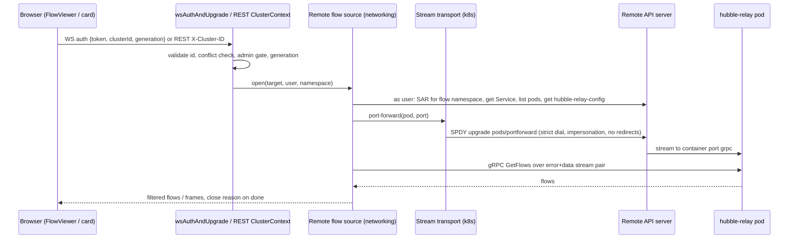
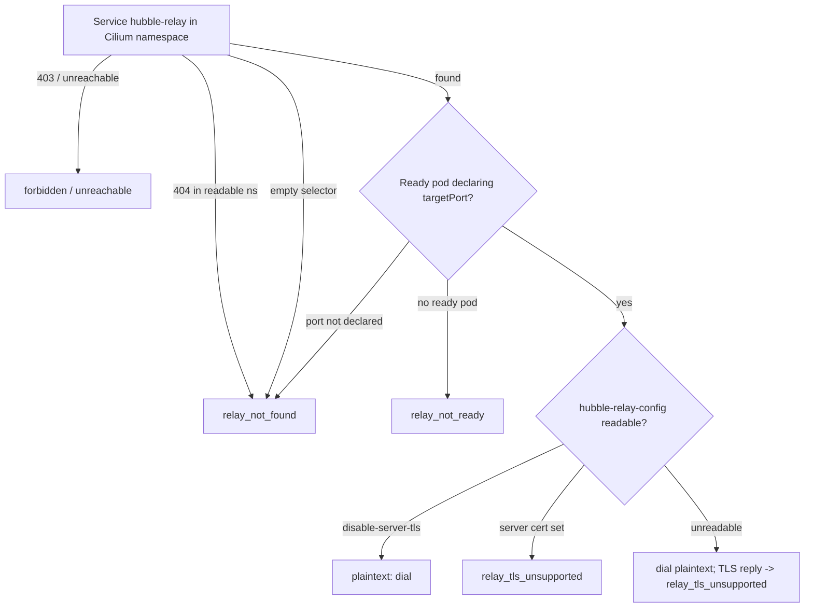
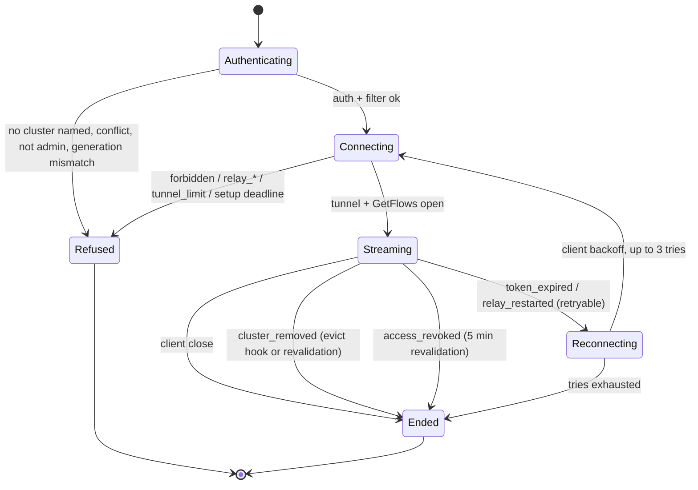
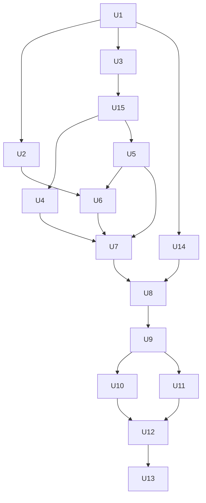

# Remote Cilium Networking and Hubble Flows - Plan

## Goal Capsule

- **Objective:** With a remote cluster selected, an operator can see and manage that cluster's Cilium networking: the CNI overview, Cilium config, BGP, IPAM, subsystem health, the agent connectivity check, and Hubble flows on the dashboard and in the live viewer. Wherever that is not possible, the view says why. No networking view ever shows local data under the remote cluster's name.
- **Means:**
  - Each networking handler gets a remote path that impersonates the user, mirroring earlier #608 slices (KTD3).
  - Port-forward and exec run over a strict SPDY transport that only the `k8s` package can build (KTD1, KTD2).
  - Hubble Relay is reached by port-forward through the remote API server (Key Decisions; KTD8).
- **Authority:** Requirements (R-IDs) win on product behavior, KTDs win on mechanism, and units carry only unit-local detail. Project rules in `CLAUDE.md` apply throughout: impersonation, direct reads on remote, `recoverutil`, fixed client messages, capability parity and the 7-day package cooldown.
- **Stop conditions:** Stop and ask if a unit would:
  - need a new third-party dependency
  - weaken the SSRF guarantee of `StrictDialContext` (KTD1)
  - export a credentialed `rest.Config` (KTD2)
  - change a local response shape beyond the additive pin fields (KTD6)
  - introduce `InsecureSkipVerify` beyond a cluster record's existing `AllowInsecureTLS` opt-in, for example on the relay dial
- **Execution profile:** Deep, shipped as two PRs:
  - PR 5a: U1, U2, U3, U15, U4, U5, U6, U7, U14, U8. This covers status, config, the CRD panels, agent exec and the live-stream cluster carrier.
  - PR 5b: U9 to U13 (Hubble).

  Every phase touches at most five files, with verification between phases (`CLAUDE.md` rule 2). Units larger than that carry split notes. U1 is its own cleanup commit before U2 (rule 1).
- **Finishing:** `ce-work` implements and verifies locally. Each PR then goes through the standard shipping flow: `ce-code-review`, a PR against `main`, CI with e2e, and a homelab smoke test.

---

## Product Contract

### Summary

Issue #608 makes k8sCenter work the same for a remote cluster as for the local one. This plan covers its Hubble slice, which the user widened to every Cilium view. The networking views get remote paths that read and write as the signed-in user. Hubble Relay is reached through the remote API server's port-forward, so no per-cluster configuration is stored. Every view reports "not installed", "not permitted", "cannot be read" and the Hubble relay cases as separate states.

### Problem Frame

k8sCenter exists to manage several clusters from one place, but its networking area only works on the cluster k8sCenter runs in. With a remote cluster selected:

- The CNI overview and Cilium config refuse with 501.
- BGP, IPAM, subsystems and the connectivity check silently answer "not configured", which is wrong.
- Hubble flows refuse.
- The live flow viewer quietly streams the local cluster's flows, because the browser cannot tell the WebSocket which cluster is selected.

An operator therefore cannot see or change a remote cluster's network without leaving k8sCenter. In one place they are shown the wrong cluster's data.

### Requirements

**Cluster targeting**

- R1. Every Cilium view follows the cluster selected in the top dropdown: the CNI overview, Cilium config view and edit, BGP, IPAM, subsystems, the connectivity check, the Hubble flows dashboard card and the live flow viewer.
- R2. Under a remote selection, no networking view or networking dashboard card shows data from any of these sources:
  - the local cluster
  - k8sCenter's service account
  - a cache filled for another cluster or another user
- R3. Remote reads and writes impersonate the signed-in user. Local behavior and local response shapes stay unchanged, except for the additive config pin fields (KTD6).

**States**

- R4. Each remote view distinguishes these states:
  - not installed on this cluster, shown only when absence is definite
  - not permitted
  - cannot be read (unreachable or unknown)
  - for Hubble, also: relay not found, relay not ready, and a relay that uses TLS k8sCenter cannot speak

  An unknown answer never renders as "not configured".
- R5. A "not permitted" result stops polling for that view and offers no retry.

**Cilium config edit**

- R6. A remote Cilium config edit writes that cluster's `cilium-config` and is audited with the remote cluster id. It runs only when it carries the cluster and registration it was loaded from, and only if they still match.
- R7. A remote edit reports "permission denied", "changed by someone else" and "outcome unknown" separately. A save never reports success for a ConfigMap the Cilium agents do not use.

**Agent exec**

- R8. The remote connectivity check and the subsystems agent data exec into Cilium agent pods as the user, under the existing agent-exec setting. A failed exec is shown as an exec problem, not as a node health failure.

**Hubble flows**

- R9. Remote Hubble flows on the dashboard card and in the live viewer come from the remote cluster's own Hubble Relay.
- R10. Flows are shown only for namespaces where the user can list pods on that cluster, the same rule as locally.
- R11. A live remote stream ends with a stated reason in these cases:
  - the cluster is removed
  - the user's access is revoked or their session expires
  - the relay restarts

  After a relay restart or a session refresh, the viewer reconnects on its own.
- R12. Remote flows work whether or not k8sCenter's own cluster runs Hubble.

**Contracts**

- R13. The capabilities endpoint, the README remote-support table, the frontend capability mirror and the dashboard remote declarations describe the remote support consistently at the end of each PR.

### Key Decisions

- **Hubble Relay is reached by port-forward through the remote API server, as the user.** No relay address or credential is stored per cluster, so no new SSRF surface is added. (session-settled: user-directed — chosen over a stored per-cluster relay address binding and over a "not configured" state only: it reuses the cluster's existing credentials and adds no stored secret.) Governs R9, R12.
- **All Cilium views are multi-cluster, including config edit, BGP, IPAM, subsystems and the connectivity check.** (session-settled: user-directed — chosen over keeping everything except Hubble local-only: a multi-cluster platform that cannot manage remote networks defeats its purpose.) Governs R1, R6, R8.
- **Remote reads and writes run as the signed-in user, and local stays as it is.** On remote, a user sees only what their remote RBAC allows. (session-settled: user-approved — proposed with the trade-off that remote panels may show "not permitted" where local ones use k8sCenter's own account; the user confirmed.) Governs R3, R4.
- **The live flow viewer is included, not only the dashboard card.** (session-settled: user-approved — proposed with the long-lived-tunnel risk shown; the user confirmed.) Governs R9, R11.
- **Only plaintext relays are supported in this slice.** Cilium's default relay listens without server TLS, and the local path already supports plaintext only. A TLS or mTLS relay is a named state, not an error. Governs R4, R9.

### Acceptance Examples

- AE1. Covers R2, R9, R12.
  - **Given** a remote cluster with Hubble, and a k8sCenter whose own cluster has no Hubble.
  - **When** an admin opens the live flow viewer under the remote selection.
  - **Then** flows come from the remote relay. A flows connection that names no cluster at all is refused with `cluster_required`; it is never served from local.
- AE2. Covers R4, R5.
  - **Given** a remote user who may list pods in `default` but has no `pods/portforward` in `kube-system`.
  - **When** they open the flows card for `default`.
  - **Then** the card shows "not permitted" and does not retry.
- AE3. Covers R7.
  - **Given** a remote user who is forbidden in `kube-system`, while a leftover `cilium/cilium-config` exists.
  - **When** they open or save the Cilium config.
  - **Then** they see "not permitted", and the `cilium` namespace copy is never shown or written.
- AE4. Covers R6.
  - **Given** the config editor was loaded for a remote cluster.
  - **When** that cluster is deleted and re-registered before the admin saves.
  - **Then** the save is refused with `cluster_unknown` (404) and nothing is written, because a re-registration always mints a new cluster id. The editor shows the reload state. A remote save that carries no pin is refused with `cluster_pin_required`.
- AE5. Covers R11.
  - **Given** a live remote stream.
  - **When** the cluster is deleted from k8sCenter.
  - **Then** the stream on the replica that handled the delete closes at once with `cluster_removed`. Streams on other replicas close at their next revalidation. If the relay pod restarts instead, the viewer reconnects within three tries.
- AE6. Covers R8.
  - **Given** a remote admin without `pods/exec` in the Cilium namespace.
  - **When** they run the connectivity check.
  - **Then** they see one "not permitted to exec into Cilium agents" message, not a failed row per node.

### Scope Boundaries

- Mobile has no networking screens and is untouched.
- Local panels keep reading with k8sCenter's service account. They are not moved to per-user reads.
- The resource and pod-exec WebSockets stay local-only and are not changed. Their routes never read the in-band cluster fields.
- The Cilium network policy editor already creates resources through the generic resource route. It is re-verified, not changed.
- **Considered and not built:**
  - **Tunnel reuse across REST requests.** A tunnel per request keeps a revoked authorization from staying usable. The cost of the dashboard card's polling is acceptable. Evidence of API-server load or slow cards would change this.
  - **A confirmation dialog for remote config edits.** The user asked for the same confirm step as local. The required pin (KTD6) covers the wrong-target case.
  - **Lost-update detection with `resourceVersion` on config edit.** This gap exists locally already. Real concurrent edits by two admins would change the call.
  - **A prompt to restart agents after a config edit.** There is no such prompt locally either.
  - **Rejecting a namespace that does not exist for a remote stream.** An empty stream is honest enough.
  - **A 429 state for the shared networking rate limiter.** It shows as an error, as it does today.
  - **Hiding peers in unreadable namespaces.** The flow filter matches the source or the destination namespace, so peer pod names and labels from namespaces the user cannot read are shown. This is the accepted local behavior, carried over unchanged.

#### Deferred to Follow-Up Work

- Relay server TLS and mTLS: CA discovery or an operator-supplied CA, and client certificates.
- A WebSocket-first port-forward and exec transport with a strict dialer, for API servers behind gateways that break SPDY.
- Managed relays outside `kube-system` and `cilium`, such as GKE Dataplane V2 and AKS ACNS.
- A Cilium-enabled remote cluster in the e2e kind fixture (`scripts/test-remote-capabilities.sh`), to get live evidence for remote networking.
- Per-cluster compliance history, the next #608 slice.

### Sources

- Issue #608, item 5 and the acceptance criteria.
- The plan for the previous slice: `docs/plans/2026-10-11-1251-feat-remote-alerts-health-mesh-metrics-plan.md`.
- client-go v0.37.1 port-forward and exec sources: `tools/portforward/`, `transport/spdy/`, `tools/remotecommand/`. The streaming round tripper is `k8s.io/streaming@v0.37.1/pkg/httpstream/spdy/roundtripper.go` (`NewRoundTripperWithConfig`, `RoundTripperConfig.UpgradeTransport`).
- Cilium: `cilium/pkg/k8s/portforward/portforward.go` and the relay chart `install/kubernetes/cilium/templates/hubble-relay/`. TLS is covered in the docs.cilium.io page `observability/hubble/configuration/tls`.
- KEP-4006 (the WebSocket transition) and the `AuthorizePodWebsocketUpgradeCreatePermission` gate (k8s 1.35).

---

## Planning Contract

### Key Technical Decisions

- KTD1. **Port-forward and exec run over SPDY with a strict upgrade transport.**
  - The transport dials through `k8s.StrictDialContext` and carries the remote cluster's TLS, bearer token and impersonation headers.
  - It is built with `NewRoundTripperWithConfig` and an `UpgradeTransport`, uses `Proxy: nil`, does not follow redirects, and sets a 5s `PingPeriod` (matching client-go's `RoundTripperFor`) so idle-timeout load balancers do not cut quiet tunnels.
  - It inherits the TLS policy `remoteConfig` builds through `applyClusterTLS`, including an operator's per-cluster `AllowInsecureTLS` opt-in, the same as the cluster's REST client.
  - client-go's default SPDY and WebSocket dialers both ignore `rest.Config.Dial`, which would reopen the DNS-rebinding window that P2-6 closed (`k8s/cluster_router.go` `NewRemoteRESTConfig`).
  - SPDY with a strict transport can be built from public API, while a strict WebSocket path would need a hand-wired tunnel, so WebSocket is deferred. The choice came close to a bake-off, and the evidence decided it.
  - (session-settled: user-directed — port-forward was chosen over a stored relay address binding; this KTD picks its transport.)
  - Governs R9 and R8.
- KTD2. **Streams are built only inside `k8s`, and no credentialed config is exported.**
  - `remoteConfig` stays unexported.
  - `ClusterRouter` exports a stream-transport accessor for a (cluster, user, groups) target. It returns an object whose only operations are a fixed-command exec into a named pod and container (U2) and a port-forward to a server-derived pod and port (added in U9). Both are built in `k8s/stream_transport.go`.
  - Networking reaches the accessor through its own small interface, not through `k8s.ClusterClients`, so the 16 existing fakes stay untouched.
  - Optional collaborators are wired as true nil interfaces (`docs/solutions/go-typed-nil-interface.md`).
- KTD3. **The local and remote paths fork early, and remote caches are keyed per cluster and identity.**
  1. Each networking handler forks on `isLocal`.
  2. The local path stays verbatim and keeps its single global caches.
  3. The remote path uses `Clients k8s.ClusterClients`. Resolution failures are wrapped in `k8s.TargetError`, and errors are written through `WriteRemoteLoadError` or `WriteRemoteError`.
  4. Every remote result is cached in a `remotecache.Cache[T]` keyed by `(cluster, IdentityKey)`. That covers detection, BGP, IPAM, subsystems and the remote agent collector. Each singleflight key also contains the cluster and the identity key, so a concurrent request from another user never joins this user's flight (R2).
  5. One `EvictRemoteCache` hook clears every networking remote cache for a cluster.
  6. A remote `GET /cni?refresh=true` evicts only that (cluster, identity) entry and never calls the local `Detector`.
- KTD4. **On remote, the Cilium namespace and features come from detection.**
  - Remote detection records the namespace where the Cilium agent DaemonSet runs.
  - It also records the full `Features`, parsed from the remote `cilium-config` with the local parser: encryption, cluster mesh, IPAM mode, Hubble, and the mesh engine.
  - Config reads, config writes, agent-pod lookups and subsystems all consume this result.
  - When detection could not settle the namespace, the search order is `kube-system` then `cilium`, and only a 404 moves the search on. A 403 or an unreachable answer stops the search and is reported (R7).
  - The local helpers keep their current fall-through.
- KTD5. **One reason vocabulary.**
  - REST error bodies and WebSocket error frames both carry a stable `reason`.
  - The frontend maps reasons to states, never message text, and never treats a bare 404 as absence (`cluster_unknown` is also a 404).
  - The vocabulary is the table in "State reasons" below. The existing remote reasons are reused as they are: `forbidden`, `unreachable`, `credentials_invalid`, `cluster_unknown`, `discovery_unavailable`, `unsupported_platform`.
- KTD6. **A remote config edit must carry its pin.**
  1. The config GET response adds `targetCluster` and `targetGeneration`. These are additive fields, the declared exception to the rule that local responses stay byte-identical, with YAML validate as the precedent.
  2. The editor stores them and sends both the pin and an `X-Cluster-ID` taken from the stored pin, never from the live selection.
  3. A remote PUT without a pin is refused with 428 `cluster_pin_required`. A mismatch is refused with 409 `cluster_pin_mismatch` or `cluster_generation_mismatch`. All three refusals happen before any read or write and are audited as failures.
  4. A local PUT may omit the pin.
  5. The remote path runs the same `Confirmed` check and `ValidateCiliumChanges` allowlist as local.
  6. After a successful write, cache eviction runs in a `defer` whether or not the re-read succeeds.
  7. A network error during the update is audited as a failure with an unknown outcome and answered with `outcome_unknown`.
- KTD7. **Remote agent exec runs as the user, and is audited once per collection.**
  - It uses the KTD2 fixed-command exec with the same `CiliumAgent.ExecEnabled` setting as local.
  - A 403 on the agent-pod list or on the first exec short-circuits the whole run to `forbidden`.
  - A per-node exec failure carries its own exec-error state (`forbidden`, `timeout`, `pod_gone`, `failed`), kept separate from node health.
  - Each collection writes one audit row per identity: the k8sCenter user, the remote cluster id, the node count and the failure count. Per-pod rows at polling frequency would flood the 90-day audit table.
  - Local auditing is unchanged.
- KTD8. **How the relay is reached, and how its mode is detected.**
  - **Locating the relay:** it is the `hubble-relay` Service in the Cilium namespace (KTD4). An empty selector, or a `targetPort` that the chosen pod does not declare, is `relay_not_found`. The plan never falls back to listing every pod.
  - **Choosing the pod:** a Running, Ready, non-terminating pod from the selector, preferring the longest-ready one. The container port comes from the Service `targetPort`, which the chart names `grpc`. Pod and port are always derived on the server.
  - **Detecting the mode:**
    1. Read `config.yaml` from ConfigMap `hubble-relay-config`. `disable-server-tls: true` means plaintext. A `tls-relay-server-cert-file` entry means `relay_tls_unsupported`.
    2. If the ConfigMap is unreadable, dial plaintext and classify a TLS reply as `relay_tls_unsupported`. The Service port is not used as a signal, because the chart allows a custom `servicePort`.
  - `InsecureSkipVerify` is never used on the relay dial.
  - A missing Service is `relay_not_found` only after a 404 in a namespace the user can read. Any other failure reports the read error itself.
- KTD9. **A tunnel lives as long as its request or stream, and capacity is bounded.**
  - A REST flows request and a WebSocket stream each open their own tunnel and close it on completion, cancel or close.
  - Setup has a 15s deadline, because `Dial` is not context-aware.
  - The gRPC context dialer fails fast once the port-forward connection's `CloseChan` fires.
  - **Live streams:** capped at 3 per user and 20 per cluster, inside the existing global cap of 100.
  - **REST tunnels:** a separate limit of 10 concurrent per cluster.
  - Slot acquisition waits up to 2s before refusing with 429 `tunnel_limit` (`retryable: true`). That wait absorbs FlowViewer's close-then-reopen on a filter change.
  - Every new goroutine goes through `recoverutil`. Channel sends and `Close` calls that a reader depends on stay outside the wrapped closure (`docs/solutions/backend-resilience-conventions.md`).
- KTD10. **The live stream carries its cluster in-band, and the WebSocket auth helper fails closed.**
  - **Why in-band:** the WebSocket auth message gains optional `clusterId` and `generation` fields. The browser cannot set WebSocket headers, and the frontend proxy forwards frames opaquely and drops query strings, so the proxy and allowlist stay unchanged.
  - **The helper's contract:** `wsAuthAndUpgrade` takes an "accepts remote in-band" flag. Only the flows route sets it. The helper returns the user and the effective cluster id.
  - **Inside the helper, in order:**
    1. Validate the id like the header (64-character cap; `""` and `local` normalized).
    2. Refuse a non-local in-band value on routes that do not accept one.
    3. Refuse a conflict. `WSClusterContext` records whether `X-Cluster-ID` was present, and a conflict means the header was present and differs after normalization.
    4. For a non-local effective cluster, enforce `IsAdmin` right after the token check and before any cluster-store or generation lookup. This keeps the helper from acting as an existence oracle.
    5. Refuse a generation that was sent but names a different instant, with `cluster_generation_mismatch`. The literal `local` compares as a string. Any other value is parsed as RFC3339 and compared with `time.Equal`, because the client's `createdAt` and the server's `RFC3339Nano` UTC string format the same instant differently (the reason `lib/yaml-apply.ts` never string-compares them). A missing generation is allowed, and FlowViewer omits the `unknown` sentinel.
  - **Context:** the effective id is attached with `middleware.WithClusterID` to one derived context. The access checker, router and audit all use that context, never `r.Context()`.
  - **Logs and logs-search callers:** they adopt the returned context. A remote in-band value is still refused there by the flag.
  - **Flows only:** flows must name a cluster explicitly, either in-band (FlowViewer always sends one, including `local`) or as a header that was actually present. Without either, flows refuses with `cluster_required`. This closes R2 for older bundles still open in a tab.
  - **Mounting and admin check:** the flows route is always mounted. The flows handler keeps its own admin check as a second layer.
- KTD11. **Live streams end on removal, revocation, expiry or relay restart.**
  - **Removal:** active remote streams register in a per-cluster registry. A non-blocking evict hook cancels them with `cluster_removed`, following the `taskManager.CancelCluster` precedent in `server/server.go`. The hook fires only on the replica that handled the delete; other replicas end their streams at the next revalidation.
  - **Revalidation:** every `rbacRevalidateInterval` (5 minutes, `websocket/hub.go`), a stream rechecks three things on the target: the cluster still exists, the user can still read the flow namespace, and the user still holds `create pods/portforward` in the Cilium namespace. That last grant is what authorizes the tunnel. A failed check ends the stream with `access_revoked` or `cluster_removed`.
  - **Expiry:** roles and groups come from the frozen JWT claims, so a remote stream also ends at the access token's `exp` with `token_expired` (`retryable: true`). The viewer then reconnects with a refreshed token. This bounds k8sCenter-side revocation (demotion, disabled account, IdP group removal) to the 15-minute access-token lifetime, the same bound as REST.
  - **Relay restart:** a relay pod rollover ends the stream with `relay_restarted` (`retryable: true`).
  - **Reconnects:** the viewer reconnects on `retryable` with backoff of 2s, 5s and 10s, at most 3 tries. The try count resets after a stream succeeds. `relay_not_ready` is `retryable` on live-stream frames, because the first reconnect after a rollover often lands before the new relay pod is Ready; each such attempt uses one of the three tries.
- KTD12. **Capability rows.**
  - PR 5a: `cni.config` becomes remote-supported, and two rows are added: `cilium.status` (the CNI overview, BGP, IPAM and subsystems; probes `list daemonsets`) and `cilium.connectivity` (probes `create pods/exec`).
  - PR 5b: `flows.stream` becomes remote-supported.
  - In each PR, the Go and TypeScript definitions, the README and the pinned tests change together.
  - "Partial" stays disallowed. The plaintext-only relay limitation is stated in the README row text and in the `flows.stream` comment.
- KTD13. **The routing guard covers networking from the first remote unit on.**
  - `backend/internal/networking` joins `REMOTE_ROUTED_DIRS` in `scripts/check-cluster-routing.sh` immediately after U3, per the script's rule that a package joins in the unit that migrates it.
  - Every surviving local service-account read gets a `// nolint:cluster-routing` local-only reason, and the stale P2-5 carve-out comments are removed.
  - The guard also flags `.BaseConfig()`, `NewSPDYExecutor`, `NewWebSocketExecutor`, `spdy.RoundTripperFor`, `websocket.RoundTripperFor` and `portforward.New` in every `HANDLER_DIRS` package except `k8s/stream_transport.go`. The two local service-account stream sites that stay unchanged, `networking/agent_exec.go` and `k8s/resources/pods.go` (pod exec), carry `// nolint:cluster-routing` local-only reasons.
- KTD14. **Islands see the reason, and a 403 is final.** `frontend/lib/hooks/use-poll.ts` exposes the error status and reason alongside the message. Its only consumers are the networking islands. Those islands render the four states with shared copy, and polling stops for good after a 403 (R5). The shared helper also returns each state's recovery control, so islands do not invent their own: reload for pin refusals and `cluster_unknown`, "Try again" for cannot-be-read and busy states, "Reconnect" for an ended live stream, and none for "not permitted" (R5).
- KTD15. **One flow-source API serves both REST and WebSocket.** Networking exports a single remote flow-source opener taking a target, a user and a namespace. It owns the namespace access check, cap acquisition, relay resolution and mode detection, the tunnel, and a done signal with a close reason. U10 and U11 both consume it, so `server` never touches port-forward types.

### State reasons

| Reason | HTTP | Where | Frontend state |
|---|---|---|---|
| `not_cilium` (existing `configured:false` shape) | 200 | CNI-scoped panels, on a definite non-Cilium result | Not installed |
| `forbidden` | 403 | all | Not permitted (no retry) |
| `unreachable`, `credentials_invalid`, `cluster_unknown`, `discovery_unavailable` | 502 / 404 | all | Cannot be read |
| `unsupported_platform` | WebSocket frame | live stream before PR 5b | Not yet available on remote |
| `cluster_required` | WebSocket frame | flows connection that names no cluster | Reload |
| `relay_not_found` | 404 | flows REST, WebSocket frame | Not installed ("relay not found in kube-system or cilium") |
| `relay_not_ready` (`retryable` on WebSocket frames) | 503 | flows REST, WebSocket frame | Cannot be read (retry) / Reconnecting |
| `relay_tls_unsupported` | 501 | flows REST, WebSocket frame | Unsupported ("relay uses TLS") |
| `hubble_unavailable` | 503 / WebSocket frame | local flows without a Hubble client | Unavailable |
| `tunnel_limit` (`retryable`) | 429 / WebSocket frame | flows REST, live stream | Busy, retry |
| `cluster_pin_required` | 428 | remote config PUT without a pin | Reload |
| `cluster_pin_mismatch`, `cluster_generation_mismatch` | 409 / WebSocket frame | config PUT, live stream | Reload required |
| `conflict` | 409 | config PUT | Changed by someone else; refetch and keep the edit |
| `outcome_unknown` | 502 | config PUT | Reload to check |
| `cluster_removed`, `access_revoked` | WebSocket frame | live stream | Stream ended, with the reason shown |
| `token_expired`, `relay_restarted` (`retryable`) | WebSocket frame | live stream | Reconnecting |

### High-Level Technical Design

The remote flow request path, from browser to relay:

Relay mode detection (KTD8):

Live remote stream lifecycle (KTD10, KTD11):

### Implementation Constraints

- No new Go or npm dependency. `k8s.io/streaming v0.37.1` is already in `backend/go.mod`, and the classic apimachinery `httpstream` types are used.
- Error text from port-forward or exec error streams, from gRPC, and from remote APIs never reaches a response, a WebSocket frame or an audit detail. It is logged only. The remote cluster id is never echoed in client messages (`httputil/remote_error.go`).
- Local responses stay byte-identical, except for the additive pin fields (KTD6). The existing networking tests are part of every backend gate. They change only where they assert the remote 501.
- No phase touches more than five files.

### System-Wide Impact

- **Authorization boundary:**
  - Remote port-forward needs `create pods/portforward`, `get services` and `list pods` in the Cilium namespace. From k8s 1.35, the WebSocket upgrade needs `create` as well.
  - Remote exec needs `create pods/exec`.
  - These are stronger grants than the local gate, so namespace-scoped remote users will often see "not permitted" (R4).
  - The relay has no per-user authorization. R10's namespace check is the only per-user filter, the same as locally.
- **WebSocket protocol:**
  - The auth message gains two optional fields.
  - The flows route now requires a named cluster (KTD10).
  - The logs routes adopt the helper's context but stay local-only.
- **Audit:**
  - Every flows audit row carries the effective cluster id.
  - Each remote live-stream open writes one row: the user, the cluster and the namespace.
  - REST flow polls are not audited per tunnel.
  - Remote agent exec writes one row per collection per identity (KTD7).
- **Remote API server load:** each dashboard flows poll and each live stream opens one port-forward (KTD9).
- **Multi-replica:** evict hooks are replica-local, so other replicas rely on revalidation (KTD11).
- **Dashboard declarations:**
  - `hubble-status` flips to `remote` in PR 5a, because its source, `/networking/cni`, becomes remote in U3.
  - `hubble-flows` flips in PR 5b.
  - Each flip removes the matching `UNSUPPORTED_STATUSES` entry, which the invariant in `frontend/lib/dashboard/data_test.ts` requires.

### Risks

- **API servers behind gateways that break SPDY show "cannot be read" for flows and exec.** This is accepted, and the WebSocket transport is deferred.
- **Authorization is checked only at the upgrade.** Kubernetes RBAC revocation, including of the port-forward grant, is bounded by the 5-minute revalidation. k8sCenter-side revocation is bounded by the 15-minute token expiry (KTD11). REST tunnels never outlive their request.
- **Remote evidence comes from fixtures only.** The kind remote fixture has no Cilium, so the remote paths are proven by handler tests against fakes and by the homelab smoke test. The README keeps its "verified against fixtures only" note.

### Sequencing

PR 5a contains U1, U2, U3, U15, U4, U5, U6, U7, U14 and U8. PR 5b contains U9 to U13 and starts from main after PR 5a merges.

---

## Implementation Units

| U-ID | Title | Key files | Depends on |
|---|---|---|---|
| U1 | Networking cleanup pass | `networking/handler.go`, `agent_exec.go` | none |
| U2 | Strict stream transport and exec | `k8s/stream_transport.go` (new), `k8s/cluster_router.go` | U1 |
| U3 | Remote Cilium detection and CNI status | `networking/remote.go` (new), `networking/detect_remote.go` (new) | U1 |
| U15 | Routing guard covers networking | `scripts/check-cluster-routing.sh`, networking files | U3 |
| U4 | Remote Cilium config view and edit | `networking/cilium.go`, `handler.go` | U15 |
| U5 | Remote BGP, IPAM and subsystems | `networking/handler.go`, `remote.go` | U15 |
| U6 | Remote agent exec | `networking/agent_exec_remote.go` (new) | U2, U5 |
| U7 | Networking island states and config pin | `lib/hooks/use-poll.ts`, `src/islands/*` | U4, U5, U6 |
| U14 | Live-stream cluster carrier | `server/ws_helpers.go`, `src/islands/FlowViewer.tsx` | U1 |
| U8 | PR 5a parity: capabilities, README, dashboard | `server/handle_capabilities.go`, `README.md`, `lib/dashboard/data.ts` | U7, U14 |
| U9 | Relay tunnel and remote flow source | `networking/relay_tunnel.go` (new), `k8s/stream_transport.go` | U8 |
| U10 | Remote REST flows | `networking/handler.go` | U9 |
| U11 | Live remote streaming and lifecycle | `server/handle_ws_flows.go`, `server/flow_streams.go` (new) | U9 |
| U12 | FlowViewer and flows dashboard declaration | `src/islands/FlowViewer.tsx`, `lib/dashboard/data.ts` | U10, U11 |
| U13 | PR 5b parity: capabilities, README, e2e | `server/handle_capabilities.go`, `e2e/tests/*` | U12 |

Backend paths are under `backend/internal/` and frontend paths under `frontend/`.

### U1. Networking cleanup pass

- **Goal:** Remove dead code, unused exports and debug logs from the networking package before the structural change (`CLAUDE.md` rule 1).
- **Requirements:** none. This is hygiene ahead of the R1 work.
- **Dependencies:** none.
- **Files:** `backend/internal/networking/handler.go`, `backend/internal/networking/agent_exec.go`, `backend/internal/networking/detect.go`, `backend/internal/networking/networking_test.go`.
- **Approach:** Delete only code that has no callers, and land it as its own commit. If nothing is dead, say so in the PR description and skip the commit.
- **Test expectation:** none. There is no behavior change, and the existing networking tests must pass unchanged.
- **Verification:** `go vet` and the networking tests pass, and the diff is deletions only.

### U2. Strict stream transport and exec

- **Goal:** Build the strict SPDY transport inside `k8s`, and export only a fixed-command exec for a remote target (KTD1, KTD2).
- **Requirements:** R3, R8.
- **Dependencies:** U1.
- **Files:** `backend/internal/k8s/cluster_router.go`, `backend/internal/k8s/stream_transport.go` (new), `backend/internal/k8s/stream_transport_test.go` (new).
- **Approach:**
  1. Add an exported stream-transport accessor on `ClusterRouter`. It builds the target's transport from the unexported impersonated `remoteConfig`. An empty username still fails closed.
  2. Configure the strict SPDY round tripper per KTD1: `UpgradeTransport.DialContext = StrictDialContext`, the config's TLS policy, `Proxy: nil`, no redirect following, a 5s ping period, and the auth and impersonation wrappers.
  3. Hold the upgrade dial function in an unexported field that defaults to `StrictDialContext`. Tests override it to reach an httptest TLS server, which `StrictDialContext` refuses because it is loopback.
  4. Have the transport's exec take a namespace, pod, container and a command from a fixed set. It exposes no free argv and has a setup deadline (KTD9).
  5. Leave the port-forward operation out; U9 adds it.
- **Patterns to follow:** `NewRemoteRESTConfig` and `applyClusterTLS` in `k8s/cluster_router.go`. The `ClusterClients` comment explains why loopback test servers are refused.
- **Test scenarios:**
  - The production transport's upgrade dial is `StrictDialContext`. An upgrade to a loopback or RFC1918 literal address is refused. Rebinding itself is covered by `StrictDialContext`'s own resolve-then-pin tests.
  - Through the test dial seam, the upgrade request carries `Impersonate-User` and the impersonated groups.
  - A 3xx answer to the upgrade request is not followed.
  - The cluster's custom CA is honored, and an untrusted server certificate is refused.
  - A cluster with no CA and `AllowInsecureTLS` false fails verification before any upgrade. An `AllowInsecureTLS` cluster's transport matches its REST client's TLS behavior.
  - An empty username returns an error before any transport is built.
  - A command outside the fixed set is rejected without dialing.
  - A dial that never completes returns a deadline error within the setup bound. The goroutine count returns to its baseline, using the `runtime.NumGoroutine` wait pattern in `velero/assurance_service_test.go`.
- **Verification:** The new tests pass, and `go vet ./...` is clean.

### U3. Remote Cilium detection and CNI status

- **Goal:** Serve `GET /networking/cni` for a remote cluster from detection made as the user, including the namespace, `Features` and Hubble presence (KTD3, KTD4).
- **Requirements:** R1, R2, R3, R4.
- **Dependencies:** U1.
- **Files:** `backend/internal/networking/remote.go` (new), `backend/internal/networking/detect_remote.go` (new), `backend/internal/networking/handler.go`, `backend/cmd/kubecenter/main.go`, `backend/internal/networking/handler_remote_test.go` (new).
- **Approach:**
  1. Wire the handler's new `Clients k8s.ClusterClients`, `Presence`, remote caches and evict hook in `main.go`.
  2. Run remote detection as the user. It reads DaemonSets in the CNI search namespaces, API groups through `TargetSchemaFor`, the `cilium-config` ConfigMap (parsed by the local feature parser), and the `hubble-relay` Service.
  3. Have detection return the agent namespace and `Features`. It never returns `hubbleRelayAddr` for a remote cluster.
  4. Fork `HandleCNIStatus` on `isLocal`. "Not Cilium" is returned only on a definite answer; any other failure returns the read error.
  5. Make `refresh=true` evict the (cluster, identity) entry.
- **Patterns to follow:** `limits/remote.go` and `scanning/remote.go` (fork, `TargetError`, write helpers), `remotecache` wiring in `servicemesh/remote.go`, and the fake clients in `limits/handler_remote_test.go`.
- **Test scenarios:**
  - A remote cluster running Cilium in `kube-system` with Hubble enabled and the relay Service present reports Cilium, Hubble detected and the encryption mode, with no relay address.
  - A remote cluster running a non-Cilium CNI reports that CNI with `configured:false` Cilium panels.
  - A forbidden DaemonSet list returns 403 `forbidden`, not "unknown CNI".
  - An unreachable cluster returns 502 `unreachable`.
  - A remote request never touches a local informer, the local `Detector`, local discovery or a service-account client (guarded fakes).
  - Two users on one cluster get separate cache entries. A concurrent request from the second user does not join the first user's singleflight. Evicting the cluster clears both.
  - A remote `refresh=true` refetches without calling `Detector.Detect`.
  - The local response body is byte-identical to before.
- **Verification:** The networking tests pass, and the local CNI status tests are unchanged.

### U15. Routing guard covers networking

- **Goal:** Put networking under the routing guard before more remote code lands, and flag stream constructors used outside `k8s` (KTD13).
- **Requirements:** R2.
- **Dependencies:** U3.
- **Files:** `scripts/check-cluster-routing.sh`, `backend/internal/networking/handler.go`, `backend/internal/networking/detect.go`, `backend/internal/networking/agent_exec.go`, `backend/internal/networking/cilium_crds.go`, `backend/internal/k8s/resources/pods.go`.
- **Approach:**
  1. Add networking to `REMOTE_ROUTED_DIRS`.
  2. Add the new constructor patterns across `HANDLER_DIRS`, with `k8s/stream_transport.go` as the only unannotated site (KTD13).
  3. Annotate every local service-account read and the local stream sites with their local-only reasons, and remove the stale P2-5 carve-out comments.
- **Execution note:** Two phases: the script and the four networking files, then `k8s/resources/pods.go`.
- **Test scenarios:**
  - The guard passes in fail mode on the annotated tree.
  - Temporarily adding an unannotated `.BaseDynamicClient()` call in networking fails the guard. Check this by hand; it is not committed.
  - An unannotated `NewSPDYExecutor` reference outside `k8s/stream_transport.go` fails the guard. The annotated local sites in `agent_exec.go` and `pods.go` pass.
- **Verification:** `CHECK_CLUSTER_ROUTING_GATE=fail scripts/check-cluster-routing.sh` passes.

### U4. Remote Cilium config view and edit

- **Goal:** Read and write a remote cluster's `cilium-config` as the user, with a required pin, distinct outcomes and correct audit rows (KTD4, KTD6).
- **Requirements:** R1, R6, R7.
- **Dependencies:** U15.
- **Files:** `backend/internal/networking/cilium.go`, `backend/internal/networking/handler.go`, `backend/internal/networking/handler_remote_test.go`, `backend/internal/networking/networking_test.go`.
- **Approach:**
  1. Add remote config helpers that use the detected namespace and stop on any non-404. The local helpers are untouched.
  2. Add the pin fields to GET for both local and remote.
  3. On PUT, check the pin first: required on remote, optional on local. Then run `Confirmed` and the allowlist, then require a remote detection result of Cilium.
  4. Map `IsForbidden`, `IsConflict` and network errors to the KTD5 reasons.
  5. Stamp the request's cluster id on both success and failure audit rows.
  6. Evict the cluster's remote caches in a `defer` after a successful write. Local invalidation and the async detect run only for local.
- **Patterns to follow:** The YAML pin refusal in `yaml/handler.go`, and the audit `ClusterID` taken from `middleware.ClusterIDFromContext` (`certmanager/handler.go`).
- **Test scenarios:**
  - Covers AE3. A 403 in `kube-system` while `cilium/cilium-config` exists returns 403. The `cilium` copy is never read and no write is attempted.
  - A remote GET returns the config plus the pin fields. A local GET differs from before only by those fields.
  - Covers AE4. A remote PUT with no pin returns 428 `cluster_pin_required`, makes no API call and writes a failure audit row.
  - A remote PUT carrying a fabricated stale generation for an existing cluster id returns 409 `cluster_generation_mismatch` (unit test only; a real re-registration mints a new id).
  - Covers AE4. A remote PUT pinned to a cluster id that no longer exists returns 404 `cluster_unknown` and writes nothing.
  - A PUT whose pinned cluster differs from `X-Cluster-ID` returns 409 `cluster_pin_mismatch`.
  - A remote PUT with a key outside the allowlist returns 400, and so does one without `confirmed`, both before any API call.
  - A remote PUT answered 409 by the API returns `conflict`. One answered 403 returns `forbidden`.
  - A network error during the update returns `outcome_unknown` with a failure audit row noting the unknown outcome.
  - A successful write whose re-read fails still evicts the remote cache and audits success.
  - A successful remote write audits `ActionUpdate`, kind `CiliumConfig`, with the remote cluster id and the changed keys.
  - When remote detection is unknown (403), the PUT returns `forbidden`, not 400 "only supported for Cilium".
  - A local PUT without pin fields behaves as before.
- **Verification:** The networking tests and the routing guard pass, and the local config tests are unchanged apart from the additive fields.

### U5. Remote BGP, IPAM and subsystems

- **Goal:** Serve the three Cilium CRD panels for a remote cluster as the user, with honest absence and partial coverage (KTD3, KTD4).
- **Requirements:** R1, R2, R4.
- **Dependencies:** U15.
- **Files:** `backend/internal/networking/handler.go`, `backend/internal/networking/remote.go`, `backend/internal/networking/cilium_crds.go`, `backend/internal/networking/agent_types.go`, `backend/internal/networking/handler_remote_test.go`.
- **Approach:**
  1. Split `isCiliumLocal` into "remote" and "not Cilium", so a remote cluster no longer answers `configured:false`.
  2. Read with the dynamic client as the user. Check BGP's fixed-version CRD with `k8s.ServesGVR`, and use `Presence` for the others.
  3. Read the subsystems CRDs through `k8s.RunLists` and `CoverageOf`, so a denied or failed list shows up as coverage, never as zeros.
  4. Take encryption, cluster mesh, the mesh engine and the IPAM mode from the remote detection `Features`.
  5. Add the exec-error field to the per-node agent type, ready for U6. Until U6 lands, a remote response carries an "agent data unavailable" coverage row instead.
- **Patterns to follow:** `scanning/remote.go` (`remoteInstalled`), and `RunLists` in `k8s/remote_sources.go`.
- **Test scenarios:**
  - A remote cluster with the BGP CRDs at the served version returns node configs read as the user.
  - A remote cluster without the BGP CRD returns `configured:false` only after a definite absence.
  - A discovery failure returns `discovery_unavailable`.
  - A forbidden CiliumNode list in subsystems returns the other sections plus a forbidden coverage row, with no zero counts.
  - The IPAM mode and encryption come from the remote `cilium-config`. A guarded local `Detector` fails the test if it is called during any remote subsystems, IPAM or BGP request.
  - A remote request never writes the global local caches, and a second identity triggers its own fetch.
- **Verification:** The networking tests and the routing guard pass, and the local panel tests are unchanged.

### U6. Remote agent exec

- **Goal:** Run the connectivity check and the subsystems agent data on a remote cluster through the fixed-command exec as the user (KTD2, KTD7).
- **Requirements:** R1, R2, R8.
- **Dependencies:** U2, U5.
- **Files:** `backend/internal/networking/agent_exec_remote.go` (new), `backend/internal/networking/agent_exec_remote_test.go` (new), `backend/internal/networking/handler.go`, `backend/cmd/kubecenter/main.go`.
- **Approach:**
  1. The remote collector finds agent pods in the detected namespace as the user.
  2. It execs the existing agent commands through the U2 transport, keeping the per-pod timeout, the output caps and the concurrency limit.
  3. Results are cached per (cluster, identity), with a matching singleflight key on a detached context that carries the identity.
  4. A 403 on the pod list or on the first exec short-circuits the run.
  5. Each collection writes one audit row.
  6. `HandleCiliumConnectivity` and the subsystems agent section fork on `isLocal`, under the same `ExecEnabled` gate.
  7. The stream-transport seam is wired in `main.go`.
- **Patterns to follow:** The local `AgentCollector` (`agent_exec.go`), `limitedWriter`, and `recoverutil.Go` on an errgroup (`limits/remote.go`).
- **Test scenarios:**
  - Covers AE6. A 403 on the first exec returns one `forbidden` result and one audit row, with no failures listed per node.
  - When two of five agents time out, three nodes report health, two report the exec error `timeout`, and the response is partial.
  - Users A and B request concurrently on the same cluster. Each gets their own result, and neither joins the other's flight.
  - With exec disabled, a remote request returns the same "not enabled" state as local.
  - One collection writes exactly one audit row, carrying the remote cluster id and the failure count.
  - Raw stderr never appears in the response.
  - A panic inside one pod's exec is recovered, and that node reports `failed`.
- **Verification:** The networking tests, the existing local collector tests and the routing guard pass.

### U7. Networking island states and config pin

- **Goal:** Make each networking island render the four states from reasons, stop polling on a 403, and send the config pin (KTD5, KTD6, KTD14).
- **Requirements:** R4, R5, R6, R7.
- **Dependencies:** U4, U5, U6.
- **Files:** `frontend/lib/hooks/use-poll.ts`, `frontend/src/islands/CniOverview.tsx`, `frontend/src/islands/CiliumConfigEditor.tsx`, `frontend/src/islands/BgpStatus.tsx`, `frontend/src/islands/IpamStatus.tsx`, `frontend/src/islands/CiliumSubsystems.tsx`, `frontend/src/islands/NodeConnectivity.tsx`, and tests next to them.
- **Approach:**
  1. `usePoll` keeps the `ApiError` status and reason, and stops for good on a 403.
  2. A shared helper maps reasons to the state copy.
  3. The config editor stops swallowing GET errors and stores the pin from the GET response. On PUT it sends the pin, with `X-Cluster-ID` taken from the pin. It handles the outcomes like this:
     - pin refusals and `cluster_unknown`: reload
     - `conflict`: refetch and keep the pending value
     - `outcome_unknown`: reload to check
     - "saved, could not refresh": shown without leaving the row in edit mode
  4. Node connectivity renders exec errors separately from health.
- **Execution note:** Three phases:
  1. `usePoll` and the shared state helper, with their tests.
  2. The config editor and its test.
  3. The four status islands, with tests.
- **Patterns to follow:** `VulnerabilityDetail.tsx` (501 versus 403), `NamespaceTopology.tsx` (`err.reason`), and `components/ui/SourceCoverageNotice.tsx`. Colors come from theme tokens only.
- **Test scenarios:**
  - `usePoll` stops after a 403 and does not resume on refocus. A 502 keeps today's retry behavior.
  - The config editor shows "not permitted" on a 403 GET, not "not available".
  - A PUT carries the pin and an `X-Cluster-ID` equal to the pinned cluster.
  - A PUT answered with `cluster_generation_mismatch` or `cluster_unknown` shows the reload message and control, and keeps no stale success state.
  - Each state renders the recovery control the shared helper returns. "Not permitted" renders none.
  - A PUT answered with `conflict` refetches and keeps the user's pending value.
  - BGP with a remote `discovery_unavailable` shows "cannot be read", not "not configured".
  - Node connectivity shows a node with exec error `timeout` as an exec problem, distinct from an unhealthy node.
- **Verification:** `bun run check` and `bun test` pass repo-wide.

### U14. Live-stream cluster carrier

- **Goal:** Make the live viewer name its cluster, and make the WebSocket auth helper fail closed, so a remote selection can no longer stream local flows (KTD10).
- **Requirements:** R2, R12.
- **Dependencies:** U1.
- **Files:** `backend/internal/server/ws_helpers.go`, `backend/internal/server/middleware/cluster.go`, `backend/internal/server/handle_ws_flows.go`, `backend/internal/server/handle_ws_logs.go`, `backend/internal/server/handle_ws_logs_search.go`, `backend/internal/server/routes.go`, `backend/internal/server/handle_ws_flows_remote_test.go`, `frontend/src/islands/FlowViewer.tsx`.
- **Approach:**
  1. `WSClusterContext` records whether the header was present.
  2. `wsAuthAndUpgrade` implements the KTD10 contract and returns the effective cluster in a derived context.
  3. The logs callers adopt the returned context.
  4. The flows route is always mounted. Flows requires a named cluster. For local without a Hubble client, flows answers `hubble_unavailable` in-band. For a remote cluster, flows keeps its refusal, now as a reasoned frame (`unsupported_platform`), until U11.
  5. Every flows audit row carries the effective cluster id.
  6. FlowViewer sends `clusterId` and `generation` from `currentTarget()`, omitting the `unknown` generation sentinel.
- **Execution note:** Three phases:
  1. The middleware, the helper and the helper tests.
  2. The three WebSocket callers and `routes.go`.
  3. FlowViewer and its test.
- **Patterns to follow:** The admin re-check in `handle_ws_logs_search.go`, and the length cap in `middleware/cluster.go`.
- **Test scenarios:**
  - Covers AE1. A flows connection with no in-band cluster and no header is refused with `cluster_required`.
  - An in-band remote cluster on the logs route is refused, and no log stream starts.
  - A header that is present and differs from the in-band value is refused, with a failure audit row naming the requested cluster.
  - A non-admin with an in-band remote cluster is refused before any cluster-store lookup, and the audit row carries the requested cluster id.
  - A generation naming a different instant is refused with `cluster_generation_mismatch`. The same instant written with a non-UTC offset is accepted.
  - FlowViewer omits `generation` when it is the `unknown` sentinel, and the stream is accepted.
  - An in-band id longer than 64 characters is refused.
  - With an in-band `local` and no local Hubble client, the client receives `hubble_unavailable` and the route stays mounted.
  - FlowViewer's auth message carries the selected cluster and generation.
- **Verification:** The server tests pass, as do `bun run check` and `bun test`.

### U8. PR 5a parity: capabilities, README, dashboard

- **Goal:** Declare the remote support PR 5a ships, consistently across every contract surface (KTD12).
- **Requirements:** R13.
- **Dependencies:** U7, U14.
- **Files:** `backend/internal/server/handle_capabilities.go`, `backend/internal/server/handle_capabilities_test.go`, `frontend/lib/capability-types.ts`, `frontend/lib/capability-types_test.ts`, `README.md`, `frontend/lib/dashboard/data.ts`, `frontend/lib/dashboard/types.ts`, `frontend/lib/dashboard/data_test.ts`, `e2e/tests/remote-capabilities.spec.ts`, `e2e/tests/websocket-channels.spec.ts`.
- **Approach:**
  1. Make `cni.config` remote-supported.
  2. Add the `cilium.status` and `cilium.connectivity` rows with their scope and guard comments, mirror them in TypeScript, and add README rows.
  3. Flip `hubble-status` to `remote` and remove its `UNSUPPORTED_STATUSES` entry.
  4. In e2e, expect the new capability rows. The websocket-channels spec stops asserting the flows route is unmounted. It now sends `clusterId: "local"` and asserts `hubble_unavailable`.
- **Execution note:** Three phases:
  1. Go capabilities and their test, the TypeScript mirror and its test, and the README.
  2. The dashboard declarations and their test.
  3. The two e2e specs.
- **Test scenarios:**
  - The pinned remote-support test lists `cni.config`, `cilium.status` and `cilium.connectivity` as supported, and the scope-pinned test accepts their scopes.
  - The README parity and TypeScript capability parity tests pass with the new rows.
  - The dashboard invariant test passes with `hubble-status` declared remote.
  - The e2e capability spec expects the new rows in the two-cluster fixture.
  - The e2e websocket-channels spec receives `hubble_unavailable` on a kind cluster without Hubble.
- **Verification:** The backend tests, the routing guard, `bun run check`, `bun test` and the CI e2e job pass.

### U9. Relay tunnel and remote flow source

- **Goal:** Add the port-forward operation to the stream transport, and build the single remote flow-source API on top of it (KTD8, KTD9, KTD15).
- **Requirements:** R4, R9, R10, R12.
- **Dependencies:** U8 (PR 5a merged).
- **Files:** `backend/internal/k8s/stream_transport.go`, `backend/internal/networking/relay_tunnel.go` (new), `backend/internal/networking/hubble_client.go`, `backend/internal/networking/relay_tunnel_test.go` (new), `backend/cmd/kubecenter/main.go`.
- **Approach:**
  1. **Port-forward:** the transport gains a port-forward to a given pod and port over the strict SPDY connection. For each gRPC dial it creates the error stream, then the data stream, and wraps them as a `net.Conn` whose close is idempotent and resets and removes both streams.
  2. **gRPC client:** `HubbleClient` gains a constructor that takes a context dialer, using `grpc.NewClient` with a `passthrough:///` target and plaintext credentials. The local constructor is unchanged.
  3. **Flow source:** the remote flow-source opener checks flow-namespace access on the target, acquires a slot, resolves the relay and detects its mode as the user, then opens the tunnel and client. It returns a flow source with a done signal and a close reason, or a KTD5 reason.
  4. **Wiring:** the access checker and stream seam are wired through a networking-local interface in `main.go`.
  5. **Error stream:** the drain goroutine runs under `recoverutil.Safe`, and its result send stays outside the closure.
- **Execution note:** Two phases: the transport port-forward with its tests, then the flow source with its tests.
- **Patterns to follow:** client-go `tools/portforward/portforward.go` `handleConnection` for stream header order and request id. Cilium `pkg/k8s/portforward/portforward.go` for pod selection.
- **Test scenarios:**
  - The error stream is created before its data stream, with a matching request id and port header.
  - A non-empty error-stream message fails the dial with a sanitized error that does not contain the pod uid.
  - With `disable-server-tls: true` in the relay config, the source dials plaintext. With a server cert set, it returns `relay_tls_unsupported` without dialing.
  - With the relay ConfigMap forbidden, a plaintext relay on Service port 443 still dials and streams. The Service port is never used as a TLS signal.
  - A missing Service after a 404 returns `relay_not_found`. A forbidden Service get returns `forbidden`.
  - An empty Service selector returns `relay_not_found`, and no pod list runs. A pod that does not declare the `targetPort` returns `relay_not_found`.
  - With no Ready pod, the source returns `relay_not_ready`. Among several ready pods, the longest-ready one wins.
  - A named `targetPort` `grpc` resolves to container port 4245.
  - A plaintext dial answered with a TLS handshake returns `relay_tls_unsupported`.
  - Namespace access denied returns `forbidden`, and no tunnel is opened.
  - A fourth live stream for one user waits up to 2s, then returns `tunnel_limit`. If a slot frees within the wait, it proceeds.
  - After the connection closes, the context dialer fails at once with no backoff spin.
  - Closing the source returns the goroutine count to its baseline (the `runtime.NumGoroutine` wait pattern), and a bufconn relay serves `GetFlows` through the fake tunnel.
- **Verification:** The networking and k8s tests pass, including under `-race`, and so does the routing guard.

### U10. Remote REST flows

- **Goal:** Serve `GET /networking/hubble/flows` for a remote cluster through the U9 flow source, independent of the local Hubble client (R10, R12).
- **Requirements:** R1, R2, R4, R9, R10, R12.
- **Dependencies:** U9.
- **Files:** `backend/internal/networking/handler.go`, `backend/internal/networking/handler_remote_test.go`, `backend/internal/networking/networking_test.go`.
- **Approach:**
  1. Fork on `isLocal` before the local nil-client check. That check stays local-only and answers `hubble_unavailable`.
  2. On remote, open one flow source for the request, read flows with the existing filter and timeout, close it, and map reasons to responses.
- **Test scenarios:**
  - Covers AE2. When namespace access is allowed but port-forward is forbidden, the handler returns 403 `forbidden`.
  - When namespace access is denied, the handler returns 403 before any tunnel opens.
  - A remote request succeeds while the local `HubbleClient` is nil.
  - An unreachable cluster returns 502 `unreachable`, distinct from 403.
  - The source is closed after the response, including when the client cancels mid-request.
  - A REST request beyond the per-cluster limit returns 429 `tunnel_limit`.
  - A local request behaves exactly as before.
- **Verification:** The networking tests pass, and the local flows tests are unchanged.

### U11. Live remote streaming and lifecycle

- **Goal:** Replace the remote refusal with a remote stream. The stream ends with a reason on removal, revocation, expiry or relay restart (KTD9, KTD11, KTD15).
- **Requirements:** R1, R2, R10, R11, R12.
- **Dependencies:** U9.
- **Files:** `backend/internal/server/handle_ws_flows.go`, `backend/internal/server/flow_streams.go` (new), `backend/internal/server/server.go`, `backend/internal/server/ws_helpers.go`, `backend/internal/server/handle_ws_flows_remote_test.go`.
- **Approach:**
  1. The flows handler opens the U9 flow source for a remote cluster.
  2. It writes one audit row per remote stream open.
  3. It registers the stream in the per-cluster registry; the evict hook is wired in `server.go`.
  4. It runs revalidation through `recoverutil.Tick`.
  5. It ends the stream at the token's `exp`.
  6. Error frames carry `reason` and, where it applies, `retryable`.
  7. The existing raw goroutines in this handler and in `wsStartKeepalive` move onto `recoverutil`, with their channel sends kept outside the closures.
- **Execution note:** Before wiring the evict hook, add a deadlock test covering the pump, the keepalive, revalidation and the expiry timer together.
- **Patterns to follow:** `taskManager.CancelCluster` as an evict hook, and `rbacRevalidateInterval` in `websocket/hub.go`.
- **Test scenarios:**
  - Covers AE1. An in-band remote `clusterId` streams from the fake relay while the local `HubbleClient` is nil.
  - A remote stream open writes one audit row with the user, the remote cluster and the namespace.
  - Covers AE5. Evicting the cluster closes its streams with `cluster_removed`, and the hook returns without blocking.
  - Revalidation that finds namespace access revoked closes the stream with `access_revoked`.
  - Revalidation that finds `create pods/portforward` in the Cilium namespace revoked closes the stream with `access_revoked`.
  - Revalidation that finds the cluster gone closes the stream with `cluster_removed`.
  - Once the token passes `exp`, the stream closes with `token_expired` and `retryable: true`, even while the access check still allows it.
  - A relay restart sends `relay_restarted` with `retryable: true` and closes the stream.
  - A panic in the flow pump is recovered, and the client receives an error frame rather than a hang.
- **Verification:** The server and networking tests pass, including under `-race`.

### U12. FlowViewer and flows dashboard declaration

- **Goal:** Reconnect the viewer on retryable endings, and declare the flows dashboard source remote (KTD5, KTD11).
- **Requirements:** R4, R5, R9, R11, R13.
- **Dependencies:** U10, U11.
- **Files:** `frontend/src/islands/FlowViewer.tsx`, `frontend/lib/dashboard/data.ts`, `frontend/lib/dashboard/types.ts`, `frontend/components/dashboard/widgets/HubbleFlowsWidget.tsx`, and tests next to them.
- **Approach:**
  1. FlowViewer shows a connecting state with a client timeout and renders end states from the frame's reason.
  2. On `retryable` it reconnects per KTD11, after refreshing the token for `token_expired`. An ended stream offers the "Reconnect" control from the shared state helper (KTD14).
  3. Set `hubble-flows` to `remote` in `REMOTE_BEHAVIOUR` and remove its `UNSUPPORTED_STATUSES` entry.
  4. `classify` keys on `reason`, not on status: `relay_not_found` maps to absent, `relay_tls_unsupported` to unsupported, and `relay_not_ready` and `tunnel_limit` to failure. No 404 is added to `ABSENT_STATUSES`.
  5. The widget copy names the relay states.
- **Execution note:** Two phases: FlowViewer with its test, then the dashboard files with their tests.
- **Test scenarios:**
  - On `token_expired`, the viewer refreshes the token, reconnects, and resets its try count once the new stream is up.
  - After a `relay_restarted` frame, a first reconnect answered with `relay_not_ready`, then a successful one, the viewer is streaming again.
  - Three failed tries end in the ended state, which offers "Reconnect" and resets the try count when used.
  - A `cluster_removed` frame shows its message and does not reconnect.
  - The dashboard invariant test passes with `hubble-flows` declared remote.
  - `classify` maps a 404 `relay_not_found` to absent, a 404 `cluster_unknown` to failure, and a 501 `relay_tls_unsupported` to unsupported.
- **Verification:** `bun run check` and `bun test` pass repo-wide.

### U13. PR 5b parity: capabilities, README, e2e

- **Goal:** Declare remote flow support on every contract surface (KTD12).
- **Requirements:** R13.
- **Dependencies:** U12.
- **Files:** `backend/internal/server/handle_capabilities.go`, `backend/internal/server/handle_capabilities_test.go`, `frontend/lib/capability-types_test.ts`, `README.md`, `e2e/tests/remote-capabilities.spec.ts`.
- **Approach:**
  1. Make `flows.stream` remote-supported, with a comment naming the port-forward requirement and the plaintext-only limit.
  2. Say the same in the README row.
  3. The e2e capability spec expects `flows.stream` to be supported remotely.
- **Test scenarios:**
  - The pinned remote-support test lists `flows.stream` as supported.
  - The README parity and TypeScript capability tests pass.
  - The e2e capability spec expects `flows.stream` remote-supported in the two-cluster fixture.
- **Verification:** The backend tests, the routing guard, `bun run check` and the CI e2e job pass.

---

## Verification Contract

| Gate | Command | Applies to |
|---|---|---|
| Backend vet and tests, repo-wide | `cd backend && go vet ./... && go test ./...` | every backend unit, at each phase boundary |
| Race detector on the stream code | `cd backend && go test -race ./internal/networking/... ./internal/server/... ./internal/k8s/...` | U2, U6, U9, U10, U11, U14 |
| Routing guard | `CHECK_CLUSTER_ROUTING_GATE=fail scripts/check-cluster-routing.sh` | U15 onward, every backend unit |
| Frontend checks, repo-wide | `cd frontend && bun run check` | U7, U8, U12, U14 |
| Frontend tests | `cd frontend && bun test` | U7, U8, U12, U14 |
| E2E | CI e2e job (the two-cluster cases run in the kind fixture) | U8, U13 |
| Homelab smoke test | Against a remote cluster running Cilium and Hubble, check each Cilium view, a config edit, the live viewer through a token refresh, and the Cilium policy editor's create | each PR before merge |

Local responses must stay byte-identical, apart from the additive pin fields. The existing networking and WebSocket flow tests are part of every backend gate, changed only where they asserted the remote 501.

---

## Definition of Done

- Every unit's verification passes, and the repo-wide backend and frontend gates are green.
- No remote networking path reads an informer, the local `Detector`, the local Hubble client or a service-account client. Guarded fakes in the remote tests prove this.
- Every remote port-forward and exec is constructed only in `k8s/stream_transport.go` and dials through `StrictDialContext`. U2's dialer and private-address tests and the U15 guard prove this.
- No response, WebSocket frame or audit detail carries remote error text, a pod uid or a relay address.
- At the end of each PR, the capability rows, the README table, the TypeScript mirror, the dashboard declarations and the e2e specs agree.
- U1 landed as its own commit before U2.
- Abandoned-attempt and experimental code is removed from the diff.
