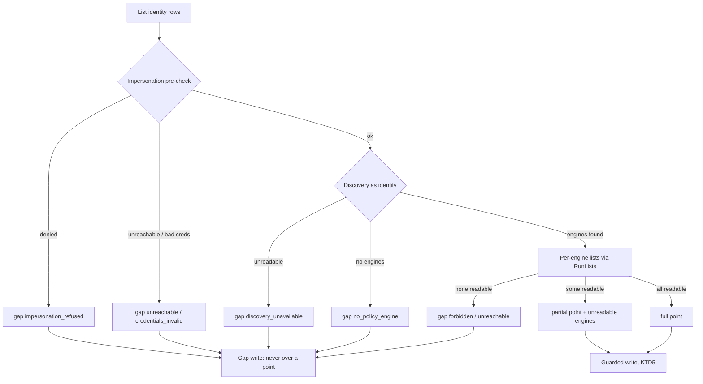
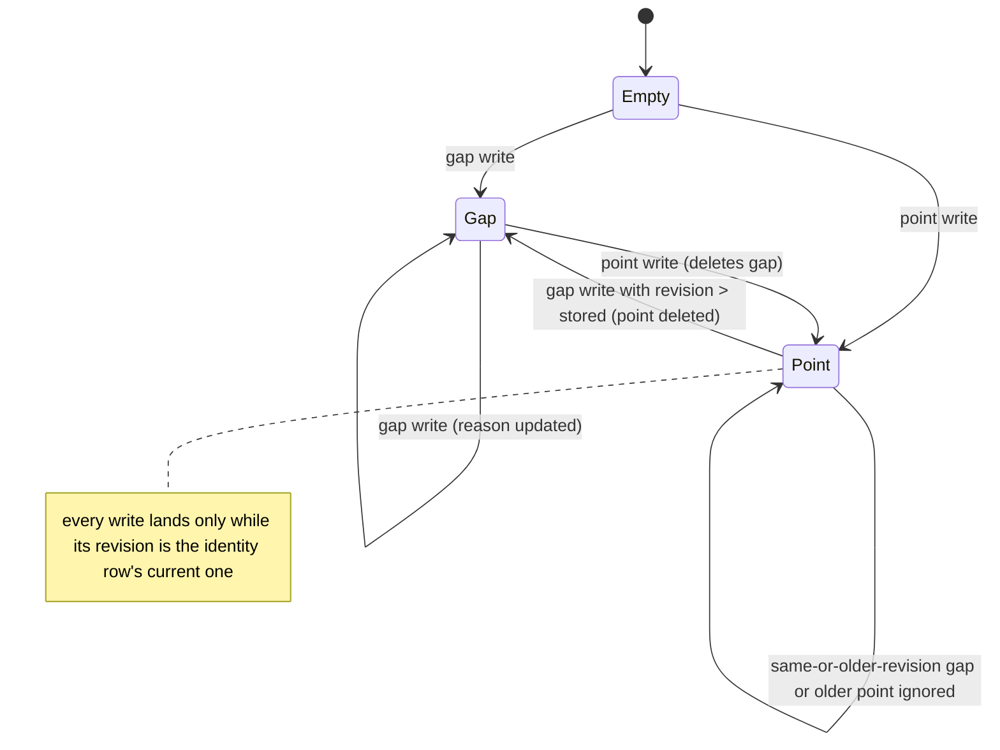
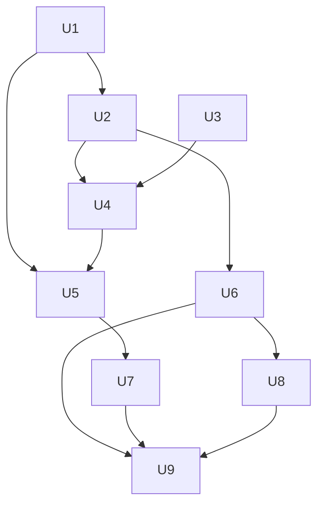

# Remote Compliance History - Plan

## Goal Capsule

- **Objective:** An admin who selects a remote cluster can see that cluster's policy compliance trend over time, on the dashboard history card and the policy page. When the trend cannot be shown, the view says plainly why.
- **Means:** a daily recorder that impersonates an admin-named background identity on each remote cluster (Key Decisions; KTD1, KTD3).
- **Product authority:** This Product Contract. It is the final slice of #608. Local compliance history and the local recorder are not in scope beyond staying unchanged.
- **Authority order:** Requirements (R-IDs) win on product behavior, KTDs win on mechanism, units carry only unit-local detail. `CLAUDE.md` rules apply throughout: remote calls impersonate, background goroutines use `recoverutil`, fixed client messages, capability parity, the 7-day package cooldown.
- **Stop conditions:** Stop and ask if a unit would:
  - read a remote cluster with the registration credential's own permissions, beyond the impersonation-rights check (KTD2)
  - need a new third-party dependency
  - change the local history response beyond additive fields
  - delete or rewrite existing local snapshot rows
- **Execution profile:** Deep, one PR. Every phase touches at most five files, with verification between phases (`CLAUDE.md` rule 2).
- **Finishing:** `ce-work` implements and verifies locally. The PR then goes through `ce-code-review`, CI with e2e, and a homelab smoke test against a remote cluster running Kyverno or Gatekeeper.
- **Open blockers:** None.

---

## Product Contract

Product Contract preservation: changed R2 (a username is required, groups are optional; group-only impersonation is not possible in Kubernetes) and R4 (clearing an identity hides existing history), both confirmed by the user during planning. AE4 rewritten to match the agreed meaning of partial (KTD4). Other R and AE IDs unchanged.

### Summary

Each remote cluster gets its own daily compliance snapshot. The snapshot is taken by impersonating a background identity (a username, optionally with groups) that an admin names on that cluster's registration. The history card and the policy page show that cluster's trend the way they show the local one. Partial views, failed days and identity changes are marked on the chart, and a cluster's history is removed with the cluster.

### Problem Frame

With a remote cluster selected, the compliance history card and the policy page's history chart answer 501 `remote_history_unsupported`. Daily snapshots are taken only for the local cluster, by k8sCenter's service account at midnight UTC. A remote cluster has no k8sCenter service account. It has only the credential stored at registration, and the project's rule is that remote calls impersonate a user rather than use that credential's own permissions. So an admin can see a remote cluster's compliance score today, but not whether it is improving or slipping. This is the last dashboard source keeping #608 open.

### Key Decisions

- **Remote snapshots impersonate an identity an admin names per cluster.** This keeps the impersonate-always rule for remote calls. (session-settled: user-directed — chosen over reading with the stored registration credential directly, recording only when a user views the page, and keeping remote history unsupported: it keeps remote calls impersonated without leaving gaps on days nobody looks.) Governs R1, R2, R3.
- **The identity always has a username; groups are optional.** Kubernetes rejects group impersonation without a user. (session-settled: user-approved — proposed over sending a fixed synthetic username with group-only identities: audit rows then name a real user and the cluster needs no extra impersonation grant.) Governs R2.
- **A snapshot from an incomplete view is recorded and marked partial.** (session-settled: user-directed — chosen over skipping the day and recording without marking: the trend keeps its points while showing which ones rest on less than the whole cluster.) Governs R6.
- **Changing the identity is marked on the chart rather than resetting history.** (session-settled: user-directed — chosen over clearing history on change and doing nothing special: a step in the trend caused by a wider or narrower view is explained, not mistaken for a compliance change.) Governs R7.
- **Clearing the identity hides history; naming one again shows it.** (session-settled: user-directed — chosen over keeping it visible with a "recording off" note and deleting it on clear: an unconfigured cluster reads as unconfigured, and nothing recorded is lost to a mistaken clear.) Governs R4.
- **A cluster's history is deleted with the cluster.** (session-settled: user-directed — chosen over keeping it until retention expires: a re-registered cluster gets a new id, so kept rows could never be shown again.) Governs R9.
- **No per-user filter on reading remote history.** Reading remote history stays admin-only, like all remote access. The trend shows the named identity's view, as local history shows the service account's view. Governs R8.
- **The not-configured state follows the metrics-binding pattern.** A remote cluster without a named identity records nothing and says so, as remote metrics do without a binding. Governs R4.

### Requirements

**Recording**

- R1. Each remote cluster with a named identity gets one compliance snapshot per day, taken by impersonating that identity on that cluster.
- R2. An admin can name, change and clear the background identity on a remote cluster's registration: a username is required, and groups are optional.
- R3. The first snapshot is taken as soon as an identity is named or changed, without waiting for the next daily run.
- R4. A remote cluster with no named identity records no snapshots, and its history views say compliance history is not configured for this cluster; history recorded before an identity was cleared is hidden, and shown again once an identity is named.
- R5. A day whose snapshot fails is recorded as a gap with its reason, and the next scheduled run tries again.

**Reading and display**

- R6. A snapshot taken when the identity could not read every policy source is recorded with its score and marked partial, naming what could not be read; the chart shows the point as partial.
- R7. Each snapshot records which identity took it, and the chart marks the point where the identity changed.
- R8. The dashboard history card and the policy page show the selected remote cluster's own history, never the local cluster's, and are readable by anyone who may select that remote cluster.

**Lifecycle and contracts**

- R9. Deleting a remote cluster deletes its compliance history.
- R10. Remote history keeps the same retention window as local history.
- R11. Local compliance history, the local recorder and its service-account view are unchanged.
- R12. The capability row for compliance history, the README remote-support table and the dashboard's remote declaration for `policy-compliance-history` describe the new remote support consistently.

### Acceptance Examples

- AE1. **Covers R4.** **Given** a remote cluster with no named identity. **When** an admin opens the compliance history card for it. **Then** the card says compliance history is not configured for this cluster, and shows no local data.
- AE2. **Covers R1, R3.** **Given** a remote cluster with no history. **When** an admin names a background identity. **Then** a snapshot is taken right away, and the chart shows one point for today.
- AE3. **Covers R6.** **Given** an identity that can read Kyverno reports but not Gatekeeper constraints. **When** the daily snapshot runs. **Then** the day's point is recorded from the Kyverno data and marked partial, naming Gatekeeper as unreadable.
- AE4. **Covers R7.** **Given** thirty days of history taken by an identity that can read only Kyverno. **When** an admin switches to an identity that can read both engines. **Then** the chart shows a marker at the switch, earlier points stay, and the card's trend figure counts only points since the switch.
- AE5. **Covers R5.** **Given** a named identity. **When** the cluster is unreachable at the daily run. **Then** that day is a gap marked with the reason, and the next day's run records normally.
- AE6. **Covers R9.** **Given** a remote cluster with history. **When** an admin deletes the cluster and registers it again. **Then** the new registration starts with no history.
- AE7. **Covers R4.** **Given** a remote cluster with twenty days of history. **When** an admin clears its identity, then names one again a week later. **Then** the card says not configured during that week, and afterwards shows the old points, a run of missing days, and the new point with an identity-change marker.

### Scope Boundaries

- Backfilling history from before an identity is named.
- Retrying a failed day before the next scheduled run.
- Per-cluster retention settings.
- A per-user RBAC filter on reading history.
- Recording remote snapshots with the stored registration credential's own permissions.
- Changing the local recorder or its service-account view.
- Considered and not built:
  - **A leader lease for the remote recorder.** Every backend replica reads each remote cluster once a day. The reads are a discovery call and a handful of lists, and the KTD5 write rules keep the result correct whichever replica writes. Evidence of API-server load on remote clusters would change this.
  - **Per-namespace listing so a namespace-scoped identity yields partial points.** Its cluster-wide lists are refused, so its days are gaps with reason `forbidden` (KTD4). Listing per namespace multiplies reads by namespace count. A request for namespace-scoped compliance would change this.
  - **Showing the first snapshot's outcome in the identity form.** The snapshot runs in the background after the save, and its result appears on the history chart within seconds.

### Dependencies / Assumptions

- Remote access already requires the admin role (`backend/internal/server/middleware/cluster.go`), and the `/clusters` routes and `/policies/compliance/history` are admin-gated (`backend/internal/server/routes.go`).
- Snapshots are already stored per cluster (`backend/internal/store/migrations/000005_create_compliance_snapshots.up.sql`, unique on cluster and date).
- The registration credential must be allowed to impersonate the named user and groups. KTD2 checks this at save time.

### Sources / Research

- `backend/internal/policy/handler.go` `HandleComplianceHistory`: the remote 501 `remote_history_unsupported` refusal.
- `backend/internal/policy/recorder.go`: the local daily recorder (midnight UTC, service account, 90-day retention through `ComplianceStore.Cleanup`).
- `backend/internal/store/compliance.go`: snapshot store keyed by cluster id; `Cleanup` already deletes across all clusters.
- `backend/internal/policy/remote.go` `fetchRemote`: remote policy reads as a user; fails the whole read on any list error.
- `backend/internal/server/handle_cluster_metrics.go`, `backend/internal/store/cluster_metrics.go`, `frontend/src/islands/MetricsBindingForm.tsx`: the per-cluster binding pattern.
- `docs/solutions/backend-resilience-conventions.md`, `docs/solutions/go-typed-nil-interface.md`, `docs/solutions/postgres-test-harness-conventions.md`.
- Issue #608, item 6.

---

## Planning Contract

### Key Technical Decisions

- KTD1. **The identity lives in its own table that cascades with the cluster.** A new `cluster_compliance_identity` table keyed by cluster id (`REFERENCES clusters(id) ON DELETE CASCADE`) holds the username, the groups, a revision, and who saved it. It is not a secret, so no encryption. Clearing deletes the row.
  - The revision comes from one Postgres sequence, so it is never reused and always grows, even across a clear and a re-name.
  - A save draws a new revision only when the username or groups differ from the stored ones. Routes `GET/PUT/DELETE /clusters/{id}/compliance-identity` sit beside the metrics binding under `RequireAdmin`, refuse the local cluster, and are audited. Governs R2, R4.
- KTD2. **Saving an identity first proves the registration credential can impersonate it.** The PUT runs SelfSubjectAccessReviews as the registration credential: `impersonate` on `users` for the username, and on `groups` for each group. A username of the form `system:serviceaccount:<ns>:<name>` is checked as `impersonate` on `serviceaccounts` in `<ns>` for `<name>` instead, which is what the API server enforces for service accounts. A denied review answers 422 `impersonation_denied`, and nothing is stored. This is the one read made with the credential's own permissions; it mirrors `ProbeImpersonateRights` (`backend/internal/k8s/cluster_prober.go`) and is built inside `k8s` (a `ClusterRouter` method), so no credentialed config leaves the package. Governs R2.
- KTD3. **One remote recorder loop, separate from the local one.** It runs at startup and every midnight UTC under `recoverutil.Tick`, lists the identity rows, and snapshots each cluster in turn with a per-cluster deadline. Each snapshot impersonates the stored identity through `ClusterRouter` (`ClientForCluster`, `TargetSchemaFor`), not a request. The local `ComplianceRecorder` is not changed (R11). Governs R1, R5.
- KTD4. **A recorder-only policy read reports coverage per engine.** It reuses the remote listing helpers but collects each source's error instead of failing on the first, through `k8s.RunLists` and `k8s.CoverageOf`. An engine is readable only when every list it needs succeeded. `fetchRemote`'s fail-closed behavior on the live routes is unchanged. The outcome, decided in this order:
  1. Impersonation refused (pre-check SAR) → gap `impersonation_refused`.
  2. Cluster unreachable or credentials rejected → gap `unreachable` or `credentials_invalid`.
  3. Discovery unreadable → gap `discovery_unavailable`.
  4. Discovery definitely shows no Kyverno and no Gatekeeper → gap `no_policy_engine`.
  5. No installed engine readable → gap `forbidden` (all refused) or `unreachable` (any other failure).
  6. Some installed engines readable, some not → partial point naming the unreadable engines.
  7. Every installed engine readable → full point.

  Governs R5, R6.
- KTD5. **Same-day writes are guarded, and gaps live apart from points.** Gaps go in a `compliance_snapshot_gaps` table (cluster, date, reason, identity revision), because `overall_score` is `NOT NULL`. The write rules:
  - Every write carries the identity revision it was taken with, and lands only while that revision is still the identity row's current one. So a snapshot finishing after a cluster delete, a clear, or an identity change writes nothing.
  - A point write replaces an existing same-day point only when its revision is at least the stored one, and it deletes that day's gap.
  - A gap write never replaces a same-day point of the same or a higher revision. A gap with a strictly higher revision than the stored same-day point replaces it, so a newly named identity that cannot read shows as a gap at once.

  Identity (username, groups, revision) and coverage go in the point's existing JSONB `payload`. Governs R5, R6, R7, R9.
- KTD6. **The history response stays compatible, with additive fields.** Points keep `{date, score, pass, fail, warn, total}`. Remote points add `partial`, `unreadable`, and `identityChanged` (true on the first point whose identity revision differs from the previous point's). `data` stays the bare points array. Gaps go in a top-level `gaps` key beside `data` (`{date, reason}` each), written by the remote branch through a handler-local envelope. The local branch keeps `httputil.WriteData` and omits the new fields, so it stays byte-identical, and mobile's list parse and numeric `score` contract hold. A remote cluster with no identity row answers 404 with reason `compliance_history_not_configured`, even when rows exist (R4). Governs R4, R6, R7, R8.
- KTD7. **Deleting a cluster deletes its snapshots and gaps in the same transaction.** `compliance_snapshots` has no FK, so `ClusterStore.Delete` runs the row deletes and the cluster delete in one transaction. The identity row goes by cascade. `ComplianceStore.Cleanup` already ages out all clusters and is extended to gaps. The local recorder calls it only after a successful local snapshot, so the remote recorder also calls it after each daily run, keeping remote retention independent of local health. Governs R9, R10.
- KTD8. **The dashboard declares the source `remote` and keys not-configured on reason.** `REMOTE_BEHAVIOUR["policy-compliance-history"]` becomes `remote`. `binding` is documented as Prometheus-backed, so it doesn't fit. The `UNSUPPORTED_STATUSES` entry is removed, and `REASON_KINDS` maps `compliance_history_not_configured` to `unsupported`, as `hubble-flows` maps its relay reasons. Governs R4, R12.
- KTD9. **Trend figures count from the latest identity change.** This applies to the card's trend figure and to the chart's delta, best and worst. Earlier points stay drawn. Governs R7.

### High-Level Technical Design

Daily remote snapshot, per cluster:

Write guard per (cluster, date):

### Assumptions

- The remote recorder runs only when a database is configured, the same condition as the local recorder.
- The recorder's impersonation pre-check (KTD4 step 1) reuses the KTD2 method, so "impersonation refused" is decided by that review and never inferred from a later 403. A 403 after a passing pre-check means the identity cannot read the source.

### Sequencing

---

## Implementation Units

### U1. Identity table and store

- **Goal:** Store a remote cluster's background identity, removed with the cluster.
- **Requirements:** R2, R4, R9.
- **Dependencies:** None.
- **Files:** `backend/internal/store/migrations/000029_compliance_identity_and_gaps.up.sql` (new), `backend/internal/store/migrations/000029_compliance_identity_and_gaps.down.sql` (new), `backend/internal/store/migrations/NOTES.txt`, `backend/internal/store/compliance_identity.go` (new), `backend/internal/store/compliance_identity_test.go` (new).
- **Approach:**
  1. Migration 000029 creates `cluster_compliance_identity` (KTD1) and `compliance_snapshot_gaps` (KTD5) with re-runnable DDL. It does not touch `compliance_snapshots`.
  2. The store exposes `Get`, `List` (all rows, for the recorder), `Upsert` (bumps the revision), and `Delete`, with a not-found sentinel like `ErrMetricsBindingNotFound`.
  3. A NOTES.txt section covers purpose, lock impact, rollback and an inspect query.
- **Patterns to follow:** `backend/internal/store/cluster_metrics.go` (a plain upsert is enough, without the CAS), migrations 000027/000028 and their NOTES.txt sections.
- **Test scenarios:**
  - An upsert stores the username and groups. A second upsert with different groups draws a higher revision, and one with identical values keeps it.
  - Clearing and then naming the same identity again draws a revision higher than any previous one.
  - `Get` on an unknown cluster returns the not-found sentinel.
  - Deleting the cluster row removes its identity row (cascade).
  - The migration is idempotent: running up twice succeeds, and down then up keeps existing snapshots.
- **Verification:** The store tests pass against the `testDB` harness.

### U2. Guarded snapshot and gap writes, history read, and cluster delete

- **Goal:** Write points and gaps under the KTD5 rules, read them back for history, and delete them with the cluster.
- **Requirements:** R5, R6, R7, R9, R10.
- **Dependencies:** U1.
- **Files:** `backend/internal/store/compliance.go`, `backend/internal/store/compliance_test.go` (new), `backend/internal/store/clusters.go`.
- **Approach:**
  1. Add a guarded point write that carries identity, revision and coverage in `payload`, and a gap write; both require the identity row (KTD5).
  2. Extend `ComplianceSnapshot` with the payload fields, and add a gaps query for a cluster and window.
  3. `Cleanup` also ages out gaps.
  4. `ClusterStore.Delete` deletes snapshots and gaps and the cluster in one transaction (KTD7).
  5. `Insert` (the local recorder's write) is unchanged.
- **Execution note:** Write the same-day write-guard tests first; they pin the rules the recorder relies on.
- **Patterns to follow:** `docs/solutions/postgres-test-harness-conventions.md` (a unique cluster id per test).
- **Test scenarios:**
  - A point write followed by a gap write for the same day leaves the point.
  - A gap write followed by a point write leaves the point and removes the gap.
  - A point with revision 1 does not replace a same-day point with revision 2. A revision 3 point does replace it.
  - A gap with a higher revision than the same-day point replaces it. A gap with the same revision does not.
  - A write carrying a revision that is no longer the identity row's current one writes nothing. So does a write for a cluster with no identity row.
  - After a clear and a re-name, a same-day point from the new revision replaces the old identity's point.
  - The history and gaps queries return only the given cluster's rows, inside the day window.
  - `Cleanup` removes points and gaps older than the retention window for every cluster.
  - Deleting a cluster removes its points and gaps and leaves another cluster's untouched.
  - The local `Insert` path writes and upserts as before.
- **Verification:** The store tests pass against the `testDB` harness.

### U3. Recorder-only remote policy read with per-engine coverage

- **Goal:** Read a remote cluster's policies and violations as an identity and report which engines could be read.
- **Requirements:** R6.
- **Dependencies:** None.
- **Files:** `backend/internal/policy/remote_record.go` (new), `backend/internal/policy/remote_record_test.go` (new).
- **Approach:**
  1. A function takes a cluster id and a username plus groups (no request), runs discovery and the per-engine lists through `RunLists`, and returns policies, violations, the installed engines and the unreadable ones.
  2. It classifies outcomes per KTD4 steps 3 to 7.
  3. It reuses `listRemote` and the existing normalizers. It does not use `h.load` or the request-scoped remote cache.
- **Patterns to follow:** `backend/internal/policy/remote.go` (`fetchRemote`, `remoteDiscovery`, `listRemote`), `backend/internal/policy/handler_remote_test.go` (fake cluster fixtures).
- **Test scenarios:**
  - Covers AE3. Kyverno lists succeed and Gatekeeper lists are refused: the result is partial, with Gatekeeper unreadable and a score from Kyverno.
  - Both engines readable: the result is full.
  - Every list refused: the result is a `forbidden` gap.
  - Discovery shows neither engine: the result is a `no_policy_engine` gap.
  - Discovery unreadable: the result is a `discovery_unavailable` gap, never `no_policy_engine`.
  - One Kyverno list fails while the other succeeds: Kyverno counts as unreadable.
  - Every read impersonates the given username and groups (the fake records the identity).
- **Verification:** The policy tests pass, and the routing guard passes.

### U4. Remote compliance recorder

- **Goal:** Take one snapshot per remote cluster with an identity each day, and on demand for one cluster.
- **Requirements:** R1, R3, R5.
- **Dependencies:** U2, U3.
- **Files:** `backend/internal/policy/remote_recorder.go` (new), `backend/internal/policy/remote_recorder_test.go` (new), `backend/internal/k8s/cluster_router.go`, `backend/cmd/kubecenter/main.go`.
- **Approach:**
  1. The loop runs at startup and every midnight UTC under `recoverutil.Tick` (KTD3).
  2. It lists identity rows, then for each cluster runs the impersonation pre-check (KTD4 steps 1 and 2), then the U3 read, then the guarded writes from U2.
  3. Per-cluster work has its own deadline, and a panic in one cluster's snapshot does not stop the others.
  4. `SnapshotNow(clusterID)` runs a single cluster, for U5. It runs under `recoverutil.Safe` with a detached context and a timeout.
  5. The recorder takes interfaces for the identity store, the snapshot store and the reader, wired in `main.go` with true-nil handling (`docs/solutions/go-typed-nil-interface.md`).
  6. `ClusterRouter` gains the KTD2 impersonation-rights method, used here and in U5.
- **Patterns to follow:** `ClusterProber.Run` (`backend/internal/k8s/cluster_prober.go`), the local `ComplianceRecorder` (`backend/internal/policy/recorder.go`), `docs/solutions/backend-resilience-conventions.md`.
- **Test scenarios:**
  - Covers AE5. An unreachable cluster gets a gap `unreachable`, and the next run records a point.
  - A denied impersonation gets a gap `impersonation_refused`.
  - Two clusters, one panicking: the other still gets its point.
  - A cluster with no identity row is not read.
  - `SnapshotNow` writes today's point with the current revision.
  - The impersonation-rights method sends one review for the user and one per group, without impersonation headers.
  - For a `system:serviceaccount:<ns>:<name>` username, it reviews `impersonate` on `serviceaccounts` in that namespace.
  - The daily run also ages out points and gaps past retention, even when the local recorder did not run.
- **Verification:** The policy and k8s tests pass, including under `-race` in CI, and the routing guard passes.

### U5. Admin identity routes

- **Goal:** Let an admin name, change and clear a remote cluster's identity, checked before storing, with the first snapshot started at once.
- **Requirements:** R2, R3, R4.
- **Dependencies:** U1, U4.
- **Files:** `backend/internal/server/handle_compliance_identity.go` (new), `backend/internal/server/handle_compliance_identity_test.go` (new), `backend/internal/server/routes.go`, `backend/internal/server/server.go`.
- **Approach:**
  1. `GET`, `PUT` and `DELETE /clusters/{clusterID}/compliance-identity` (KTD1).
  2. A shared preamble checks for a database (503), refuses the local cluster (400), and maps an unknown cluster to 404 `cluster_unknown`.
  3. PUT validates the username and groups (non-empty username, no blank groups, a length cap), runs the KTD2 check, upserts, calls `SnapshotNow`, and audits with `ResourceKind "cluster-compliance-identity"`.
  4. GET without a row answers 404 `compliance_history_not_configured`.
  5. DELETE removes the row and audits.
- **Patterns to follow:** `backend/internal/server/handle_cluster_metrics.go` (`metricsPreamble`, fixed messages, store seam for fakes, `auditClusterMetrics`).
- **Test scenarios:**
  - The local cluster id is refused with 400.
  - An unknown cluster answers 404 `cluster_unknown`.
  - A blank username is refused with 400, and nothing is stored.
  - A denied impersonation review answers 422 `impersonation_denied`, and nothing is stored. This includes a service-account username whose `serviceaccounts` review is denied.
  - Covers AE2. A valid PUT stores the identity, starts one snapshot, and writes an audit row naming the cluster.
  - A second PUT with new groups bumps the revision.
  - GET without a row answers 404 `compliance_history_not_configured`.
  - DELETE removes the row and audits. A following GET answers 404.
  - A non-admin is refused.
  - No database answers 503 without the raw error.
- **Verification:** The server tests pass.

### U6. Remote history read

- **Goal:** Serve a remote cluster's history from its own rows, with markers, gaps and the not-configured state.
- **Requirements:** R4, R6, R7, R8.
- **Dependencies:** U2.
- **Files:** `backend/internal/policy/handler.go`, `backend/internal/policy/handler_remote_test.go`, `backend/internal/policy/handler_test.go`.
- **Approach:**
  1. Replace the remote 501 with: no identity row gives 404 `compliance_history_not_configured`; otherwise read points and gaps for the selected cluster.
  2. Set `identityChanged` by comparing consecutive points' revisions (KTD6).
  3. The local branch keeps its query and response.
  4. The history handler reads the identity through a small interface wired in `main.go`.
- **Patterns to follow:** The metrics `not configured` answer (`backend/internal/server/handle_cluster_metrics.go`), `TestRemote_ComplianceHistoryIsUnsupported` (rewritten).
- **Test scenarios:**
  - Covers AE1. A remote cluster without an identity answers 404 `compliance_history_not_configured`, even with stored rows.
  - Covers AE7. After an identity is named again, the old points return with the new one, and the new one has `identityChanged`.
  - A partial point carries `partial` and the unreadable engines.
  - Gaps arrive in the top-level `gaps` key beside `data`, including a gap after the last point, and `data` is still a bare array.
  - A remote request never returns the local cluster's rows.
  - The local response is byte-identical to before for the same rows.
- **Verification:** The policy tests pass.

### U7. Identity form on the cluster manager

- **Goal:** Give admins a form to name, change and clear a remote cluster's identity.
- **Requirements:** R2, R4.
- **Dependencies:** U5.
- **Files:** `frontend/src/islands/ComplianceIdentityForm.tsx` (new), `frontend/src/islands/ComplianceIdentityForm_test.tsx` (new), `frontend/src/islands/ClusterManager.tsx`.
- **Approach:**
  1. The form has a username, a groups list, save and clear, and maps reasons to messages: `impersonation_denied` names the missing grant; `cluster_unknown` offers reload.
  2. It sits beside the metrics form in each remote row, with a "compliance history: configured / not configured" badge.
  3. It uses theme tokens only.
- **Patterns to follow:** `frontend/src/islands/MetricsBindingForm.tsx` and its test, `ClusterManager.tsx` (`metricsFor`).
- **Test scenarios:**
  - Saving sends the username and groups and shows the configured badge.
  - An `impersonation_denied` answer shows the grant message and keeps the input.
  - A blank username cannot be saved.
  - Clear asks for confirmation, sends DELETE, and shows not configured.
- **Verification:** `bun run check` and `bun test` pass.

### U8. Chart and card show remote history, markers and gaps

- **Goal:** Render partial points, identity changes, gaps and the not-configured state on the policy page chart and the dashboard card.
- **Requirements:** R4, R6, R7, R8, R12.
- **Dependencies:** U6.
- **Files:**
  - Phase 1: `frontend/src/islands/ComplianceTrendChart.tsx`, `frontend/src/islands/ComplianceTrendChart_test.tsx`.
  - Phase 2: `frontend/components/dashboard/widgets/PolicyComplianceWidget.tsx`, `frontend/lib/dashboard/severity.ts`, `frontend/lib/dashboard/data.ts`, `frontend/lib/dashboard/types.ts`, `frontend/lib/dashboard/data_test.ts`.
- **Approach:**
  1. **Chart:** refetch when the selected cluster changes, and render partial points, identity-change markers and gap markers. The chart reads `gaps` from the top-level key (KTD6). The card does not consume gaps. Failed-day gaps are drawn differently from days with no record. Each gap reason has one plain message, with a next step where one exists:
     - `unreachable`: the cluster could not be reached that day.
     - `credentials_invalid`: the cluster rejected its stored credentials; re-register it.
     - `impersonation_refused`: the cluster no longer lets k8sCenter act as this identity; grant impersonation.
     - `discovery_unavailable`: the cluster's API list could not be read.
     - `no_policy_engine`: neither Kyverno nor Gatekeeper is installed.
     - `forbidden`: the identity could not read any policy source; widen its read access.
  2. **Chart:** fill missing days through the end of the window, and fix `addDays` to compute in UTC. Today it never advances east of UTC.
  3. **Chart:** show the not-configured state on `compliance_history_not_configured`, with a link to the cluster manager.
  4. **Card:** `historyView` reads the new fields, and the trend figure counts from the latest identity change (KTD9).
  5. **Dashboard declarations:** per KTD8.
- **Execution note:** Two phases: the chart with its test, then the card and dashboard declarations with their tests.
- **Patterns to follow:** `fillDateGaps` (`ComplianceTrendChart.tsx`), the `hubble-flows` `REASON_KINDS` entry (`frontend/lib/dashboard/types.ts`).
- **Test scenarios:**
  - Covers AE1. A not-configured answer shows the not-configured state and no points.
  - Covers AE3. A partial point is drawn as partial, and its tooltip names Gatekeeper.
  - Covers AE4. An identity-change marker appears at the switch, and both the card's trend figure and the chart's delta count only points after it.
  - A gap after the last point is shown with its reason's message, and every reason code has a message.
  - Switching the selected cluster refetches the chart.
  - `addDays` advances one day for a date under a UTC+10 timezone.
  - The dashboard invariant test passes with `policy-compliance-history` declared remote, and `classify` maps 404 `compliance_history_not_configured` to unsupported.
- **Verification:** `bun run check` and `bun test` pass repo-wide.

### U9. Contract parity

- **Goal:** Declare remote compliance history support on every contract surface.
- **Requirements:** R12.
- **Dependencies:** U6, U7, U8.
- **Files:** `backend/internal/server/handle_capabilities.go`, `backend/internal/server/handle_capabilities_test.go`, `README.md`, `e2e/tests/remote-capabilities.spec.ts`.
- **Approach:**
  1. Flip `policy.compliance_history` to remote-supported. Its comment names the identity requirement.
  2. Update the README row.
  3. Move the id to the supported list in the e2e spec.
  4. Check that mobile's `ComplianceHistoryPoint.fromJson` ignores unknown fields; it needs no change if it does.
- **Test scenarios:**
  - The pinned remote-support set lists `policy.compliance_history`.
  - The README and TypeScript capability parity tests pass.
  - The e2e capability spec expects it as supported in the two-cluster fixture.
- **Verification:** The backend tests, `bun run check`, and the CI e2e job pass.

---

## Verification Contract

| Gate | Command | Applies to |
|---|---|---|
| Backend vet and tests, repo-wide | `cd backend && go vet ./... && go test ./...` | every backend unit |
| Store tests against Postgres | `KUBECENTER_TEST_DATABASE_URL=... go test ./internal/store/...` | U1, U2 |
| Race detector | CI `go test ./... -race` (no cgo locally on Windows) | U4, U5 |
| Routing guard | `CHECK_CLUSTER_ROUTING_GATE=fail scripts/check-cluster-routing.sh` | U3, U4, U6 |
| Frontend checks, repo-wide | `cd frontend && bun run check && bun test` | U7, U8, U9 |
| E2E | CI e2e job | U9 |
| Homelab smoke test | Name an identity on a remote cluster with Kyverno or Gatekeeper. Check the first point, a partial point (an identity that can read one engine), clearing and re-naming, and the dashboard card | before merge |

---

## Definition of Done

- Every unit's verification passes, and the repo-wide backend and frontend gates are green.
- A remote cluster with an identity shows its own daily trend on the card and the policy page. Without an identity it says not configured, and it never shows local data.
- No remote read uses the registration credential's own permissions except the KTD2 impersonation-rights check.
- Local compliance history responses are byte-identical to before.
- The capability row, README table, dashboard declaration and e2e spec agree.
- Abandoned-attempt and experimental code is removed from the diff.
