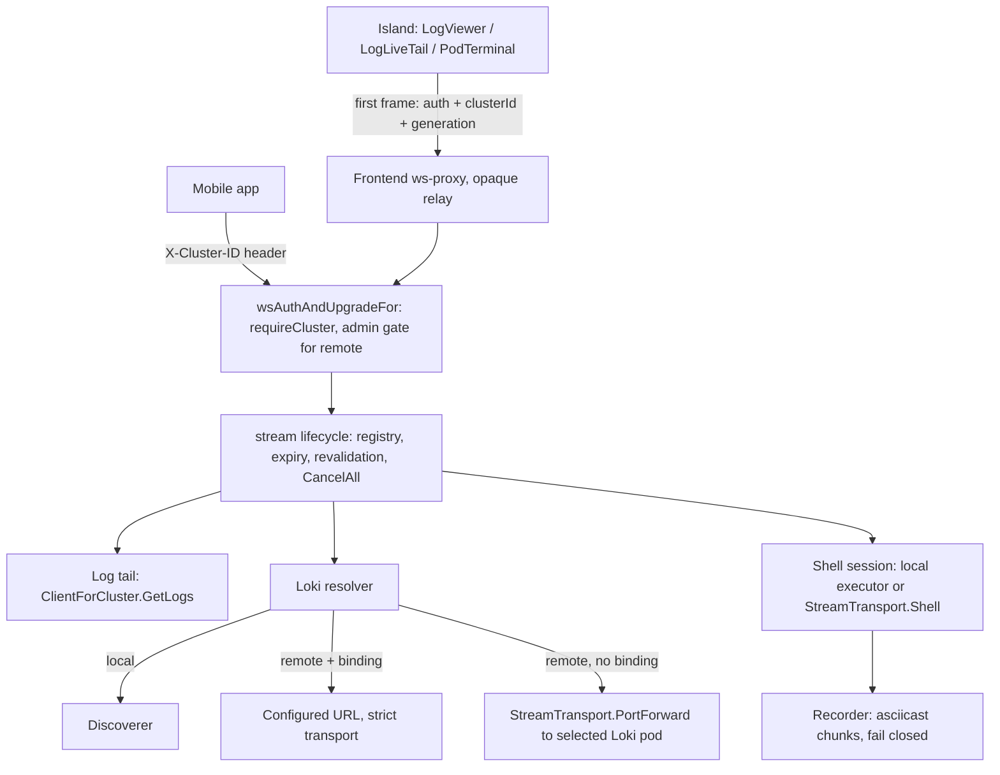
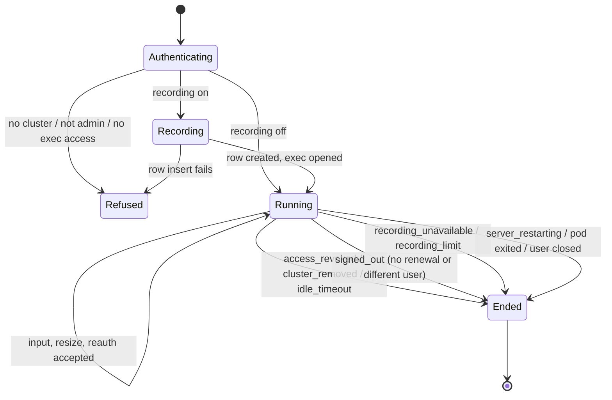
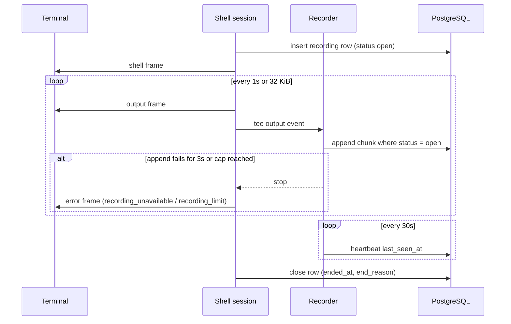
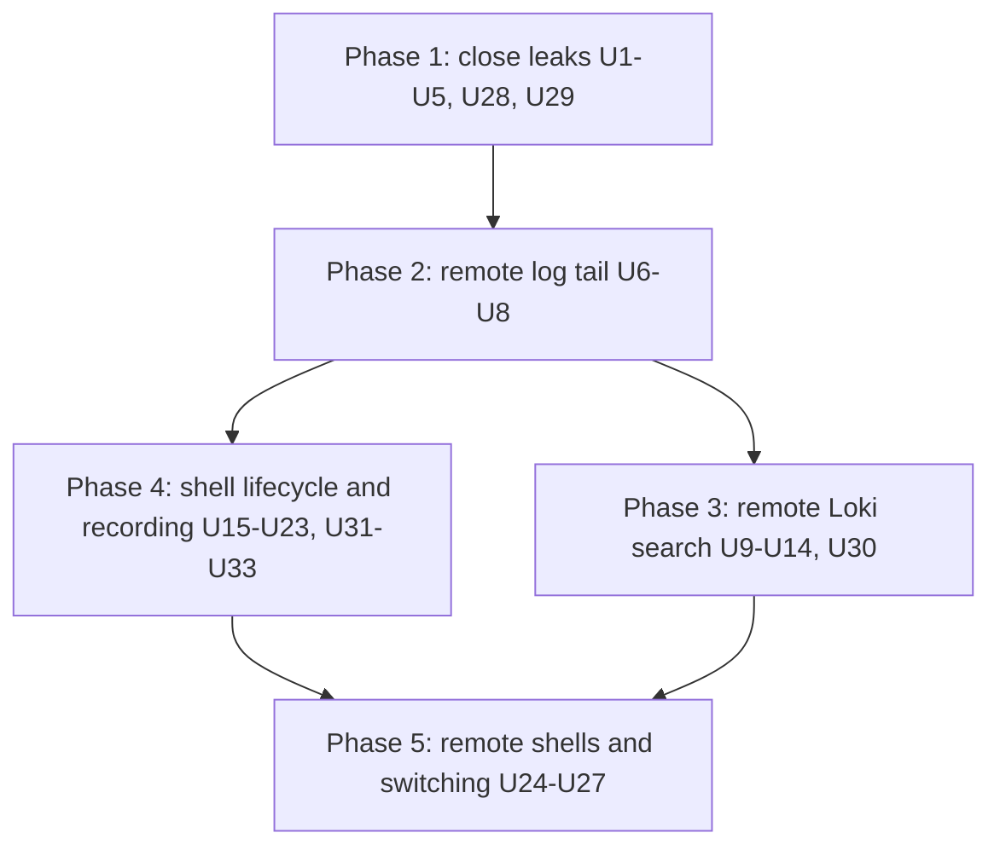

# Remote Logs and Shells - Plan

## Goal Capsule

- **Objective:** An admin who switches k8sCenter to any registered cluster can tail a pod's logs, search that cluster's logs, and open a recorded shell in a pod, with the same behaviour as on the local cluster and never with another cluster's data.
- **Means:** Follow the remote Hubble flows pattern. Each stream names its cluster in its first frame and runs through one shared stream lifecycle (KTD1, KTD4). Recording lands before remote shells (Key Decisions).
- **Product authority:** This plan owns `logs.search`, `logs.stream` and `pod.exec`, plus shell recording, which applies to local and remote shells alike. The other local-only capabilities (`eso.write`, `eso.history`, `eso.metrics`, `velero.assurance`, `incidents.capture`) and reaching clusters on private networks are not active scope. The Product Contract wins on behaviour, KTDs win on mechanism, and units override neither.
- **Execution profile:** Units ship one PR each, in Unit Index order, with at most five touched files per unit including tests (CLAUDE.md). Phase 1 (U1–U5, U28, U29) is a security fix and ships first.
- **Stop conditions:** Stop and ask if a unit would need a sixth file, change a Product Contract requirement, or loosen the strict dialer or user impersonation. Also stop if a remote stream would read through anything but the target cluster as the user.
- **Open blockers:** None for planning. Live two-cluster verification stays blocked until private-cluster reachability lands (Dependencies / Assumptions).
- **Who finishes:** `ce-work` per unit, with `/ce:review` before each merge and a homelab smoke test per phase (CLAUDE.md).

---

## Product Contract

Product Contract preservation: changed. R1 is narrowed to Loki search and the new R21 owns the web streams' cluster naming. R4 is narrowed to the backend's mobile path, because mobile WebSockets behind the default ingress reach the frontend, which does not bridge `/api/v1/ws`. R9 gains the sign-out bound and the same-user rule. R12 and AE10 follow the reload-on-switch design. R15 loses the no-database branch, because the server will not start without PostgreSQL (`backend/cmd/kubecenter/main.go`), and AE8 is removed with it. New: R21, AE12, AE13. Every change was confirmed in the planning dialogue.

### Summary

Logs and shells follow the selected cluster, shipped one stream at a time:
1. Stop the web log tail, Loki search and terminal from silently reaching the local cluster.
2. Remote live log tail.
3. Remote log search.
4. Shell lifecycle rules and recording for every shell.
5. Remote shells, last, so they never run unrecorded.

### Problem Frame

k8sCenter's direction is a single control plane for every Kubernetes environment an organization runs: an admin signs in once and manages any cluster by switching the active one. #608 made the dashboard follow that switch, but day-to-day troubleshooting does not. With a remote cluster selected, the live log tail and Loki tail refuse and pod exec returns 501. That holds only for clients that send the cluster header. The admin falls back to `kubectl` with another context.

The web UI is worse than refused. Browser WebSockets cannot set `X-Cluster-ID`, the server defaults a missing header to the local cluster, and the log viewer, Loki live tail and terminal send no cluster at all. With a remote cluster selected, a pod page's follow-mode logs and Terminal tab therefore reach the local cluster's pod with the same namespace and name, unlabelled. The Loki REST endpoints check namespace RBAC against the selected cluster and then query the local Loki. Both are the confused-deputy defect #608 removed from the dashboard.

Shells raise a second problem for an organization-wide console. A shell is the most powerful thing k8sCenter offers. Today the only record of one is a single audit row at start. Nothing limits idle time, and nothing ends the shell when the user's access is revoked.

### Key Decisions

- **Reaching private-network clusters is a separate brainstorm.** Logs and shells are worth having on any cluster k8sCenter can reach today. Reachability is upstream of every remote feature and gets its own Product Contract. (session-settled: user-approved — chosen over switching this brainstorm to reachability first: logs and shells are independently valuable and their requirements do not depend on how a cluster is reached.)
- **Loki is found automatically, with an optional per-cluster URL.** Switching clusters should need no setup when Loki runs in the cluster, while a shared or external Loki still has a way in. Governs R5, R6. (session-settled: user-approved — chosen over a configured URL only, like the Prometheus binding, which would require Loki exposed on public HTTPS, and over auto only, which leaves a shared Loki unsupported.)
- **Shells end on revocation, cluster removal, sign-out or idle, not on token expiry.** A shell cannot reconnect without losing its state, so the 15-minute access-token boundary that ends a flow stream would drop shells constantly. Governs R8, R9. (session-settled: user-approved — chosen over ending at token expiry, which drops shells about every 15 minutes, and over today's unlimited local behaviour.)
- **Sign-out elsewhere ends a shell within one access-token lifetime.** No server-side session signal exists today, and an instant end would need new session tracking across replicas. Governs R9. (session-settled: user-approved — chosen over instant sign-out via a new session-family claim and logout registry: the 15-minute bound needs no new auth state.)
- **Live log tails end at token expiry and reconnect on their own.** Losing a tail costs nothing, so tails follow the remote Hubble flow pattern rather than the shell rule. Governs R3.
- **Shells are recorded.** An organization's control plane needs evidence of what was done in a shell, not just that one was opened. Governs R13–R17. (session-settled: user-directed — chosen over start-and-end audit rows only and over today's single start row: compliance needs replayable evidence.)
- **A recording captures screen output only.** Typed commands appear because the shell echoes them, while passwords typed at hidden prompts are not stored. Governs R13. (session-settled: user-approved — chosen over screen plus raw keystrokes, which would store hidden-prompt passwords.)
- **Recording fails closed.** No recording means no shell, so an unrecorded shell cannot happen silently. Governs R14. (session-settled: user-approved — chosen over keeping the shell and flagging it unrecorded, which leaves a gap in the evidence.)
- **Recording is an admin setting, on by default.** Governs R15. (session-settled: user-approved — chosen over opt-in recording and over always-on with no setting.)
- **Only admins replay recordings.** Recordings are audit evidence. Governs R16. (session-settled: user-approved — chosen over also letting users replay their own sessions.)
- **Switching cluster still reloads the tab; open sessions survive only in other tabs.** The reload is the app's deliberate guard against acting on the wrong cluster, so a tab with an open session asks first, and other tabs keep their sessions and show a notice. Governs R12. (session-settled: user-approved — chosen over closing silently with no warning and over reworking switching to stop reloading, a large separate project.)
- **Delivery goes one stream at a time, recording before remote shells.** It closes a live defect first, each step ships alone, and no remote shell ever exists unrecorded. Governs R19. (session-settled: user-approved — chosen over building a shared session layer first, which delays everything and rewrites working local streams, and over remote shells first with recording later, which conflicts with fail-closed recording.)
- **Prometheus keeps its configured-URL binding for now.** Loki (automatic) and Prometheus (configured) are set up differently after this work. Aligning them is deferred.

<!-- ce-section: work-relationships -->
### How This Work Fits Together

This plan covers logs and shells on remote clusters. The breakdown below is the current understanding of the surrounding work, not a committed roadmap.

- **Private-cluster reachability** (separate brainstorm, not started). Depends on nothing here. Enables live verification of this plan and of every other remote feature in an organization whose API servers are on private networks. Still to decide: an admin opt-in for private addresses versus an agent in each cluster that dials out.
- **Remaining local-only capabilities** (`eso.write`, `eso.history`, `eso.metrics`, `velero.assurance`, `incidents.capture`). Can proceed independently of this plan. Each is a later round that follows the same pattern (target cluster, as the user, explicit "not configured" states).
- **Prometheus binding alignment.** Shares the "reach an in-cluster service through the API server" question with R5. Still to decide whether Prometheus moves to the automatic model.
- **Mobile WebSocket routing.** Depends on nothing here. Mobile WebSockets behind the default ingress reach the frontend, which does not bridge them. Enables R4's backend path for real mobile clients.

### Actors

- A1. Admin: a k8sCenter user with the admin role. Remote-cluster access already requires this role, so A1 is the only actor who opens remote shells, tails remote logs, searches remote logs, changes the recording setting and replays recordings.
- A2. Non-admin user: keeps local-cluster logs and shells as today, now under the shell lifecycle and recording rules.
- A3. Selected cluster: its API server serves logs and exec as the user, and it may run Loki in-cluster.
- A4. Mobile app: sends the selected cluster as a header on its log tail connection.

### Requirements

**No stream reaches a cluster other than the one it names**

- R1. No log search path (REST query, labels, label values, volume, status, or live Loki tail) returns logs from a cluster other than the one the request targets; a target whose Loki cannot be used gets an explicit unavailable state instead.
- R21. Every web live log tail, Loki live tail and shell names the cluster it was opened against, and the server refuses one that names none rather than assuming the local cluster.

**Live log tail**

- R2. With a remote cluster selected, an admin can tail a pod container's logs, read as that admin's Kubernetes identity on that cluster.
- R3. A remote log tail ends at access-token expiry, on revocation of the admin's log access, or on removal of the cluster, and the viewer resumes the tail on the same cluster without user action when access still holds.
- R4. The backend serves a remote log tail to a client that names its cluster with the `X-Cluster-ID` upgrade header, as the mobile app does.

**Remote log search**

- R5. With a remote cluster selected, log search finds that cluster's in-cluster Loki and reaches it through the cluster's API server as the admin, with no per-cluster setup.
- R6. An admin can set an optional Loki URL for a cluster, with an optional bearer token and tenant, which replaces automatic discovery for that cluster.
- R7. When Loki cannot be found or reached on the selected cluster, or the admin lacks the permission the automatic path needs, log search shows a plain state naming which of those it is.

**Shell lifecycle (all shells, local and remote)**

- R8. A shell stays open across access-token refreshes.
- R9. A shell ends when the user's exec access in that namespace is revoked, the cluster is removed, the shell has been idle past the idle limit, or the user signs out; sign-out elsewhere takes effect within one access-token lifetime, and a refreshed token for a different user ends the shell.
- R10. When a shell ends for any reason other than the user closing it, the terminal says why.

**Sessions follow the cluster where they were opened**

- R11. Every shell and live log tail shows which cluster it is connected to.
- R12. Switching cluster in a tab with an open shell or live log tail asks for confirmation before the switch ends them; shells and tails open in other tabs stay connected to their cluster and show a notice that the selection changed.

**Shell recording**

- R13. While recording is on, every shell (local or remote) is recorded as the terminal output it displayed; keystrokes are not stored.
- R14. While recording is on and a recording cannot be started or continued, the shell is refused or ended, and the terminal says recording is unavailable.
- R15. Recording is an admin setting that is on by default, and changing it is audit-logged.
- R16. Only admins can list and replay recordings, and every replay is audit-logged.
- R17. Recordings are kept for 90 days by default, and the retention period is configurable.

**Remote shells**

- R18. With a remote cluster selected, an admin can open an interactive shell in a pod container, authorized and run as that admin's Kubernetes identity on that cluster.
- R19. Remote shells become available only once R8–R10 and R13–R17 are in place.

**Support is declared consistently**

- R20. As each step ships, the capabilities endpoint, README's "Remote cluster support" table and the frontend's unsupported-feature handling change together, and each of `logs.stream`, `logs.search` and `pod.exec` is marked remote-supported only when its step lands.

### Key Flows

- F1. Remote log search
  - **Trigger:** A1 selects a remote cluster and opens log search.
  - **Actors:** A1, A3
  - **Steps:** k8sCenter uses the cluster's Loki URL if one is set, else finds Loki inside the cluster; it runs the query against that Loki only; results show under that cluster's name.
  - **Outcome:** Logs from the selected cluster, or a state naming why Loki is unavailable there.
  - **Covered by:** R1, R5, R6, R7
- F2. Recorded remote shell
  - **Trigger:** A1 opens a shell on a pod in a remote cluster.
  - **Actors:** A1, A3
  - **Steps:** k8sCenter checks exec access on that cluster; starts the recording (or refuses if it cannot); opens the shell as A1; renews A1's token in-band and re-checks access while it runs; closes it on revocation, cluster removal, sign-out or idle, with the reason shown.
  - **Outcome:** A shell that behaves like a local one and leaves a recording an admin can replay.
  - **Covered by:** R8, R9, R10, R13, R14, R18
- F3. Cluster switch with open sessions
  - **Trigger:** A1 has a shell open on cluster A in tab 1 and a log tail on cluster A in tab 2, then switches the selection to cluster B in tab 1.
  - **Actors:** A1
  - **Steps:** Tab 1 asks to confirm that the shell will end; on confirm it reloads on cluster B. Tab 2 keeps its tail on A and shows that the selection is now B.
  - **Outcome:** No session silently changes cluster, and none ends without warning.
  - **Covered by:** R11, R12

### Acceptance Examples

- AE1. **Covers R1.** Given an admin with a remote cluster selected and no Loki available for it, when they run a log query, then they see the unavailable state and no local-cluster log lines.
- AE2. **Covers R5, R7.** Given a remote cluster running Loki in-cluster and an admin without port-forward rights in Loki's namespace there, when they search logs, then the page says the admin lacks the permission to reach Loki on that cluster.
- AE3. **Covers R6.** Given a remote cluster with a Loki URL set, when an admin searches logs, then the query goes to that URL and automatic discovery is not used.
- AE4. **Covers R3.** Given a remote log tail running when the admin's access token expires and their access still holds, when the tail ends, then the viewer resumes it on the same cluster without user action.
- AE5. **Covers R8.** Given an open shell, when the user's access token refreshes, then the shell keeps running.
- AE6. **Covers R9, R10.** Given an open shell, when the user's permission to exec into pods in that namespace is revoked, then the shell closes and the terminal says access was revoked.
- AE7. **Covers R14.** Given recording on and the database unreachable, when a user opens a shell, then the shell is refused and the terminal says recording is unavailable.
- AE9. **Covers R16.** Given a non-admin user, when they try to list or replay recordings, then access is refused.
- AE10. **Covers R12.** Given a shell open on cluster A in this tab, when the admin chooses cluster B, then a confirmation says the shell will end, and cancelling keeps the shell on A; given a log tail on A in another tab, then that tab keeps streaming from A and shows that the selection is B.
- AE11. **Covers R19.** Given recording not yet shipped, then `pod.exec` remains remote-unsupported.
- AE12. **Covers R9.** Given an open shell for user U, when another tab signs out and user V signs in, then U's shell ends at its next token renewal and the terminal says the user signed out.
- AE13. **Covers R21.** Given a remote cluster selected in the web UI and a local pod with the same namespace and name, when the admin opens that pod's Terminal or follows its logs before remote support ships, then the stream is refused with the remote-unsupported state and nothing from the local pod is shown.

### Success Criteria

- Two-cluster isolation tests against fixtures show no logs, log search results or shell sessions crossing clusters, for each step as it ships.
- `e2e/tests/remote-capabilities.spec.ts` covers `logs.stream`, `logs.search` and `pod.exec` in their remote-supported state.

### Scope Boundaries

- Reaching clusters whose API servers are on private, CGNAT or loopback addresses (separate brainstorm).
- External Secrets write actions, sync history and store metrics; Velero backup assurance; incident evidence capture (later rounds).
- Remote-cluster access for non-admin users.
- Keystroke capture in recordings.
- Users replaying their own recordings.
- Moving the Prometheus binding to the automatic model.
- Mobile UI changes, and routing mobile WebSockets past the frontend (see How This Work Fits Together).
- Changing local live log tail lifecycle beyond R11, R12 and R21.
- Considered and not built:
  - **Instant sign-out across replicas.** Not built: it needs a session-family claim and a logout registry, and the token-lifetime bound (R9) holds without new auth state. Reconsider if a compliance rule requires sub-minute session termination.
  - **Per-pod exec authorization.** Not built: `AccessChecker` is namespace-granular and pod-scoped exec grants are rare. Reconsider if resource-name RBAC on `pods/exec` appears in a target environment.
  - **A synchronous replay-audit store.** Not built: replay audit uses the standard audit logger, which drops rows only when its buffer is full, and replays are rare. Reconsider if audit buffer drops are ever observed.
  - **A cached Loki tunnel across requests.** Not built: a tunnel never outlives its request (Cilium plan KTD9). Reconsider if per-search tunnel setup shows up as user-visible latency.
  - **A recording metadata endpoint.** Not built: the list rows and the asciicast header already carry what the UI shows. Reconsider if another client needs one recording's metadata without its output.

#### Deferred to Follow-Up Work

- Retire the duplicated `clusterLabel` in `YamlApplyPage` and `FlowViewer` now that `frontend/src/lib/cluster-label.ts` exists.

### Dependencies / Assumptions

- **Reachability.** Remote clusters must have API servers at public addresses until the reachability brainstorm lands. Live verification (Q2) is blocked until then, and fixture-based tests carry verification meanwhile.
- **Admin Kubernetes permissions.** The automatic Loki path needs `create pods/portforward` in Loki's namespace and `list services` cluster-wide for discovery on the target cluster; without them, R7 applies.
- **Optional Loki URL and the address rule.** A configured Loki URL follows the same public-address validation as other admin-entered URLs, so a shared Loki on a private address is not usable until the reachability work decides otherwise.
- **Single replica or sticky sessions for AE5.** Refresh sessions live in each replica's memory, so in-band renewal on a multi-replica install without sticky sessions behaves like today's token refresh.

### Sources / Research

- `backend/internal/server/middleware/cluster.go` (`WSClusterContext` defaults a missing header to local), `frontend/src/islands/LogViewer.tsx`, `LogLiveTail.tsx` and `PodTerminal.tsx` (no cluster sent) — the R21 defect.
- `backend/internal/loki/handler.go` and `backend/internal/loki/discovery.go` — single process-wide Loki client; namespace RBAC checked against the request's cluster (the R1 defect).
- `backend/internal/server/handle_ws_flows.go`, `backend/internal/server/flow_streams.go`, `backend/internal/server/ws_helpers.go` — the remote stream precedent (in-band cluster, `requireCluster`, expiry end, revalidation, evict hook).
- `backend/internal/networking/relay_tunnel.go` — port-forward as the user to a server-selected pod.
- `backend/internal/k8s/stream_transport.go` — the only remote SPDY builder; closed command set; no stdin or TTY; setup timeout applied to the whole stream.
- `backend/internal/store/cluster_metrics.go`, `backend/internal/server/handle_cluster_metrics.go`, `backend/internal/monitoring/resolver.go` — per-cluster binding, validation and resolver patterns.
- `backend/internal/incidents/retention.go` — hourly retention sweep with a lowering guard.
- `frontend/src/islands/ClusterSwitcher.tsx` — reload-on-switch by design; `frontend/src/lib/yaml-apply.ts` — pinned-target stale notice.
- `docs/solutions/tracked-apply-durable-intent.md`, `docs/solutions/backend-resilience-conventions.md`, `docs/solutions/go-typed-nil-interface.md`, `docs/solutions/postgres-test-harness-conventions.md`.
- `docs/plans/2026-09-10-release-c-remote-workflow-impl.md` (DA2), `docs/plans/2026-10-11-1751-feat-remote-cilium-networking-plan.md` (KTD1, KTD2, KTD8, KTD9, KTD11, KTD13).
- client-go v0.35 `tools/remotecommand`: the WebSocket executor has no dial hook, while SPDY accepts a custom upgrade transport. Kubernetes 1.35 authorizes WebSocket exec and port-forward upgrades as `create`. The apiserver's `services/proxy` strips `Authorization`.
- asciicast v2 format; asciinema-player's WebAssembly core (rejected under the frontend CSP). Teleport sync-mode recording ends the session on a write failure.
- Issue #608 — the remote dashboard parity this plan extends.

---

## Planning Contract

### Key Technical Decisions

- KTD1. **Every web stream names its cluster in its first frame, pinned per session.** `/ws/logs`, `/ws/logs-search` and `/ws/exec` set `requireCluster`. The islands send `clusterId` and `generation` from `currentTarget()`, taken once when the session opens and reused on every resume. `requireCluster` accepts the header too, so mobile is unaffected (R4, R21).
- KTD2. **Exec moves to first-message in-band auth.** The exec route uses `wsAuthAndUpgradeFor` like every other stream. The `Sec-WebSocket-Protocol` bearer and the proxy's exec-only `Authorization` header are retired after one transitional unit (U3 → U4). The same in-band channel carries token renewal (KTD9). Rejected: a target frame on top of subprotocol auth, which keeps two auth paths; a second subprotocol value, which keeps a header-shaped credential in the proxy.
- KTD3. **Until a remote step ships, its route refuses remote explicitly and never falls back to local.** Refusals use `unsupported_platform` with fixed messages. Loki REST handlers refuse a non-local target, and `backend/internal/loki` joins `REMOTE_ROUTED_DIRS` in `scripts/check-cluster-routing.sh` (R1, R21).
- KTD4. **One shared stream lifecycle, extracted from flows.** It provides:
  - typed end reasons with stable snake_case codes and fixed messages;
  - a per-cluster registry wired to `ClusterRouter.RegisterEvictHook`;
  - a token-expiry watcher and a revalidation ticker under `recoverutil.Tick`;
  - `CancelAll` for shutdown.

  It lives in `backend/internal/server/stream_lifecycle.go`. Flows, logs, Loki tail and exec all use it. End messages avoid the words the mobile client treats as fatal, pinned by a test.
- KTD5. **Remote log tail reads through `ClusterRouter.ClientForCluster` as the user.** It needs no new transport, because the remote typed client already dials strictly. Ends at token expiry are retryable, and `get pods/log` is revalidated every 5 minutes (R2, R3; governs the "Live log tails end at token expiry" Key Decision).
- KTD6. **The automatic Loki path port-forwards to a server-selected Loki pod as the user.**
  - **Selection:** the same order as local discovery. The well-known Service names in their fixed namespaces come first, then the gateway label, then `app.kubernetes.io/name=loki`, then `app=loki` cluster-wide, with ties broken by namespace and name. A label match never outranks a well-known Service, so a tenant cannot plant a decoy Loki ahead of the real one. `/logs/status` reports the chosen namespace and Service. The chosen Service maps to the longest-ready pod and its declared target port, using Service-backend helpers lifted from `networking` into `k8s`.
  - **Tunnels:** each REST request opens and closes its own tunnel. A live tail holds one tunnel for its life.
  - **Caching:** the discovery result is cached per (cluster, identity) in `k8s/remotecache` for 30s.
  - **Rejected:** `services/proxy`. It needs a second RBAC verb and code path for the tail, and the apiserver strips `Authorization`. Port-forward covers REST and tail with one grant, as Hubble does (R5, R7).
- KTD7. **A per-cluster Loki resolver.** Local uses the existing `Discoverer`. Remote with a binding uses the configured URL over `k8s.StrictHTTPTransport()` with redirects refused, and the tail dials through `StrictDialContext`. Remote without a binding uses KTD6. Remote never falls back to local. The resolver mirrors `monitoring.ClientResolver` (TTL, epoch, `Evict`) and is evicted on binding change and cluster delete (R1, R5, R6).
- KTD8. **The Loki binding lives on `cluster_monitoring`.** Migration `000030` adds the URL, the encrypted bearer token, the token origin and the tenant id. The API is admin-only `/clusters/{id}/logs`, with the metrics binding's validation and pointer-token semantics. The token is pinned to its URL origin, and its value never leaves the store. Token and tenant are built now, because adding stored columns later is a data change (R6).
- KTD9. **One shell session object owns the lifecycle for local and remote shells.**
  - **Connection handling:** a single writer goroutine for all frames, a keepalive, and every goroutine under `recoverutil`.
  - **Renewal:** the server sends `reauth_required` 2 minutes before token expiry. The client refreshes, with backoff until the deadline, and sends `{type:"auth", token}`. The server accepts the token only for the same `sub` and auth provider, still admin for a remote cluster, with exec access still held. An accepted renewal replaces the session's identity (username, groups, roles) with the renewed token's, and every later revalidation uses it. A mismatch ends the shell as `signed_out`. With no fresh token by expiry plus 60s, the shell ends as `signed_out`.
  - **Rollout:** the expiry deadline applies only to sessions whose first auth frame declared renewal support (`renews: true`). A client without it keeps today's behaviour, so main stays green between U15 and U17.
  - **Revalidation:** `create pods/exec` in the namespace every 60s. With the access cache, a revocation takes effect within about 2 minutes.
  - **Idle:** 30 minutes with no input frame, configurable as `KUBECENTER_SHELL_IDLETIMEOUT`.
  - **Other ends:** `cluster_removed` through the registry and `server_restarting` through `CancelAll`.

  (R8, R9, R10.) (session-settled: user-approved — chosen over instant sign-out via a new session-family claim: in-band renewal bounds sign-out to one token lifetime without new auth state.)
- KTD10. **Recording is a synchronous, fail-closed tee of the output choke point.**
  - **Format and start:** events are asciicast v2 (`o` output, `r` resize). The recording row is inserted before the exec stream opens.
  - **Encoding:** the encoder carries an incomplete trailing UTF-8 sequence into the next event and turns only invalid bytes into U+FFFD. It splits one output event into several at UTF-8 boundaries, so no chunk exceeds the 64 KiB ceiling however heavily the output escapes.
  - **Writes:** output is buffered and flushed as one chunk every second or at 32 KiB of encoded event bytes, whichever comes first. Each append is conditional on the row still being open.
  - **Failed flush:** the session stops forwarding input to the pod on the first failure, and a successful retry resumes it. Retries run for up to 3s, after which the session ends with `recording_unavailable`.
  - **Limits:** a 50 MiB per-recording cap, held as a SQL CHECK and a Go ceiling. Reaching it ends the shell with `recording_limit`.
  - **Liveness:** a heartbeat writes `last_seen_at` every 30s on a timer. A reaper marks open recordings with no heartbeat for 5 minutes as `interrupted`.
  - **Survival:** recordings carry `cluster_id` as text with no foreign key, and `owner_id` uses `ON DELETE SET NULL` with a username snapshot. Both cluster delete and user delete keep the evidence.
  - **Rejected:** object storage for chunks, a dependency the chart does not ship; writing through the audit logger, which drops rows when its buffer is full and so cannot fail closed.

  (R13, R14.)
- KTD11. **The recording setting is a column read fresh per shell.** `app_settings.shell_recording_enabled` defaults to true and is read from the database on every shell open, bypassing the per-replica `SettingsService` cache. A failed read counts as on, so the shell is refused when the database is down. A shell keeps the mode it opened with, and a toggle affects only shells opened afterwards. A change writes an audit row whose detail names the toggle (R15, AE7). Rejected: the cached `SettingsService` read, which other replicas never refresh.
- KTD12. **Replay is two admin-only endpoints over the chunk table, played in the existing xterm.js terminal.**
  - **Endpoints:** list (filters: user, cluster, namespace, pod, time) and cast. Cast assembles asciicast v2 from stored chunks up to the moment of the request, so an in-progress recording replays as a snapshot.
  - **Audit:** each replay writes an audit row with a new `ActionReplay`.
  - **Player:** the UI replays the events through `@xterm/xterm`, already a dependency of the terminal.
  - **Rejected:** `asciinema-player`. Its WebAssembly core needs `'wasm-unsafe-eval'`, which the frontend CSP (`frontend/server/headers.ts`) does not allow, and it would add a new dependency (R16).
- KTD13. **Recording retention follows the incidents Retainer.** `RecordingsConfig.RetentionDays` defaults to 90 (`KUBECENTER_RECORDINGS_RETENTIONDAYS`). An hourly sweep under `recoverutil` deletes only ended recordings older than the cutoff. A persisted retention state defers the first sweep after a lowering unless `KUBECENTER_RECORDINGS_RETENTIONLOWERINGCONFIRMED` is set (R17).
- KTD14. **Remote shells use a new `StreamTransport.Shell` over SPDY only.**
  - **Why SPDY:** client-go's WebSocket executor has no dial hook and would bypass `StrictDialContext`.
  - **What it adds:** stdin, TTY and a terminal size queue. The shell argv comes from a closed set defined in `k8s` (`/bin/bash`, `/bin/sh`, `/bin/ash`, tried in order).
  - **Departure from the fixed-container rule:** the container is caller-chosen but must pass DNS-1123 validation, unlike `execSpecs`.
  - **Timeouts:** the setup timeout bounds only the handshake, never the stream's life (R18).
- KTD15. **Cluster switching keeps its reload.**
  - **Registry:** a per-tab active-session registry records open shells and tails.
  - **This tab:** `ClusterSwitcher` asks for confirmation when this tab has an open session.
  - **Other tabs:** they listen for the persisted selection's `storage` event, keep their own selection, and `SessionClusterBadge` shows "You are now viewing B. This session is on A." with an action to switch this tab too (R11, R12).
- KTD16. **Shutdown ends live streams before the server stops.** Before `httpServer.Shutdown`, the server calls `CancelAll(server_restarting)` and waits up to 10s for sessions to finalize their recordings. Only then does the database pool close (R10, R14).
- KTD17. **Old browser tabs after a deploy get a reload instruction, not a dual protocol.** `cluster_required` and a missing in-band auth frame both map to "Reload the page" copy in `frontend/lib/stream-state.ts`.

### High-Level Technical Design

How a stream reaches its cluster:

Shell session states:

Recording write path:

### Implementation Constraints

- At most five touched files per unit, including tests. Each unit leaves `main` green and deployable.
- Every goroutine outside a request runs under `recoverutil` (`Go`, `Tick`, `Safe`), with `wg.Done()` and counted sends outside the closure.
- Errors from Kubernetes, Loki or PostgreSQL never reach a response, WebSocket frame or audit detail. Only fixed messages with a `reason` do.
- Optional seams follow `docs/solutions/go-typed-nil-interface.md`.
- New migrations take the next free number at merge time. The plan's `000030` and `000031` are intent, not assignment. Each gets a `NOTES.txt` block and a round-trip test.
- Rate limits added for new endpoints carry a `cfg.Dev` budget sized for the serial e2e suite.
- The frontend pod gains no environment variable or volume (CLAUDE.md security checklist).

### Sequencing

Five phases, each shippable alone. Phase 1 is the security fix and goes first. Inside a phase, units follow the Unit Index order.

### System-Wide Impact

- **Auth boundary:** exec changes how it authenticates (KTD2), and every stream now carries its cluster. This is the security-review surface (`security-review` agent per CLAUDE.md for each Phase 1 and Phase 5 unit).
- **Data lifecycle:** two new tables (recordings and chunks), new `cluster_monitoring` columns, a new `app_settings` column, and a new retention sweep.
- **Operators:** shells now end on idle, revocation and deploys. Recording is on by default, and recordings hold terminal output, which may include echoed secrets. Admin-only replay is the control.
- **Shared infrastructure:** flows moves onto the shared stream lifecycle (U6). Its behaviour must not change.
- **Mobile:** the header path is kept and its end messages are pinned (KTD4). No mobile release is part of this plan.

### Risks & Dependencies

| Risk | Mitigation |
|---|---|
| Moving exec auth breaks terminals in tabs opened before the deploy | KTD17 reload copy; U3 keeps the old path until U4 |
| Refactoring flows onto the shared lifecycle regresses Hubble streams | U6 is behaviour-preserving, with the existing `handle_ws_flows_remote_test.go` suite unchanged and passing |
| A database failover longer than 3s ends every open shell and refuses new ones until it completes | Accepted under fail-closed recording; the 3s budget absorbs only brief blips (KTD10) |
| Recordings capture echoed secrets | Admin-only replay, audited (R16); retention (R17) |
| In-band renewal draws on the shared `/auth/refresh` rate limit (5 per minute per IP), which users behind the frontend may share; a 429 in the renewal window ends a shell as `signed_out` | Accepted: `refreshSession` joins the tab's existing refresh, so renewal adds no refreshes; check the bucket key in the Phase 4 homelab smoke test |
| Background tabs throttle the client renewal timer | Server-sent `reauth_required` (KTD9) plus refresh with backoff until the deadline |

### Documentation / Operational Notes

- README "Remote cluster support" rows change with each capability flip (U7, U30, U25).
- `backend/internal/store/migrations/NOTES.txt` gets blocks for `000030` and `000031`.
- New configuration (`KUBECENTER_SHELL_IDLETIMEOUT`, `KUBECENTER_RECORDINGS_RETENTIONDAYS`, `KUBECENTER_RECORDINGS_RETENTIONLOWERINGCONFIRMED`) is documented in the Helm `values.yaml` comments and the README configuration section in the units that add it.
- CLAUDE.md's WebSocket route list drops the exec subprotocol note once U4 lands.

---

## Implementation Units

| U-ID | Title | Key files | Depends on |
|---|---|---|---|
| U1 | Web log streams name their cluster | `frontend/src/islands/LogViewer.tsx`, `LogLiveTail.tsx`, `frontend/lib/stream-state.ts` | — |
| U2 | Log routes require a named cluster | `server/handle_ws_logs.go`, `handle_ws_logs_search.go`, `e2e/tests/websocket-channels.spec.ts` | U1 |
| U28 | Loki REST refuses remote | `loki/handler.go`, `loki/handler_test.go` | — |
| U3 | Exec authenticates in-band (transitional) | `server/handle_ws_exec.go`, `server/routes.go`, `k8s/resources/pods.go` | — |
| U4 | Web terminal uses in-band auth | `frontend/src/islands/PodTerminal.tsx`, `frontend/server/ws-proxy.ts` | U3 |
| U29 | Retire the legacy exec path | `frontend/src/lib/ws-exec-auth.ts`, `server/routes.go` | U4 |
| U5 | Loki joins the routing guard | `scripts/check-cluster-routing.sh`, `loki/discovery.go` | U28 |
| U6 | Shared stream lifecycle | `server/stream_lifecycle.go`, `server/flow_streams.go` | — |
| U7 | Remote live log tail | `server/handle_ws_logs.go`, `server/handle_capabilities.go`, `README.md` | U2, U6 |
| U8 | Log viewer resume and cluster badge | `LogViewer.tsx`, `frontend/src/components/SessionClusterBadge.tsx` | U1, U7 |
| U9 | Shared Service-backend selection | `k8s/service_backend.go`, `networking/relay_tunnel.go` | — |
| U10 | Loki binding storage | `store/migrations/000030_*`, `store/cluster_logs.go` | — |
| U11 | Per-cluster Loki resolver | `loki/resolver.go`, `loki/client.go`, `loki/discovery.go` | U9, U10 |
| U12 | Loki handlers and tail per cluster | `loki/handler.go`, `server/handle_ws_logs_search.go` | U6, U11, U28 |
| U13 | Loki binding API | `server/handle_cluster_logs.go`, `server/routes.go` | U10, U12 |
| U30 | Log search capability flip | `server/handle_capabilities.go`, `README.md` | U12, U13 |
| U14 | Log search UI per cluster | `LokiBindingForm.tsx`, `ClusterManager.tsx`, `LogExplorer.tsx` | U8, U13 |
| U15 | Shell session lifecycle | `k8s/resources/exec_session.go`, `server/handle_ws_exec.go` | U3, U6 |
| U16 | Graceful shutdown of live streams | `cmd/kubecenter/main.go`, `server/stream_lifecycle.go` | U6 |
| U17 | Terminal renewal, end reasons, badge | `PodTerminal.tsx`, `frontend/src/lib/active-sessions.ts` | U4, U8, U15 |
| U31 | Log streams register as active sessions | `LogViewer.tsx`, `LogLiveTail.tsx` | U14, U17 |
| U18 | Recording storage | `store/migrations/000031_*`, `store/shell_recordings.go` | — |
| U19 | Recorder package | `internal/recording/recorder.go`, `.github/workflows/fuzz.yml` | U18 |
| U20 | Recording wired into shells | `k8s/resources/exec_session.go`, `cmd/kubecenter/main.go`, `store/settings.go` | U15, U19 |
| U21 | Recording setting change audit | `server/handle_settings.go` | U20 |
| U32 | Recording retention and reaper | `internal/recording/retention.go`, `config/config.go`, `cmd/kubecenter/main.go` | U18, U20 |
| U22 | Replay API | `server/handle_recordings.go`, `server/routes.go` | U18 |
| U23 | Replay UI | `RecordingsPage.tsx`, `RecordingPlayer.tsx`, `frontend/lib/asciicast.ts` | U22 |
| U33 | Recording toggle and settings link | `SettingsPage.tsx`, `SettingsDashboard.tsx` | U21, U23 |
| U24 | Interactive remote stream transport | `k8s/stream_transport.go`, `k8s/resources/exec_session.go` | U15 |
| U25 | Remote shells enabled | `server/handle_ws_exec.go`, `server/handle_capabilities.go`, `README.md` | U20, U21, U32, U24 |
| U26 | Cluster switch confirmation and cross-tab notice | `ClusterSwitcher.tsx`, `frontend/src/lib/cluster.ts` | U8, U17, U31 |
| U27 | End-to-end coverage | `e2e/tests/remote-capabilities.spec.ts`, `e2e/tests/shell-recording.spec.ts` | U7, U30, U25, U33 |

Backend paths are under `backend/internal/` unless shown in full.

### U1. Web log streams name their cluster

**Goal:** The log viewer and Loki live tail send the cluster they were opened against in their first frame, so the server's existing remote refusal fires for web clients.

**Requirements:** R21, AE13; KTD1, KTD17.

**Dependencies:** None.

**Files:**
- `frontend/src/islands/LogViewer.tsx`
- `frontend/src/islands/LogLiveTail.tsx`
- `frontend/lib/stream-state.ts` (new)
- `frontend/lib/stream-state.test.ts` (new)

**Approach:**
1. Take `currentTarget()` once when each island mounts and send `clusterId` and `generation` (omitted when `UNKNOWN_GENERATION`) in the auth frame, mirroring `FlowViewer.tsx`.
2. Add `stream-state.ts` with a reason-to-copy mapping keyed on `reason`, never message text: `unsupported_platform`, `cluster_required` (reload copy), `forbidden`, `cluster_pin_mismatch`.
3. Render the mapped copy in each island's error state.

**Patterns to follow:** `frontend/src/islands/FlowViewer.tsx` auth frame; `frontend/lib/networking-state.ts` `streamState`.

**Test scenarios:**
- Covers AE13. A remote `currentTarget()` produces an auth frame carrying that `clusterId` and its generation.
- `UNKNOWN_GENERATION` omits the generation field.
- `unsupported_platform` maps to the remote-unsupported copy; `cluster_required` maps to reload copy.
- An unknown reason maps to a generic failure, not the raw server message.

**Verification:** With a remote cluster selected, following a pod's logs shows the remote-unsupported state and no local log lines.

### U2. Log routes require a named cluster

**Goal:** The server stops assuming local for web log streams.

**Requirements:** R21, AE13; KTD1.

**Dependencies:** U1 (web clients already send their cluster).

**Files:**
- `backend/internal/server/handle_ws_logs.go`
- `backend/internal/server/handle_ws_logs_search.go`
- `backend/internal/server/handle_ws_logs_remote_test.go`
- `e2e/tests/websocket-channels.spec.ts`

**Approach:**
1. Set `requireCluster: true` on both log WebSocket routes.
2. Change the e2e log-tail probe ("log tail streams and reports a missing pod") to send `clusterId: "local"` in its auth frame.

**Patterns to follow:** `server/handle_ws_flows.go` `flowsWSRoute`; `server/ws_helpers.go` refusal frames.

**Test scenarios:**
- A WebSocket log connection with no header and no in-band cluster is refused with `cluster_required`.
- A connection naming `local` in-band streams as today.
- A connection with a remote header (mobile shape) is still refused with the existing remote message until U7.

**Verification:** `go test ./...` and the E2E suite pass; the existing remote-refusal tests still pass with the named-cluster requirement.

### U28. Loki REST refuses remote

**Goal:** No Loki REST path answers a remote target from the local Loki.

**Requirements:** R1, AE1; KTD3.

**Dependencies:** None.

**Files:**
- `backend/internal/loki/handler.go`
- `backend/internal/loki/handler_test.go`

**Approach:** In each Loki handler, refuse a non-local `middleware.ClusterIDFromContext` with a fixed `unsupported_platform` response before any client is resolved. `/logs/status` reports Loki unavailable for that cluster with the same reason. Namespace enforcement for local is unchanged.

**Patterns to follow:** fixed-message refusals in `server/handle_cluster_metrics.go`.

**Test scenarios:**
- Covers AE1. `GET /logs/query` with a remote `X-Cluster-ID` returns the unsupported state and never calls the local Loki client (spy client records zero calls).
- The same holds for labels, label values, volume and status.
- A local request behaves as today.

**Verification:** `go test ./internal/loki/...` passes.

### U3. Exec authenticates in-band (transitional)

**Goal:** Exec accepts the same first-message auth as other streams and names its cluster, while the old subprotocol path keeps working until U4 ships.

**Requirements:** R21; KTD1, KTD2.

**Dependencies:** None.

**Files:**
- `backend/internal/server/handle_ws_exec.go` (new)
- `backend/internal/server/routes.go`
- `backend/internal/k8s/resources/pods.go`
- `backend/internal/server/handle_ws_exec_test.go` (new)

**Approach:**
1. Split `HandlePodExec` into an upgrade step and a session runner that takes an upgraded connection, the user and the target context.
2. Add a server handler that runs `wsAuthAndUpgradeFor` with `requireCluster: true` (local only, `acceptsRemoteInBand: false`), checks `create pods/exec`, then calls the runner.
3. Route requests without an `Authorization` header to the new handler; keep the old middleware path for requests that carry one.
4. After in-band auth, the runner raises the connection's read limit to 16 KiB as `HandlePodExec` does today. The shared helper sets 4 KiB, which is sized for auth frames.

**Patterns to follow:** `server/handle_ws_flows.go` for auth and audit; existing `HandlePodExec` access check and shell detection.

**Test scenarios:**
- An in-band auth frame naming `local` opens a shell (fake executor) and writes the success audit row with the cluster id.
- A 10 KiB input frame on the in-band path reaches stdin.
- An in-band frame naming a remote cluster is refused with `unsupported_platform` and a failure audit row.
- A frame with no cluster is refused with `cluster_required`.
- A non-admin without `create pods/exec` is refused before any executor is built.
- A request with an `Authorization` header still reaches the legacy path.

**Verification:** Both auth paths pass their tests; no executor is built for a refused request.

### U4. Web terminal uses in-band auth

**Goal:** The terminal sends its token and cluster in the first frame, and the proxy stops converting the subprotocol credential.

**Requirements:** R21, AE13; KTD2, KTD17.

**Dependencies:** U3.

**Files:**
- `frontend/src/islands/PodTerminal.tsx`
- `frontend/server/ws-proxy.ts`
- `frontend/server/ws-proxy_test.ts`
- `e2e/tests/websocket-channels.spec.ts`

**Approach:**
1. `PodTerminal` sends `{type:"auth", token, clusterId, generation}` first, with the target taken once per session, then the existing input and resize frames.
2. Remove the exec subprotocol bearer handling and the exec-only `Authorization` header from the proxy.
3. Rewrite the e2e exec channel tests to authenticate in-band, dropping their use of the subprotocol encoder.

**Patterns to follow:** U1 auth frame; the proxy's existing first-message queueing for other routes.

**Test scenarios:**
- Covers AE13. The terminal's first frame carries the selected cluster; a remote selection shows the unsupported copy and no shell.
- The proxy forwards an exec upgrade with no `Authorization` header and relays the first frame unchanged.
- A legacy client offering a bearer subprotocol gets a refusal that maps to reload copy.

**Verification:** `bun run check`, `bun test` and the E2E suite pass; a local terminal works end to end in the homelab smoke test.

### U29. Retire the legacy exec path

**Goal:** Only the in-band exec path remains.

**Requirements:** R21; KTD2.

**Dependencies:** U4.

**Files:**
- `frontend/src/lib/ws-exec-auth.ts` (delete)
- `frontend/src/lib/ws-exec-auth_test.ts` (delete)
- `backend/internal/server/routes.go`
- `backend/internal/server/handle_ws_exec_test.go`

**Approach:** Remove the legacy exec route branch and the subprotocol encoder module with its test. Search for any remaining import of the encoder before deleting it.

**Test scenarios:**
- An exec request carrying an `Authorization` header and no in-band auth frame is refused.

**Verification:** `go test ./...`, `bun run check` and `bun test` pass, and nothing imports the deleted module.

### U5. Loki joins the routing guard

**Goal:** The routing guard covers `backend/internal/loki`, so a future handler cannot quietly use the local client for a routed request.

**Requirements:** R1; KTD3.

**Dependencies:** U28.

**Files:**
- `scripts/check-cluster-routing.sh`
- `backend/internal/loki/discovery.go`

**Approach:** Add `loki` to `REMOTE_ROUTED_DIRS`. Annotate each remaining `BaseClientset()` in local discovery with `// nolint:cluster-routing local discovery only; remote uses the resolver`.

**Patterns to follow:** Cilium plan KTD13 (a package joins the list in the unit that migrates it).

**Test scenarios:**
- Test expectation: none -- guard configuration; the script's own `expect_violation`/`expect_clean` self-tests cover it.

**Verification:** The guard passes on the tree and fails on an unannotated `BaseClientset()` in `loki`.

### U6. Shared stream lifecycle

**Goal:** One lifecycle helper for every long-lived stream, with flows moved onto it unchanged in behaviour.

**Requirements:** R3, R9, R10 (foundation); KTD4.

**Dependencies:** None.

**Files:**
- `backend/internal/server/stream_lifecycle.go` (new)
- `backend/internal/server/stream_lifecycle_test.go` (new)
- `backend/internal/server/flow_streams.go`
- `backend/internal/server/handle_ws_flows.go`
- `backend/internal/server/server.go`

**Approach:**
1. Move the end type, the per-cluster registry and the expiry and revalidation watcher out of `flow_streams.go` into `stream_lifecycle.go`. Generalize them over a revalidate function and a registry name, and add `CancelAll(end)`.
2. Keep the reason codes `cluster_removed`, `access_revoked` and `token_expired`, and add `signed_out`, `idle_timeout`, `server_restarting`, `recording_unavailable` and `recording_limit`.
3. Wire one registry per stream kind to `RegisterEvictHook` in `server.go`.

**Execution note:** Keep the existing `handle_ws_flows_remote_test.go` suite unchanged; it is the characterization coverage for this refactor.

**Patterns to follow:** `server/flow_streams.go`, `server/handle_ws_flows.go` `watchRemoteFlowStream`.

**Test scenarios:**
- A registered stream is cancelled with `cluster_removed` when its cluster is evicted, and other clusters' streams are untouched.
- `CancelAll` cancels every registered stream with the given end.
- The expiry watcher cancels with `token_expired` at the deadline and stops when the stream ends first.
- A revalidate function returning an end cancels the stream; one returning nothing leaves it running.
- No end message contains "auth", "token" or "permission" (mobile treats those as fatal).

**Verification:** All existing flows tests pass unmodified.

### U7. Remote live log tail

**Goal:** An admin's log tail on a remote cluster streams from that cluster as the admin, ending at token expiry and on revocation or cluster removal.

**Requirements:** R2, R3, R4, R20, AE4; KTD5.

**Dependencies:** U2, U6.

**Files:**
- `backend/internal/server/handle_ws_logs.go`
- `backend/internal/server/handle_ws_logs_remote_test.go`
- `backend/internal/server/handle_capabilities.go`
- `backend/internal/server/handle_capabilities_test.go`
- `README.md`

**Approach:**
1. Set `acceptsRemoteInBand: true` and remove the remote gate.
2. For a remote target, get the client with `ClusterRouter.ClientForCluster` as the user and open `GetLogs` with `Follow`.
3. Register with the lifecycle. The revalidate function checks that the cluster is registered and that `get pods/log` still holds.
4. Run the reader goroutine under `recoverutil.Safe` and audit one row per open with the cluster id.
5. Mark `logs.stream` remote-supported, remove it from the capabilities test's remote-unsupported list, and update the README row in the same change.

**Patterns to follow:** `server/handle_ws_flows.go` remote branch; `k8s/resources/pods.go` `HandlePodLogs` client path.

**Test scenarios:**
- A remote in-band target streams lines from the fake remote client, and the audit row names the remote cluster.
- A remote header target (mobile shape) streams the same way.
- Covers AE4. A 2-second token ends the stream with retryable `token_expired`.
- Revoking `get pods/log` ends the stream with `access_revoked` at the next revalidation (interval overridden in test).
- Evicting the cluster ends the stream with `cluster_removed` without deadlock.
- A non-admin naming a remote cluster is refused before any client is built.

**Verification:** The capability parity test passes with the new README row.

### U8. Log viewer resume and cluster badge

**Goal:** The log viewer shows which cluster it streams from and resumes after a retryable end on the same cluster.

**Requirements:** R3, R11, AE4; KTD1, KTD15.

**Dependencies:** U1, U7.

**Files:**
- `frontend/src/islands/LogViewer.tsx`
- `frontend/src/components/SessionClusterBadge.tsx` (new)
- `frontend/src/lib/cluster-label.ts` (new)
- `frontend/lib/stream-state.ts`
- `frontend/lib/stream-state.test.ts`

**Approach:**
1. Add FlowViewer's retry loop (2s, 5s, 10s), calling `refreshSession()` before reconnecting on `token_expired` and reusing the session's pinned target. On resume the viewer keeps its lines, skips replayed lines whose timestamp is not later than the last line shown, and inserts one "reconnected" marker at the join.
2. Extract `clusterLabel` into `cluster-label.ts`.
3. Add `SessionClusterBadge`, which shows the session's cluster label; U26 adds the stale notice to it.
4. Add lifecycle reasons to `stream-state.ts`.

**Patterns to follow:** `frontend/src/islands/FlowViewer.tsx` `endStream`; `frontend/src/islands/YamlApplyPage.tsx` `clusterLabel`.

**Test scenarios:**
- Covers AE4. A retryable end triggers a refresh and a reconnect carrying the original cluster even after the stored selection changed.
- A non-retryable end shows the mapped copy and does not reconnect.
- Three failed retries stop and show the failure state.
- A resume whose first 500 lines overlap what is already shown adds no duplicate lines and one reconnected marker.
- The badge renders "the local cluster" for local and the registered name for a remote id.

**Verification:** `bun test` passes; in the homelab, a remote tail survives a token expiry.

### U9. Shared Service-backend selection

**Goal:** The Service → longest-ready pod → declared port selection used for Hubble Relay becomes a shared `k8s` helper that Loki can reuse.

**Requirements:** R5 (foundation); KTD6.

**Dependencies:** None.

**Files:**
- `backend/internal/k8s/service_backend.go` (new)
- `backend/internal/k8s/service_backend_test.go` (new)
- `backend/internal/networking/relay_tunnel.go`
- `backend/internal/networking/relay_tunnel_test.go`

**Approach:** Lift `longestReadyPod`, `containerPortFor` and the selector-based pod listing into exported helpers that take a user-scoped clientset. `findRelay` calls them. Behaviour is unchanged: an empty selector or an undeclared port is "not found", with no fallback to all pods.

**Execution note:** Move the existing relay selection tests with the code before changing any call site.

**Patterns to follow:** `networking/relay_tunnel.go` `findRelay`.

**Test scenarios:**
- The longest-ready Running, Ready, non-terminating pod is chosen, with the name as tie-break.
- A named target port resolves to the declared container port; an undeclared port returns not-found.
- An empty selector returns not-found without listing pods.
- Existing relay tests pass unchanged.

**Verification:** `go test ./internal/networking/... ./internal/k8s/...` passes with no behaviour change.

### U10. Loki binding storage

**Goal:** A cluster can store an optional Loki URL, bearer token and tenant, with the token encrypted and pinned to its origin.

**Requirements:** R6; KTD8.

**Dependencies:** None.

**Files:**
- `backend/internal/store/migrations/000030_cluster_loki_binding.up.sql` (new)
- `backend/internal/store/migrations/000030_cluster_loki_binding.down.sql` (new)
- `backend/internal/store/migrations/NOTES.txt`
- `backend/internal/store/cluster_logs.go` (new)
- `backend/internal/store/cluster_logs_test.go` (new)

**Approach:**
1. Add the `loki_url`, `loki_token BYTEA`, `loki_token_origin` and `loki_tenant_id` columns to `cluster_monitoring`, re-runnably.
2. Add the store, which returns a binding without the token and the decrypted token separately, only when its origin matches the current URL.
3. Distinguish an unknown cluster from no binding.

**Patterns to follow:** `store/cluster_metrics.go`, migrations `000027` and `000028`.

**Test scenarios:**
- Round-trip migration up and down on a real database (env-gated harness).
- Set, get and clear a binding; the token is encrypted at rest and absent from the binding struct.
- Changing the URL to a different origin makes the stored token unusable until re-entered.
- Get for an unregistered cluster returns the not-found error distinct from "no binding".

**Verification:** Store tests pass under `KUBECENTER_TEST_DATABASE_URL`.

### U11. Per-cluster Loki resolver

**Goal:** Every Loki read resolves a client for the request's cluster: local discovery, a configured URL, or an automatic port-forward.

**Requirements:** R1, R5, R6, R7, AE2, AE3; KTD6, KTD7.

**Dependencies:** U9, U10.

**Files:**
- `backend/internal/loki/resolver.go` (new)
- `backend/internal/loki/resolver_test.go` (new)
- `backend/internal/loki/client.go`
- `backend/internal/loki/discovery.go`
- `backend/internal/server/server.go`

**Approach:**
1. The resolver returns a client or a typed unavailable reason: `loki_not_found`, `loki_unreachable`, `forbidden`, or `credentials_invalid`.
2. Local uses the `Discoverer`.
3. A remote cluster with a binding builds a client over the strict transport with redirects refused, the token and the tenant header.
4. A remote cluster without a binding discovers the Loki Service as the user, using the KTD6 order and a `remotecache` entry. Each request opens a port-forward tunnel through the stream transport, and the client dials over that tunnel.
5. `client.go` accepts an injected transport and tail dialer, and keeps Loki error bodies out of returned messages.
6. The resolver evicts on cluster delete and binding change.

**Patterns to follow:** `monitoring/resolver.go` `ClientResolver`; `networking/relay_tunnel.go` tunnel dial; `k8s/remotecache`.

**Test scenarios:**
- A local request uses the discoverer client; a remote one never does (spy).
- Covers AE3. A remote cluster with a binding uses the configured URL and never runs discovery.
- A remote cluster without a binding picks `loki-gateway` in `monitoring` over a gateway-labelled Service in another namespace (decoy test), and picks consistently by namespace and name among label matches.
- The resolver reports the chosen namespace and Service for `/logs/status`.
- No Loki Service returns `loki_not_found`.
- Covers AE2. A port-forward refusal returns `forbidden`.
- A redirect from a configured URL is refused.
- A stored token whose origin no longer matches is not sent.

**Verification:** Resolver tests pass with fake remote clients and a fake tunnel.

### U12. Loki handlers and tail per cluster

**Goal:** Log search REST and the Loki live tail serve the request's cluster through the resolver, with explicit unavailable states.

**Requirements:** R1, R5, R7, AE1, AE2; KTD3, KTD4, KTD6.

**Dependencies:** U6, U11, U28.

**Files:**
- `backend/internal/loki/handler.go`
- `backend/internal/loki/handler_test.go`
- `backend/internal/server/handle_ws_logs_search.go`
- `backend/internal/server/handle_ws_logs_search_remote_test.go` (new)
- `backend/internal/server/handle_ws_flows_remote_test.go`

**Approach:**
1. Replace U28's remote refusal with resolver lookups. Each unavailable reason returns its fixed state, and `/logs/status` reports per cluster, including the chosen Loki namespace and Service.
2. Move the tail's Loki availability check from before the upgrade to after in-band auth, resolved for the named cluster and reported as an in-band unavailable frame. Replace `TestHandleWSLogsSearch_RemoteCluster_NilLokiReturns503` with a test where a remote tail streams while the local discoverer has no client.
3. The tail sets `acceptsRemoteInBand`. It dials through the resolver: the strict dialer for a configured URL, or one held tunnel for the automatic path.
4. The tail registers with the lifecycle and revalidates `create pods/portforward` in Loki's namespace on the automatic path.
5. Keep namespace enforcement unchanged; remote is admin-only.

**Patterns to follow:** `server/handle_ws_flows.go` remote branch.

**Test scenarios:**
- Covers AE1. A remote query with no Loki returns `loki_not_found` and no local call.
- A remote query through a fake tunnel returns the remote Loki's lines.
- The remote tail streams over one tunnel and ends with `cluster_removed` on eviction.
- A token-expiry end on the tail is retryable.
- A non-admin naming a remote cluster is refused.

**Verification:** Handler and tail tests pass; the capability stays remote-unsupported until U30.

### U13. Loki binding API

**Goal:** Admins can set, read and clear a cluster's Loki binding.

**Requirements:** R6, AE3; KTD8.

**Dependencies:** U10, U12.

**Files:**
- `backend/internal/server/handle_cluster_logs.go` (new)
- `backend/internal/server/handle_cluster_logs_test.go` (new)
- `backend/internal/server/routes.go`

**Approach:**
1. Add GET, PUT and DELETE `/clusters/{clusterID}/logs` under `RequireAdmin`, following the metrics preamble.
2. Validate the URL as `validateMetricsURL` does, with pointer semantics for the token.
3. Audit with kind `cluster-logs` and evict the resolver on change.

**Patterns to follow:** `server/handle_cluster_metrics.go`.

**Test scenarios:**
- PUT with an https public URL stores it; a private, http, userinfo or query-string URL is rejected with a fixed message.
- An omitted token keeps the stored one, `""` clears it, and a value replaces it.
- A non-admin gets 403.
- PUT on the local cluster id is rejected.
- A change evicts the resolver so the next query uses the new URL.

**Verification:** Handler tests pass.

### U30. Log search capability flip

**Goal:** `logs.search` is declared remote-supported once remote search works.

**Requirements:** R20.

**Dependencies:** U12, U13.

**Files:**
- `backend/internal/server/handle_capabilities.go`
- `backend/internal/server/handle_capabilities_test.go`
- `README.md`

**Approach:** Mark `logs.search` remote-supported, remove it from the capabilities test's remote-unsupported list, and update the README row.

**Test scenarios:**
- The capabilities endpoint reports `logs.search` platform-supported for a registered remote cluster.

**Verification:** The capability parity test passes.

### U14. Log search UI per cluster

**Goal:** Log search shows which cluster it searches, explains why Loki is unavailable, and lets admins set the optional binding.

**Requirements:** R6, R7, R11, R20; KTD8.

**Dependencies:** U8, U13.

**Files:**
- `frontend/src/islands/LokiBindingForm.tsx` (new)
- `frontend/src/islands/ClusterManager.tsx`
- `frontend/src/islands/LogExplorer.tsx`
- `frontend/src/islands/LogLiveTail.tsx`
- `frontend/lib/stream-state.ts`

**Approach:**
1. Add `LokiBindingForm` alongside `MetricsBindingForm` in the cluster manager.
2. `LogExplorer` reads `/logs/status` for the selected cluster, renders the mapped unavailable copy, and shows the chosen Loki source (namespace and Service, or "configured URL") in its header.
3. `LogLiveTail` gains the badge and resume behaviour from U8.

**Patterns to follow:** `frontend/src/islands/MetricsBindingForm.tsx`; U8 retry loop.

**Test scenarios:**
- Each unavailable reason (`loki_not_found`, `loki_unreachable`, `forbidden`, `credentials_invalid`) renders distinct copy.
- The binding form never displays a stored token and sends `token` only when edited.
- The live tail badge names the session's cluster.

**Verification:** `bun run check` passes; in the homelab, remote log search works with and without a binding.

### U15. Shell session lifecycle

**Goal:** Every shell, local or remote, runs under one session object that renews in-band, revalidates, idles out and ends with a reason.

**Requirements:** R8, R9, R10, AE5, AE6, AE12; KTD9.

**Dependencies:** U3, U6.

**Files:**
- `backend/internal/k8s/resources/exec_session.go` (new)
- `backend/internal/k8s/resources/exec_session_test.go` (new)
- `backend/internal/k8s/resources/pods.go`
- `backend/internal/server/handle_ws_exec.go`
- `backend/internal/config/config.go`

**Approach:**
1. Move the output, input and resize plumbing into a session that owns:
   - a single writer goroutine;
   - keepalive;
   - an idle timer reset by input frames;
   - a `reauth_required` timer set 2 minutes before expiry;
   - an expiry-plus-60s deadline.
2. The `auth` frame handler validates the token. It applies the same-`sub`, same-provider and still-admin checks plus exec access, swaps the session's identity for the renewed token's, then moves the deadline. The deadline applies only when the first auth frame declared `renews: true` (KTD9 rollout).
3. The exec handler registers the session with the lifecycle. Revalidation runs every 60s.
4. All goroutines run under `recoverutil`.
5. Add `ShellConfig.IdleTimeout` (default 30m).

**Execution note:** Start with failing tests for the renewal and different-user cases; they are the security-critical paths.

**Patterns to follow:** U6 lifecycle; `server/ws_helpers.go` token validation; `termSizeQueue` in `pods.go`.

**Test scenarios:**
- Covers AE5. A valid renewal frame for the same user before expiry keeps the shell open past the original expiry.
- Covers AE12. A renewal frame for a different `sub` ends the shell with `signed_out`.
- No renewal by expiry plus grace ends a `renews: true` shell with `signed_out`; a shell whose client did not declare renewal is not ended at expiry.
- A renewal token whose groups no longer grant `create pods/exec` ends the shell with `access_revoked`, and the next 60s revalidation uses the renewed groups.
- Covers AE6. A revalidation that finds `create pods/exec` revoked ends it with `access_revoked`.
- No input for the idle limit (shortened in test) ends it with `idle_timeout`; output alone does not reset the timer.
- Concurrent output and an end frame never interleave a write (race detector).
- A panic in the reader is recovered and ends the session.

**Verification:** `go test -race ./internal/k8s/resources/...` passes.

### U16. Graceful shutdown of live streams

**Goal:** A deploy ends every live stream with `server_restarting` and lets recordings close before the database goes away.

**Requirements:** R10, R14; KTD16.

**Dependencies:** U6.

**Files:**
- `backend/cmd/kubecenter/main.go`
- `backend/internal/server/stream_lifecycle.go`
- `backend/internal/server/stream_lifecycle_test.go`

**Approach:** Add a server shutdown hook that calls `CancelAll(server_restarting)` on every registry and waits for registered streams to finish, up to 10s. `main.go` calls it before `httpServer.Shutdown` and before closing the pool.

**Patterns to follow:** existing shutdown order in `main.go`.

**Test scenarios:**
- Shutdown with two registered streams cancels both with `server_restarting` and returns when both finish.
- A stream that does not finish within the bound does not block shutdown past it.

**Verification:** Tests pass; a homelab rollout shows "server restarting" in an open terminal.

### U17. Terminal renewal, end reasons, badge

**Goal:** The web terminal renews its token in-band, shows why a shell ended, shows its cluster, and registers itself as an active session.

**Requirements:** R8, R10, R11, AE5, AE6; KTD9, KTD15.

**Dependencies:** U4, U8, U15.

**Files:**
- `frontend/src/islands/PodTerminal.tsx`
- `frontend/src/lib/active-sessions.ts` (new)
- `frontend/src/lib/active-sessions.test.ts` (new)
- `frontend/lib/stream-state.ts`

**Approach:**
1. Declare `renews: true` in the first auth frame. On `reauth_required`, call `refreshSession()` with backoff until the deadline, then send `{type:"auth", token}`.
2. Render `type:"error"` frames through `stream-state` copy in the terminal and the reconnect overlay.
3. Show `SessionClusterBadge`.
4. Add `active-sessions.ts`, a per-tab registry of open shells and tails; the terminal registers on open and unregisters on close (log islands register in U31).

**Patterns to follow:** U8 refresh handling; `frontend/lib/api.ts` `refreshSession`.

**Test scenarios:**
- A `reauth_required` frame leads to one auth frame with the refreshed token.
- A failed refresh retries with backoff and stops at the deadline.
- `idle_timeout`, `access_revoked`, `signed_out`, `cluster_removed`, `recording_unavailable`, `recording_limit` (saying the output cap was reached and a new shell can be opened) and `server_restarting` each render distinct copy.
- The registry reports an open session while a terminal is connected and none after it closes.

**Verification:** `bun test` passes; in the homelab, a shell stays open past 15 minutes of use.

### U31. Log streams register as active sessions

**Goal:** Open log tails count as active sessions, so a cluster switch in their tab asks first.

**Requirements:** R12; KTD15.

**Dependencies:** U14, U17.

**Files:**
- `frontend/src/islands/LogViewer.tsx`
- `frontend/src/islands/LogLiveTail.tsx`
- `frontend/src/lib/active-sessions.test.ts`

**Approach:** Register each log island with `active-sessions` when its stream opens and unregister when it closes or unmounts.

**Test scenarios:**
- An open log tail registers; closing it or unmounting unregisters.
- A failed connection never leaves a stale registration.

**Verification:** `bun test` passes.

### U18. Recording storage

**Goal:** PostgreSQL can hold recordings, their chunks, the recording setting and retention state, with size ceilings enforced in SQL.

**Requirements:** R13, R14, R15, R17; KTD10, KTD11, KTD13.

**Dependencies:** None.

**Files:**
- `backend/internal/store/migrations/000031_shell_recordings.up.sql` (new)
- `backend/internal/store/migrations/000031_shell_recordings.down.sql` (new)
- `backend/internal/store/migrations/NOTES.txt`
- `backend/internal/store/shell_recordings.go` (new)
- `backend/internal/store/shell_recordings_test.go` (new)

**Approach:**
1. The migration creates a recordings table and a chunk table:
   - recordings: id, owner (`ON DELETE SET NULL`), username snapshot, cluster id as text, namespace, pod, container, shell, `started_at`, `ended_at`, `end_reason`, status, byte total with a 50 MiB CHECK, `last_seen_at`;
   - chunks: recording id with cascade, sequence, data `BYTEA` with a 64 KiB CHECK.
2. It also adds `app_settings.shell_recording_enabled DEFAULT TRUE` and a recording retention state row.
3. The store provides:
   - create;
   - append chunk, conditional on the recording being open, updating bytes and `last_seen_at`;
   - heartbeat and close;
   - mark interrupted, where stale;
   - list with filters, and read chunks up to now;
   - delete ended recordings before a cutoff;
   - a fresh read of the setting.

**Patterns to follow:** `store/incident_evidence.go` ceilings; `store/settings.go`; migration `000024`.

**Test scenarios:**
- Round-trip migration up and down.
- An append to a closed recording affects zero rows and returns a closed error.
- An append that would exceed the byte cap is rejected by the CHECK and surfaces a limit error.
- Deleting a cluster or a user leaves recordings intact (user reference set to null).
- Delete-before-cutoff skips open recordings.
- Mark-interrupted affects only open rows whose heartbeat is stale.

**Verification:** Store tests pass under the env-gated harness.

### U19. Recorder package

**Goal:** A recorder that turns terminal output and resizes into asciicast v2 chunks with the flush, retry, cap and heartbeat rules.

**Requirements:** R13, R14; KTD10.

**Dependencies:** U18.

**Files:**
- `backend/internal/recording/recorder.go` (new)
- `backend/internal/recording/recorder_test.go` (new)
- `backend/internal/recording/asciicast_fuzz_test.go` (new)
- `.github/workflows/fuzz.yml`

**Approach:**
1. The recorder exposes `Output(bytes)`, `Resize(cols, rows)` and `Close(reason)`. It encodes asciicast v2 event lines with relative timestamps, following the KTD10 encoding rules (UTF-8 carry-over, event splitting under the 64 KiB ceiling), and buffers up to 1s or 32 KiB of encoded bytes.
2. It flushes through a store interface. The first failure signals the session to pause input. It retries for 3s before reporting failure on a stop channel, and a limit error reports `recording_limit`.
3. It heartbeats every 30s on a timer under `recoverutil.Tick`.
4. The encoder is a pure function, fuzzed with a nightly fuzz matrix row against two properties: valid UTF-8 input split at any points across `Output` calls decodes back byte-exactly, and arbitrary bytes always yield valid JSON lines no longer than the chunk ceiling.

**Patterns to follow:** `docs/solutions/backend-resilience-conventions.md` (fuzz oracle taxonomy, matrix row).

**Test scenarios:**
- Output under 32 KiB within a second is flushed once as one chunk.
- A store that fails for longer than 3s triggers the stop channel with `recording_unavailable`; one that recovers within 3s does not.
- A limit error triggers `recording_limit` immediately.
- The heartbeat fires on a quiet session with no output.
- A multi-byte character split across two `Output` calls replays intact.
- One 32 KiB write of control and invalid bytes produces chunks that are all within the 64 KiB ceiling, and no stop is signalled.
- Fuzz: the two encoder properties above.

**Verification:** Unit tests pass; the fuzz target is listed by `go test -list` and appears in `fuzz.yml`.

### U20. Recording wired into shells

**Goal:** Every shell is recorded when the setting is on, and a shell whose recording cannot start or continue is refused or ended.

**Requirements:** R13, R14, R15, AE7; KTD10, KTD11.

**Dependencies:** U15, U19.

**Files:**
- `backend/internal/k8s/resources/exec_session.go`
- `backend/internal/k8s/resources/exec_session_test.go`
- `backend/internal/store/settings.go`
- `backend/cmd/kubecenter/main.go`

**Approach:**
1. Add `shell_recording_enabled` to `store.AppSettings`, its `Update` SQL and its scan, plus a fresh, uncached read.
2. At session start, read the setting fresh; a read error counts as on.
3. When on, create the recording row before opening the executor; a failed create refuses with `recording_unavailable`.
4. Tee output from the output choke point and resize frames into the recorder.
5. A flush-failure signal pauses input forwarding until a retry succeeds. A stop from the recorder closes stdin, then ends the session with the recorder's reason.
6. The session closes the recording with the end reason in every exit path.
7. `main.go` wires the store and recorder factory.

**Patterns to follow:** `docs/solutions/tracked-apply-durable-intent.md` (row first, guarded updates, detached close context).

**Test scenarios:**
- Covers AE7. A setting read error with a failing store refuses the shell before any executor is built.
- Recording off opens a shell with no recording row.
- Output written to the terminal appears in the recorded chunks in order.
- A recorder stop closes stdin before the end frame is sent.
- Input sent while a flush is failing is not written to the executor's stdin, and input resumes after a successful retry.
- Every end reason, including user close and pod exit, closes the recording with that reason.

**Verification:** `go test -race ./...` passes; in the homelab, a local shell produces a recording row and chunks.

### U21. Recording setting change audit

**Goal:** Admins can toggle recording, and the change writes an audit row that names it.

**Requirements:** R15; KTD11.

**Dependencies:** U20.

**Files:**
- `backend/internal/server/handle_settings.go`
- `backend/internal/server/handle_settings_test.go`

**Approach:** The settings PUT accepts `shellRecordingEnabled` and writes a dedicated audit detail when it changes.

**Patterns to follow:** `server/handle_settings.go` audit.

**Test scenarios:**
- Toggling recording off writes an audit row naming the recording setting; an unrelated settings change does not.
- A non-admin cannot change the setting.

**Verification:** Handler tests pass.

### U32. Recording retention and reaper

**Goal:** Old recordings are swept and abandoned recordings are marked interrupted.

**Requirements:** R17; KTD10, KTD13.

**Dependencies:** U18, U20.

**Files:**
- `backend/internal/config/config.go`
- `backend/internal/recording/retention.go` (new)
- `backend/internal/recording/retention_test.go` (new)
- `backend/cmd/kubecenter/main.go`

**Approach:**
1. Add `RecordingsConfig{RetentionDays, RetentionLoweringConfirmed}`, clamped at startup.
2. An hourly retainer under `recoverutil.Tick` runs the cutoff delete and the stale-heartbeat reaper (5 minutes), with the incidents lowering guard.

**Patterns to follow:** `incidents/retention.go`.

**Test scenarios:**
- A sweep deletes ended recordings older than the cutoff and keeps open ones.
- Lowering retention defers the first sweep unless confirmed.
- The reaper marks an open recording with a 6-minute-old heartbeat as interrupted and leaves one at 1 minute.

**Verification:** Tests pass; the retainer starts once at boot.

### U22. Replay API

**Goal:** Admins can list recordings and fetch one as an asciicast v2 file, with every replay audited.

**Requirements:** R16, AE9; KTD12.

**Dependencies:** U18.

**Files:**
- `backend/internal/server/handle_recordings.go` (new)
- `backend/internal/server/handle_recordings_test.go` (new)
- `backend/internal/server/routes.go`
- `backend/internal/audit/logger.go`

**Approach:**
1. Add `GET /recordings` and `GET /recordings/{id}/cast` under `RequireAdmin`, rate-limited.
2. Cast streams the header and stored chunks up to now.
3. Add `ActionReplay` and audit each cast fetch with the recording id, owner and cluster.
4. A missing database answers 503 per the existing convention.

**Patterns to follow:** `incidents/handler.go` list and filters; `server/handle_settings.go` admin routes.

**Test scenarios:**
- Covers AE9. A non-admin gets 403 on both routes.
- List filters by user, cluster, pod and time window.
- Cast of an in-progress recording returns the chunks stored so far with a valid header.
- Each cast fetch writes an `ActionReplay` audit row.
- An unknown id returns 404.

**Verification:** Handler tests pass.

### U23. Replay UI

**Goal:** Admins find and replay recordings on a Settings page.

**Requirements:** R16; KTD12.

**Dependencies:** U22.

**Files:**
- `frontend/src/pages/settings/recordings.astro` (new)
- `frontend/src/islands/RecordingsPage.tsx` (new)
- `frontend/src/islands/RecordingPlayer.tsx` (new)
- `frontend/lib/asciicast.ts` (new)
- `frontend/lib/asciicast.test.ts` (new)

**Approach:**
1. Add a `/settings/recordings` page with a filterable list.
2. `asciicast.ts` parses an asciicast v2 file into header and timed events.
3. `RecordingPlayer` replays the events into a read-only `@xterm/xterm` terminal, applying `r` events as resizes, with play, pause and seek-to-start.

**Patterns to follow:** `frontend/src/islands/AuditLogViewer.tsx`; `PodTerminal.tsx` xterm setup; `.glass` chrome only, solid data surfaces.

**Test scenarios:**
- The parser reads a header and `o` and `r` events, and rejects a malformed line without throwing past the player.
- The list renders recordings with user, cluster, pod, start time, duration, status and end reason.
- Selecting a recording fetches its cast and replays its output into the terminal.

**Verification:** `bun run check` and `bun run build` pass; the page needs no CSP change.

### U33. Recording toggle and settings link

**Goal:** Admins can turn recording on or off and reach the Recordings page from Settings.

**Requirements:** R15, R16.

**Dependencies:** U21, U23.

**Files:**
- `frontend/src/islands/SettingsPage.tsx`
- `frontend/src/islands/SettingsDashboard.tsx`

**Approach:** Add the toggle to `SettingsPage` with copy explaining fail-closed behaviour, and link `/settings/recordings` from the dashboard for admins.

**Test scenarios:**
- The toggle shows the current value and sends only the changed field.
- A non-admin sees no Recordings link.

**Verification:** `bun run check` passes.

### U24. Interactive remote stream transport

**Goal:** The remote stream transport can open an interactive TTY shell, keeping it the only place a remote SPDY connection is built.

**Requirements:** R18; KTD14.

**Dependencies:** U15.

**Files:**
- `backend/internal/k8s/stream_transport.go`
- `backend/internal/k8s/stream_transport_test.go`
- `backend/internal/k8s/resources/exec_session.go`
- `scripts/check-cluster-routing.sh`

**Approach:**
1. Add a `Shell` method that takes the container, stdin, stdout and a size queue, and tries the closed shell set in order.
2. Bound only the upgrade handshake with the setup timeout; the stream's life is bounded by its context.
3. The session takes an executor interface with local and remote implementations.
4. Reword the `nolint:cluster-routing` annotations in `pods.go` to name the local-only executor.

**Patterns to follow:** existing `StreamTransport.Exec` and `PortForward`.

**Test scenarios:**
- The shell request carries `stdin=true`, `tty=true`, the validated container and a shell from the closed set only.
- An invalid container name is rejected before dialing.
- The stream stays open past the setup timeout once the handshake completes.
- A shell that exits immediately falls through to the next candidate.
- The routing guard flags an SPDY executor built outside `stream_transport.go`.

**Verification:** Tests pass; the guard passes on the tree.

### U25. Remote shells enabled

**Goal:** Admins can open recorded shells on remote clusters, and `pod.exec` is declared remote-supported.

**Requirements:** R18, R19, R20, AE11; KTD9, KTD14.

**Dependencies:** U20, U21, U32, U24.

**Files:**
- `backend/internal/server/handle_ws_exec.go`
- `backend/internal/server/handle_ws_exec_test.go`
- `backend/internal/server/handle_capabilities.go`
- `backend/internal/server/handle_capabilities_test.go`
- `README.md`

**Approach:**
1. Set `acceptsRemoteInBand: true`.
2. For a remote target, check `create pods/exec` on that cluster and build the remote executor through the stream transport as the user.
3. Run the same session and recording path as local.
4. Revalidation also checks that the cluster is registered.
5. Flip `pod.exec` to remote-supported and update the README row and the capabilities test.

**Patterns to follow:** U7 remote branch.

**Test scenarios:**
- A remote in-band target opens a shell through the fake remote executor; the recording row carries the remote cluster id.
- A non-admin naming a remote cluster is refused.
- Evicting the cluster ends the shell with `cluster_removed` and closes its recording.
- Remote shell output is recorded identically to local.

**Verification:** Capability parity and capabilities tests pass.

### U26. Cluster switch confirmation and cross-tab notice

**Goal:** Switching cluster warns before ending this tab's sessions, and other tabs show that their session's cluster is no longer the selection.

**Requirements:** R12, AE10; KTD15.

**Dependencies:** U8, U17, U31.

**Files:**
- `frontend/src/islands/ClusterSwitcher.tsx`
- `frontend/src/lib/cluster.ts`
- `frontend/src/lib/active-sessions.ts`
- `frontend/src/components/SessionClusterBadge.tsx`
- `frontend/src/lib/active-sessions.test.ts`

**Approach:**
1. `active-sessions.ts` exposes one confirmation step for any switch that would reload a tab with an open session.
2. `ClusterSwitcher.choose` uses it and cancels the switch on decline.
3. `cluster.ts` exposes a signal for the selection persisted by another tab, fed by the `storage` event, without changing this tab's selection.
4. The badge shows the stale notice and a "switch this tab" action, which goes through the same confirmation before applying the other selection and reloading.

**Patterns to follow:** `frontend/src/lib/yaml-apply.ts` `pinStale`.

**Test scenarios:**
- Covers AE10. Choosing another cluster with an open session shows the confirmation; declining keeps the selection and the session.
- Choosing with no open session reloads with no confirmation.
- A `storage` event with a different cluster shows the notice in the badge and leaves this tab's selection unchanged.
- The "switch this tab" action asks for confirmation while a session is open; declining keeps the session and the current selection.

**Verification:** `bun test` passes; in the homelab, two tabs behave per F3.

### U27. End-to-end coverage

**Goal:** End-to-end tests cover the flipped capabilities and the local recording flow.

**Requirements:** R16, R20, Success Criteria.

**Dependencies:** U7, U30, U25, U33.

**Files:**
- `e2e/tests/remote-capabilities.spec.ts`
- `e2e/tests/shell-recording.spec.ts` (new)

**Approach:**
1. The remote capabilities spec expects `logs.stream`, `logs.search` and `pod.exec` remote-supported; it stays gated on `K8SCENTER_REMOTE_CLUSTER_ID` (Q2).
2. The recording spec runs on the local kind cluster: open a shell, run a command, close; an admin replays the recording and sees the output; a non-admin cannot open Recordings.

**Patterns to follow:** existing `e2e/tests/*.spec.ts` login and cleanup backstops.

**Test scenarios:**
- Remote spec: each of the three capabilities reports platform-supported on the remote fixture.
- Recording spec: the replayed cast contains the command's output.
- Recording spec: the non-admin user gets no Recordings link and a 403 on the API.

**Verification:** The E2E workflow passes in CI (remote spec skipped there by design).

---

## Verification Contract

| Gate | Command | Applies to |
|---|---|---|
| Backend vet and tests | `cd backend && go vet ./... && go test ./...` | Every unit touching `backend/` |
| Race detector | `cd backend && go test -race ./internal/server/... ./internal/k8s/resources/... ./internal/recording/...` | U6, U7, U12, U15, U16, U19, U20, U25 |
| Database tests | `go test ./internal/store/...` with `KUBECENTER_TEST_DATABASE_URL` set | U10, U18 |
| Routing guard | `scripts/check-cluster-routing.sh` | U5, U24, and any unit touching `loki`, `k8s/resources` or `server` handlers |
| Frontend checks | `cd frontend && bun run check && bun test && bun run build` | Every unit touching `frontend/` |
| Fuzz listing | `go test -list 'Fuzz.*' ./internal/recording/...` matches the `fuzz.yml` row | U19 |
| E2E | Playwright suite in CI; `scripts/test-remote-capabilities.sh` plus the remote spec when a public remote cluster exists | U27 |
| Security review | `security-review` agent on the diff | U2, U28, U3, U4, U29, U7, U11, U12, U15, U20, U24, U25 |

Run checks repo-wide, not scoped to changed files (CLAUDE.md directive 4).

## Definition of Done

- Every unit's test scenarios exist and pass, and every gate that applies to it is green in CI.
- The README "Remote cluster support" table, `handle_capabilities.go` and the capability parity test agree after U7, U13 and U25.
- With a remote cluster selected, no web log tail, log search or shell shows data from another cluster (AE1, AE13).
- A local shell in the homelab is recorded, replayable by an admin, ends on idle and on revocation, and survives token refresh.
- Migrations have `NOTES.txt` blocks and round-trip tests.
- No abandoned-attempt code, debug logging or unused exports remain in the diff.
- Each PR passes `/ce:review` before merge, and each phase gets a homelab smoke test.
