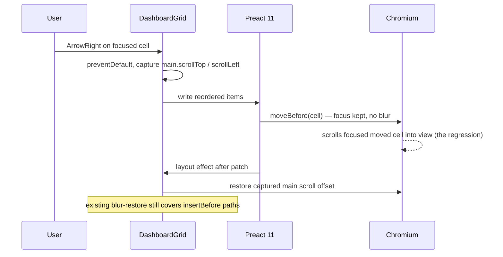
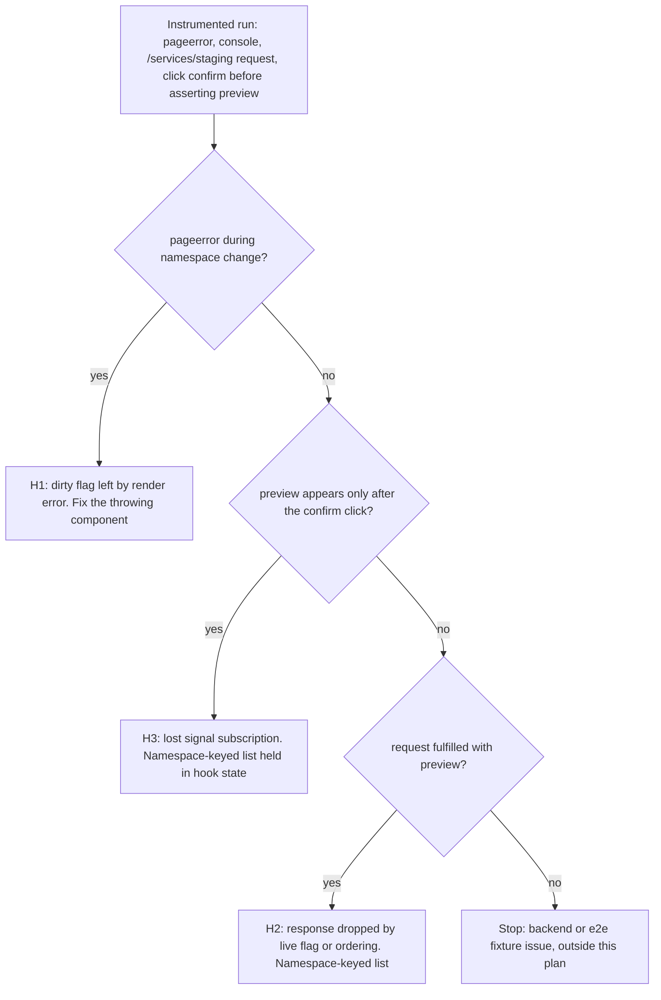

# Preact 11 Upgrade - Plan

## Goal Capsule

- **Objective:** The k8sCenter web UI runs on Preact 11, keeps every user-visible behavior it has today (dashboard arranging, widget parameters, wizards, live resource updates), and passes CI with the full gate green.
- **Means:** Bump `preact` together with the integration packages whose peer ranges gate it (KTD1, KTD3). Migrate the types to Preact 11's root exports, wrappers first (KTD4). Fix each runtime regression in our own code (KTD5, KTD6).
- **Authority:** the Requirements below own product behavior and KTDs own mechanism. Where this plan conflicts with the project's `CLAUDE.md` directives (phasing, verification, GitNexus, cooldown), the directives win.
- **Stop conditions:**
  - Stop and ask if a fix appears to need `preact/compat`, a weakened or skipped e2e assertion, or a Preact-version branch in app code (R8).
  - Stop and ask if a regression can only be fixed by `preact@11.0.2`. It was published 2026-10-23, so it is inside the 7-day cooldown until 2026-10-30, and taking it needs an explicit cooldown override from the user.
- **Execution profile:**
  - Phased under the project's 5-files-per-phase directive, with user approval between phases.
  - U3's mechanical edits fan out to subagents under the swarming directive.
  - The work lands on a fresh branch off `main` (KTD2).
- **Who finishes:** `ce-work` implements U1–U6 and opens one PR that supersedes Dependabot PR #639. `/ce:review` and a homelab smoke run before merge. The human reviewer merges.

---

## Product Contract

### Summary

Move the frontend from Preact 10.29.8 to 11.0.1 in one PR. That PR bumps the Astro Preact integration alongside, migrates the TypeScript types, and fixes the two runtime regressions the e2e suite caught on #639. It also hardens one subscription path against Preact 11's deferred unmount cleanup.

### Problem Frame

Dependabot opened #639 (`preact` 10.29.8 → 11.0.1). It was held on 2026-10-26 on compatibility grounds while the rest of that day's Dependabot batch merged.

CI on #639 fails in two places:
- **Frontend check:** `astro check` reports 378 errors.
- **E2E:** two specs fail on every retry (380 pass).

Staying on 10.x leaves the frontend on a line that now only gets forward-ports. Each later Preact-adjacent bump (`@astrojs/preact`, `@preact/signals`) will also move further toward 11-only ranges.

The 378 errors have few roots:
- Preact 11 moved most interfaces out of the `JSX` namespace into root `preact` exports and removed `MutableRef`.
- Most of the count cascades from the shared `Input`, `Select` and `Button` prop types failing to resolve. That leaves every consumer's `id`, `value` and `type` props unknown and its `onInput` parameters implicitly `any`.

Preact 11 also changes runtime behavior in ways the type checker cannot see:
- keyed moves now use `moveBefore`;
- passive-effect cleanup on unmount is deferred until after paint;
- the automatic `px` suffix for numeric styles is gone.

### Requirements

**Dependencies**

- R1. The frontend resolves `preact@11.0.1`, `@astrojs/preact@6.1.0` and `preact-render-to-string@6.8.1`, each published at least 7 days before install, with a single resolved copy of `preact` and of `@preact/signals-core`.
- R2. `frontend/bun.lock` stays a text lockfile, and the `bunfig.toml` release-age gate stays in force. No cooldown override is used.

**Types**

- R3. `bun run check` passes repo-wide with zero errors. It must not get there through `any` casts, `@ts-expect-error`, `@ts-ignore`, loosened `tsconfig.json` options, or new entries in `frontend/server/placeholder-root-parity-baseline.json`.

**Runtime behavior**

- R4. Rearranging a dashboard widget with the arrow keys leaves the scroll position of `<main>` and of the page exactly where it was, and the moved widget keeps focus.
- R5. In the widget parameter dialog, choosing a namespace makes the service picker offer exactly that namespace's services once they load. The picker never offers the previous namespace's services and never falls back to free text.
- R7. The full Playwright suite and `bun test` pass with no spec assertion weakened, skipped or retried away.
- R8. App code does not import `preact/compat` and does not branch on the Preact version.

### Key Decisions

- **The specs are the contract.** The two failing e2e specs describe intended behavior, so each regression is fixed in app code. Governs R4, R5, R7, R8. (session-settled: user-approved — chosen over weakening the specs or routing the behavior through `preact/compat`: the specs encode accessibility and validation rules the product depends on.)

### Success Criteria

- The PR's CI is fully green: Frontend (check, test, build), e2e, CodeQL and Trivy.
- A homelab smoke on the PR image shows no visible difference from `main` in five areas:
  - dashboard edit mode with keyboard arranging;
  - the widget parameter dialog for a namespace-and-service widget;
  - one SecretStore wizard (Vault);
  - live updates in a resource table;
  - the incident capture flow.

### Scope Boundaries

- Not adopting new Preact 11 features: refs as props, core `createPortal`, `useEffectEvent`. There is no `forwardRef` to remove.
- No mobile, backend or Helm changes.
- No other pending dependency bumps ride along beyond the three in R1.
- **Considered, not built:**
  - **A `px`-suffix guard.** The audit found no numeric dimensional inline style; every one is a px string, `0`, or a unitless property. Preact 11's `CSSProperties` type still accepts numbers, so a regression would be silent. Revisit with a Biome rule if a numeric style lands.
  - **Hardening `dashboardData.abort()` in `frontend/src/islands/DashboardV2.tsx` against deferred cleanup.** DashboardV2 is a page-level island that never unmounts and remounts within one render pass. Revisit if it becomes nested or keyed.
  - **An identity-checked unsubscribe in `frontend/src/lib/ws.ts` for same-id remounts.** Every `subscribe` caller is a page-level Astro island that mounts once per page load, so no instance unmounts while another mounts under the same id. The guard alone would also leak the backend's per-connection subscription count, which `backend/internal/websocket/client.go` caps at 25 and decrements only on unsubscribe frames. Any future version must suppress duplicate subscribe frames for a same-id, same-target entry. Revisit when client-side navigation or a keyed remount reuses a fixed id.

#### Deferred to Follow-Up Work

- `preact@11.0.2` and `@astrojs/preact@6.1.1` as a Dependabot follow-up once both are past the cooldown (2026-10-30 and 2026-10-28). 11.0.2 changes the `Input`/`Select` accessibility types again, so expect a small second type pass.

### Sources

- Upgrade guide: https://preactjs.com/guide/v11/upgrade-guide
- Release notes for 11.0.0-beta.0 through 11.0.2: https://github.com/preactjs/preact/releases
- PR #639 CI runs `40326732564` (Frontend) and `40326732607` (e2e).
- The 2026-10-26 Dependabot-batch session log records #639 being held on compatibility grounds.

---

## Planning Contract

### Key Technical Decisions

- KTD1. **Target `preact@11.0.1`.** It is 18 days old, so it clears the cooldown today. (session-settled: user-approved — chosen over waiting until 2026-10-30 to go straight to 11.0.2: the work can start now, and 11.0.2's type changes are a smaller follow-up.)
  - **Conflict call-out:** the e2e trace ranks Preact issue #5264 as the most likely cause (~45%) of the R5 failure. In that issue, a render error elsewhere leaves a component marked dirty so that its later re-renders are dropped. The fix shipped in 11.0.2 (#5265). The plan stays on 11.0.1 because the trigger is itself a render error in our code, which U6 fixes regardless. The 11.0.2 stop condition in the Goal Capsule applies only if no such error exists and the drop still happens.
- KTD2. **Work on a fresh branch `chore/preact-11` off `main`, and close #639 as superseded.** (session-settled: user-approved — chosen over pushing to Dependabot's branch: Dependabot stops managing a branch once someone else commits to it.)
- KTD3. **Bump `@astrojs/preact` to 6.1.0 and `preact-render-to-string` to ^6.8.1 in the same change.**
  - `@astrojs/preact@6.0.5` declares the peer `preact ^10.6.5`; 6.1.0 is the first release whose peer allows `^11.0.0`.
  - 6.1.0 depends on `preact-render-to-string ^6.8.0`, `vite ^8.3.4` and `devalue ^6`.
  - `preact-render-to-string` is a direct devDependency, so it moves by hand. 6.8.1 was published 2026-10-14.
  - The `bunfig.toml` gate keeps transitive Vite at a version past the cooldown, so 8.3.4 rather than 8.3.5.
- KTD4. **Fix types at their source, not at the cascade.**
  - Replace each `JSX.<Interface>` with the matching named type import from `preact`: `InputHTMLAttributes`, `SelectHTMLAttributes`, `HTMLAttributes`, `CSSProperties`, `TargetedEvent`, `TargetedPointerEvent`, `TargetedKeyboardEvent`.
  - Replace `MutableRef<T>` with `RefObject<T>`.
  - `preact.JSX.Element` stays as it is, since 11 still exports the `JSX` namespace with `Element`.
  - Fix the shared wrappers first and re-run `astro check` before touching consumers. Most of the 171 implicit-`any` and 173 assignability errors should vanish without edits to the ~40 consumer files, so only real residue gets fixed.
- KTD5. **Restore the scroll position after a keyboard reorder instead of preventing the DOM move.** The full sequence is in High-Level Technical Design.
  - Preact 11 moves the focused cell with `moveBefore`, which keeps focus. That means the existing blur-restore in `frontend/lib/hooks/use-dashboard-focus.ts` (`focus({ preventScroll: true })`) never fires, and Chromium scrolls the moved, still-focused cell into view.
  - **Fix:** capture `<main>`'s scroll offset before the reorder write and restore it after the patch.
  - Keep the blur-restore, since it is still the path on Preact 10 semantics and in browsers without `moveBefore`. Keep DOM order equal to visual order, since it is the tab order on purpose.
- KTD6. **Diagnose the service-picker failure before choosing a fix.** The trace narrows it to three hypotheses that one instrumented run can tell apart (see High-Level Technical Design).
  - **Render error (H1):** fix the throwing component.
  - **Stale or never-applied response (H2):** key the fetched list to its namespace by storing `{namespace, names}`, and render only a list whose namespace matches the current selection. This replaces the synchronous clear at the top of the effect in `frontend/lib/hooks/use-services.ts`.
  - **Lost signal subscription (H3):** hold the namespace-keyed list in hook state (`useState`) instead of a signal, so a resolved response re-renders the dialog through hook state rather than the signal-to-component subscription. The dialog already reads the signal during render, so reading it there again would not change anything.

### High-Level Technical Design

Keyboard reorder under Preact 11 (KTD5):

If the confirming experiment shows the browser scroll lands after layout effects, the restore moves to a one-shot `scroll` listener on `<main>` that is armed by the keydown and disarmed after one frame.

Service-picker diagnosis (KTD6):

---

## Implementation Units

### U1. Dependency bump

- **Goal:** Resolve the R1 versions on a fresh branch with a valid lockfile.
- **Requirements:** R1, R2. KTD1, KTD2, KTD3.
- **Dependencies:** none.
- **Files:** `frontend/package.json`, `frontend/bun.lock`.
- **Approach:**
  1. Branch `chore/preact-11` from current `main`.
  2. Set `preact` to `^11.0.1`, `@astrojs/preact` to `^6.1.0` and `preact-render-to-string` to `^6.8.1`. Leave the `bunfig.toml` gate on and let it pick versions past the cooldown.
  3. Confirm the lockfile resolves one `preact` and one `@preact/signals-core`, with `@astrojs/preact` at 6.1.0 rather than 6.1.1.
  4. Record the baseline `astro check` error count.
- **Execution note:** Mostly packaging. Prove it with an install and lockfile inspection, then dev-server and build smoke, rather than with unit tests.
- **Patterns to follow:** the cooldown checks in the user's global instructions (`npm view <pkg> time`). The `check-lockfile-is-text.ts` guard.
- **Test expectation:** none — manifest and lockfile only. U2–U6 and the Verification Contract cover behavior.
- **Verification:**
  - `bun install` succeeds without the release-age gate refusing a package.
  - `bun.lock` shows the R1 versions.
  - `astro check` reports roughly the #639 baseline (about 378), confirming no new error class came from the integration bump.

### U2. Shared wrapper types

- **Goal:** Restore the prop types that the cascade flows from.
- **Requirements:** R3. KTD4.
- **Dependencies:** U1.
- **Files:**
  - `frontend/components/ui/Input.tsx`
  - `frontend/components/ui/Select.tsx`
  - `frontend/components/ui/Button.tsx`
  - `frontend/components/ui/SearchBar.tsx`
  - `frontend/components/ui/GlassCard.tsx`
- **Approach:**
  1. Run GitNexus `impact` upstream on `Input`, `Select` and `Button` and report the blast radius. These three have about 155, 28 and 127 JSX consumers.
  2. Swap each `JSX.*` extends or annotation for the root named type.
  3. Drop the now-unused `JSX` import.
  4. Re-run `astro check` and record the residual count by error code.
- **Patterns to follow:** the existing `import type { ComponentChildren } from "preact"` style in these files.
- **Test expectation:** none — type-only, with no runtime change. `astro check` and the existing tests that render these components prove it.
- **Verification:**
  - The cascade errors are gone: "Property 'id' does not exist on type 'IntrinsicAttributes & InputProps'" and the implicit-`any` `onInput` parameters.
  - The residual errors are only the U3 inventory plus any accessibility-union errors on dynamic `type` expressions.

### U3. Remaining type migration

- **Goal:** Clear every remaining `astro check` error.
- **Requirements:** R3. KTD4.
- **Dependencies:** U2.
- **Files:** three sub-phases of 5 files or fewer each:
  - (a) `frontend/components/ui/Skeleton.tsx`, `frontend/components/ui/WidgetShell.tsx`, `frontend/components/ui/cell-fill.ts`, `frontend/components/dashboard/widgets/ClusterTopologyWidget.tsx`, `frontend/components/dashboard/DashboardGrid.tsx`.
  - (b) `frontend/src/islands/DashboardV2.tsx`, `frontend/src/islands/FlowViewer.tsx`, `frontend/src/islands/GatewayAPIDashboard.tsx`, `frontend/src/islands/ResourceDetail.tsx`, `frontend/src/islands/YamlApplyPage.tsx`.
  - (c) `frontend/lib/hooks/use-dashboard-focus.ts`, `frontend/lib/hooks/use-modal-dialog-keys.ts`, plus whatever residue U2's re-run names that is not in this list. Expect the two accessibility-union assignability errors where an `<input>` gets a dynamic `type` such as `"text" | "password"` or `"number" | "text"`.
- **Approach:**
  1. Apply KTD4 mechanically, using the inventory in the planning research.
  2. In `GatewayAPIDashboard.tsx`, the `import type { JSX }` sits mid-file at line 541. Hoist the replacement import to the top.
  3. For the dynamic-`type` residue, narrow the value at the call site to the union Preact's discriminated input types accept. Do not cast to `any`.
  4. Dispatch sub-phases (a) and (b) to `mechanical-edit` subagents under the swarming directive, and keep (c) in the parent, since the hook refs feed U5.
- **Patterns to follow:** U2's import shape. `RefObject` is already used in `frontend/components/dashboard/EditToolbar.tsx` via `Ref`.
- **Test expectation:** none — type-only. The existing `bun test` suites over these files prove runtime is unchanged.
- **Verification:**
  - `bun run check` passes repo-wide: Biome, `astro check` and every `server/check-*.ts` guard.
  - The diff contains no `any`, `@ts-expect-error` or `@ts-ignore`.

### U4. Cleanup-timing test triage

- **Goal:** Confirm the abort-after-unmount tests still hold under Preact 11's `act`.
- **Requirements:** R7.
- **Dependencies:** U3.
- **Files:** none expected. Only the test harness that a failing triage names would change.
- **Approach:**
  1. Run `bun test` and triage any failure in the abort-after-unmount tests listed in the research appendix. Examples: `frontend/lib/incident-api_test.ts`, `frontend/lib/dashboard/data_test.ts`, `frontend/src/islands/ESOEvidencePanel_test.tsx`.
  2. A failure there means `act` no longer flushes deferred cleanup. Fix it in the test harness by flushing inside `act`, not by loosening the assertion.
- **Test expectation:** none — this unit adds no behavior. The existing abort-after-unmount assertions are the proof.
- **Verification:** the full `bun test` run passes without edits to any assertion that checks `signal.aborted` after unmount.

### U5. Dashboard keyboard reorder keeps scroll position

- **Goal:** Arrow-key arranging no longer scrolls `<main>`.
- **Requirements:** R4, R7, R8. KTD5.
- **Dependencies:** U3 (sub-phases a and c touch these files).
- **Files:**
  - `frontend/components/dashboard/DashboardGrid.tsx`
  - `frontend/lib/hooks/use-dashboard-focus.ts` (only if the restore belongs beside the existing blur-restore)
  - `e2e/tests/dashboard-grid.spec.ts` (new scenario only; existing assertions unchanged)
- **Approach:**
  1. Confirm the trigger before writing the fix. Run the failing spec once with an init script that deletes `Element.prototype.moveBefore` (a pass confirms the trigger). Log a stack from a `scroll` listener on `<main>` to see whether the scroll is browser-initiated. Do not commit the instrumentation.
     - Apply KTD5's capture-and-restore only when `moveBefore` is confirmed as the trigger and the scroll is browser-initiated.
     - If the spec still fails with `moveBefore` deleted, or the stack shows an app-code `focus()` or `scrollIntoView` call, fix that call site instead.
     - If neither experiment points to a cause, stop and ask rather than masking an unknown cause with a restore.
  2. Implement KTD5. Capture `<main>`'s offsets in the keyboard path before the reorder write, and restore them in a layout effect that runs after the patch. Switch to the one-shot scroll-listener variant only if the experiment shows the scroll lands later.
  3. Leave the deliberate `scrollIntoView({ block: "nearest" })` on focus moves between widgets alone.
  4. `DashboardGrid.tsx` is over 300 LOC. If the change grows beyond a localized capture-and-restore, apply the project's Step 0 rule: a separate dead-code cleanup commit first.
- **Execution note:** Confirm the trigger with the experiment before writing the fix. The fix direction depends on when the scroll happens.
- **Patterns to follow:** the capture-before-patch and restore-in-layout-effect shape already used for `activePlacement` in `frontend/lib/hooks/use-dashboard-focus.ts`.
- **Test scenarios:**
  - With `<main>` at scroll 0, press ArrowRight twice on `d-cluster-health` in edit mode. Main and page scroll stay `{0, 0}` and the widget stays focused (existing spec line 921).
  - With `<main>` already scrolled partway down, move a widget with an arrow key. The scroll offset is unchanged rather than reset to 0 (new scenario).
  - Move a widget with an arrow key, then Tab. Focus lands on the next control in visual order, which proves DOM order still tracks layout.
  - Moving focus between widgets (not reordering) still scrolls an off-screen widget into view.
- **Verification:**
  - The whole `e2e/tests/dashboard-grid.spec.ts` suite passes on Chromium, including its other keyboard and edit-mode specs.

### U6. Widget parameter service picker follows the namespace

- **Goal:** The service picker shows the selected namespace's services after a namespace change.
- **Requirements:** R5, R7, R8. KTD6.
- **Dependencies:** U3.
- **Files:**
  - `frontend/lib/hooks/use-services.ts`
  - `frontend/components/dashboard/WidgetParamDialog.tsx`
  - `frontend/lib/hooks/use-services_test.tsx` (new)
  - Under H1 only: the throwing component the instrumented run names, which is not knowable now.
- **Approach:**
  1. Run the KTD6 diagnostic once (failing spec `e2e/tests/dashboard-catalog.spec.ts:319` with request, console and `pageerror` logging) and pick the branch.
  2. Under H2 or H3, make the hook return the namespace-keyed list, held in hook state under H3 per KTD6. The dialog then renders options only when the list's namespace equals the current selection.
  3. Keep the existing contracts: an empty list disables the select, and there is never a free-text fallback.
  4. Remove the diagnostic logging before commit.
- **Execution note:** Diagnose first. The fix is chosen by the experiment's outcome, not in advance.
- **Patterns to follow:** the current hook's `live` flag and `AbortController` handling. The hook tests that use `@happy-dom/global-registrator` with `act` and `render`, such as `frontend/lib/hooks/use-poll_test.tsx`.
- **Test scenarios:**
  - Namespace `default` resolves `["checkout"]`. Switch to `staging`, which resolves `["preview"]`. The hook yields `staging` with `["preview"]`, and `checkout` never appears under `staging` (covers the spec at line 319).
  - Switch from `default` to `staging` and back to `default` before `staging` resolves. The late `staging` response is not shown under `default`.
  - A namespace whose list request fails or returns 403 yields an empty list and a disabled select, with no free-text input.
  - Clearing the namespace to an empty string yields an empty list without a request.
  - A widget that declares no service key still renders the dialog without error, because the hook still runs.
- **Verification:**
  - `e2e/tests/dashboard-catalog.spec.ts` passes in full.
  - The new hook tests pass.
  - Under H1, the named component no longer throws, and a unit test reproduces its old throw.

---

## Verification Contract

| Gate | Command (from repo root unless noted) | Proves |
|---|---|---|
| Frontend check | `cd frontend && bun run check` | R3: Biome, `astro check`, and all `server/check-*.ts` guards, repo-wide |
| Unit tests | `cd frontend && bun test` | R7 and abort-after-unmount behavior |
| Build | `cd frontend && bun run build` | Astro SSR build with Preact 11 and the 6.1.0 integration |
| Dev smoke | `make dev-frontend`, then load the dashboard and a wizard | One copy of `preact` and of signals at runtime (the `vite.resolve.dedupe` contract) |
| E2E | `make test-e2e`, or the e2e job on the PR | R4, R5, R7: whole Playwright suite with no new skips. CI retries each test twice and does not fail on flaky tests, so the final PR run's report must show zero flaky tests. Before U5 and U6 are done, run `dashboard-grid.spec.ts` and `dashboard-catalog.spec.ts` locally with retries off and each test repeated five times |
| Backend | `cd backend && go vet ./... && go test ./...` | Directive 4 repo-wide gate. The backend is unchanged, so this is expected to be a no-op |
| Graph | GitNexus `detect_changes` scope `all` before each commit; `compare` against `main` before the PR | No unexpected blast radius. `partial` or `truncated` results get re-run |
| CI | `gh pr checks <N> --watch --fail-fast --interval 30` in the background | Green PR. Fix and re-watch on any failure |
| Review | `/ce:review` before merge, then a homelab smoke of the five Success Criteria surfaces | Merge readiness |

---

## Definition of Done

- **U1–U6:** each unit's Verification holds.
- **Gates:** every gate in the Verification Contract has passed on the final commit. The checks were run repo-wide, not scoped.
- **PR:** the PR supersedes #639, links it, and #639 is closed.
- **Clean diff:** no diagnostic instrumentation from U5 or U6 is left in the diff, and no abandoned-attempt code remains. The diff contains no `any` casts, `ts-ignore` or `ts-expect-error`, no `preact/compat` import, and no new baseline-file entry.
- **Supply chain:** no package in the diff is younger than 7 days at install time.
- **After merge:**
  - Delete the local and remote feature branches.
  - Make sure Dependabot will raise 11.0.2 and `@astrojs/preact` 6.1.1 as the deferred follow-up.

---

## Appendix

### Research inventory

The `JSX.*` and `MutableRef` inventory: 46 references in 25 files.

| Location | Today | Replacement |
|---|---|---|
| `components/ui/Input.tsx`, `Select.tsx` | `JSX.InputHTMLAttributes`, `JSX.SelectHTMLAttributes` | root named types |
| `components/ui/Button.tsx` | `Omit<JSX.HTMLAttributes<HTMLButtonElement>, "size">` | `Omit<HTMLAttributes<…>, "size">` |
| `components/ui/SearchBar.tsx` | `JSX.TargetedEvent` | `TargetedEvent` |
| `components/dashboard/DashboardGrid.tsx` | `JSX.TargetedPointerEvent`, `JSX.TargetedKeyboardEvent`, `JSX.CSSProperties` | root types |
| 10 style sites (`GlassCard`, `Skeleton`, `WidgetShell`, `cell-fill`, `ClusterTopologyWidget`, `DashboardV2`, `FlowViewer`, `GatewayAPIDashboard` ×6) | `JSX.CSSProperties` | `CSSProperties` |
| `ResourceDetail.tsx`, `YamlApplyPage.tsx` | `preact.JSX.CSSProperties` | `preact.CSSProperties` |
| `lib/hooks/use-dashboard-focus.ts`, `use-modal-dialog-keys.ts` | `MutableRef<T>` | `RefObject<T>` |

All paths in the table are under `frontend/`.

Findings that are not migration sites:
- All 145 `useRef` calls pass an initial value.
- There are no uses of `KebabCSSDOMProperties`, `DefinedIntrinsicElements`, `createRef`, `forwardRef`, `defaultProps`, `this.base`, preact `options` hooks, or three-argument `render`.
- No `server/check-*.ts` guard references Preact.

**Abort-after-unmount tests that depend on `act` flushing cleanup:**
- `lib/incident-api_test.ts` (lines 1369, 1390)
- `lib/yaml-apply_test.ts` (347)
- `src/islands/ChangeReceipt_test.tsx` (264)
- `src/islands/ESOEvidencePanel_test.tsx` (214, 283)
- `lib/dashboard/data_test.ts` (377, 1424)
- `lib/cluster-targeting_test.ts` (284)
- `lib/eso-refresh-observer_test.ts` (506, 558)

**Not yet confirmed against installed type definitions, so U2 checks these on first contact:**
- that `TargetedEvent`, the `*HTMLAttributes` types and `CSSProperties` are re-exported from the package root;
- whether a `ButtonHTMLAttributes` type would fit `Button.tsx` better than `HTMLAttributes`.
