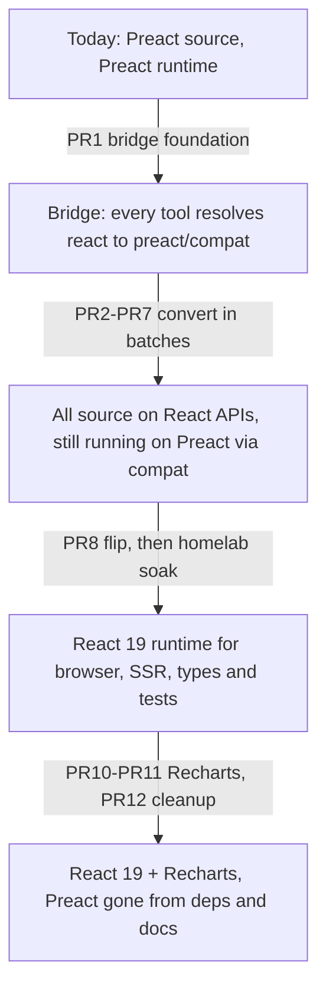
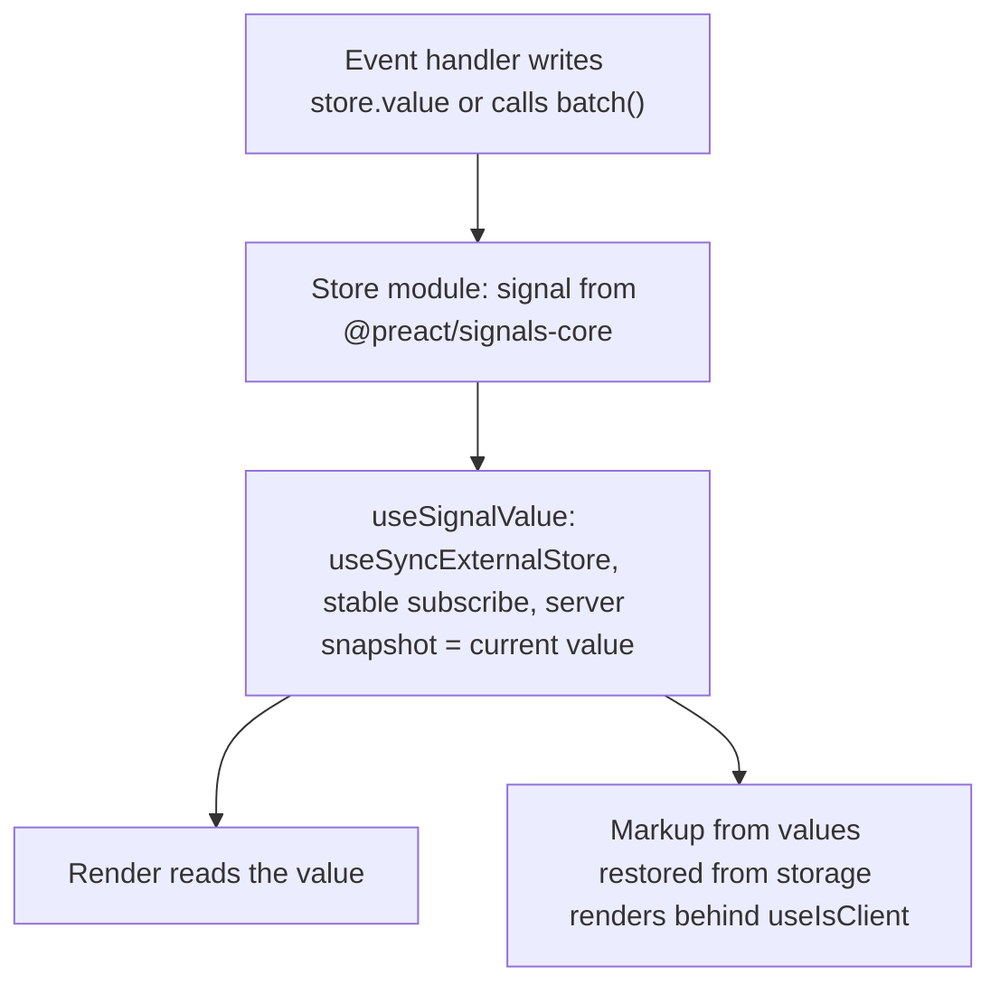

# Preact to React 19 Migration with Recharts - Plan

## Goal Capsule

- **Objective:** Operators read the Metrics tab, compliance trend and resource utilisation charts with axes, values and hover readouts, every other page keeps working as it does today, and future UI work can use React component libraries directly.
- **Means:** Rewrite the frontend to React APIs while every tool still runs it on Preact through `preact/compat` (KTD1), switch to real React 19 in one PR (KTD8), then rebuild every chart on Recharts 3 (KTD9).
- **Authority:** the user's decisions recorded in Key Decisions, then the repo's `CLAUDE.md` rules, then this plan's KTDs, then unit text. Where a unit and a KTD disagree, the KTD wins on mechanism and the R wins on behaviour.
- **Execution profile:** several PRs, grouped under Implementation Units. Inside a PR, work proceeds in phases of at most 5 files with a verification run between them (`CLAUDE.md` directive 2), and bulk conversions use parallel sub-agents of 5-8 files each (directive 5).
- **Stop conditions:**
  - A converted surface misbehaves under `preact/compat` and the only fix is a Preact-version branch or a weakened e2e assertion.
  - The flip PR (PR8) shows a regression that cannot be fixed without weakening an e2e spec.
  - React hydration still reports errors on a page after PR8's hydration work.
  - Bundle measurement in U15 shows the dashboard's first-load JavaScript grew by more than 200 KB gzipped. Stop and report before PR10.
  - A package admitted through a cooldown exception fails the KTD12 provenance check.
- **Who finishes:** each PR is built with `ce-work`, reviewed with `/ce:review` before merge, CI-watched as `CLAUDE.md` describes, and smoke-tested on the homelab when it changes runtime behaviour.

---

## Product Contract

### Summary

Move the web frontend from Preact 11 to React 19 and rebuild every data chart on Recharts 3. Source code moves to React APIs batch by batch while the browser, server rendering, type-checking and tests all keep running it on Preact through its compatibility layer, so main is shippable after every PR. One PR then swaps in the real React runtime for every tool at once and fixes React's stricter hydration. Recharts arrives after the flip has run on the homelab, with axes and tooltips on the three larger charts.

### Problem Frame

The frontend began on Deno Fresh, which only runs Preact. It kept Preact through the September 2026 move to Bun and Astro to avoid rewriting about 150 islands during a runtime migration. Running Preact without `preact/compat` has kept React component libraries out of reach. The charts are hand-drawn SVG with no axes, tooltips or hover values, and each one repeats its own point maths. The dashboard builder hand-rolled its grid partly for the same reason (`docs/plans/2026-09-13-dashboard-builder-design.md`, D-2).

The user chose to move to React itself rather than keep Preact with a permanent compatibility layer. Charts are the first library to adopt.

### Requirements

**Behaviour parity**

- R1. Every page and user flow behaves the same after each PR as before it, proven by the Playwright e2e suite. An e2e assertion may change only to stop depending on framework or SVG internals, and only to an equal or stricter check.
- R2. State shared across islands stays consistent: cluster, namespace, auth, pins, WebSocket status, resource counts, dashboard layout and data, and toasts. A cluster switch still updates every island atomically.
- R3. Every island still arrives as server-rendered HTML, and after PR8 no page logs a React hydration error or an uncaught page error.

**Runtime**

- R4. After the migration the frontend runs on React 19 and react-dom 19. No source, test or dependency uses `preact`, `preact/compat`, `@preact/signals`, `@testing-library/preact` or `preact-render-to-string`. `@preact/signals-core` stays as the store primitive.
- R5. The production frontend image keeps its properties: distroless, no package manager or Bun toolchain, React inlined into the pre-bundled SSR entry.

**Charts**

- R6. Every data chart renders with Recharts. That covers the components in `frontend/components/charts/` (`Sparkline`, `Gauge`, `Donut`, `ResourceAreaChart`), `frontend/components/ui/{SparklineChart,GaugeRing,MetricTile,NetworkTile}.tsx`, the Metrics tab chart in `PerformancePanel.tsx`, the KPI sparklines in `MetricsRail.tsx`, `ComplianceTrendChart.tsx` and the ESO sync health ring in `ESODashboard.tsx`.
- R7. The Metrics tab charts, the policy compliance trend and the resource utilisation chart show a time axis, a value axis and a tooltip with time and value that opens on hover, keyboard focus and tap. Sparklines and gauges stay bare and are exposed to assistive tech as one image with a text label.
- R8. Charts keep theme-token colours, their empty and no-data messages, and the Metrics tab's "a refresh keeps the last results" behaviour from #695.

**Engineering**

- R9. Every PR passes `bun run check`, `bun test`, `bun run build` and the e2e workflow.
- R10. From PR8 on, island and component tests render through `@testing-library/react` on real React.
- R11. New packages use their latest releases, with the 7-day cooldown overridden only for the named packages at their exact versions (KTD12).
- R12. Unused code and dependencies found during research are removed first: `d3-force`, `fuse.js` and the 7 unreachable `.tsx` files.

### Key Decisions

- **React as the end state, not Preact with `preact/compat`.** The point is direct access to React libraries; a permanent compatibility layer keeps edge-case risk on every library added. Governs R4. (session-settled: user-directed — chosen over keeping Preact and enabling `preact/compat` for Recharts only: the user wants to stop being limited by the runtime.)
- **Stage through a compat bridge.** Source moves to React APIs while the app still runs on Preact, then one PR flips the runtime. Governs R1, R9. (session-settled: user-directed — chosen over running both Astro renderers side by side with about 50 temporary React copies of shared components, and over one very large PR: shared components such as `Spinner` (91 islands) cannot belong to two runtimes at once.)
- **Latest releases, cooldown overridden.** Governs R11. (session-settled: user-directed — chosen over cooldown-compliant `@astrojs/react` 7.1.2: the user asked for the latest releases.)
- **Axes and tooltips on the three larger charts; sparklines and gauges stay bare.** Governs R7. (session-settled: user-approved — chosen over decorating every chart: tiles are too small for axes.)
- **Topology graph and dashboard grid stay hand-built and are only ported.** (session-settled: user-approved — chosen over swapping in React graph or grid libraries during the migration: that is feature work, not migration.)

### Success Criteria

- The e2e suite passes on every PR with no spec weakened, including the console-error fixture added in U25.
- A browser console sweep of the pages in U15's list on the homelab shows no hydration errors and no uncaught errors after PR8.
- First-load JavaScript for the dashboard, a pod detail page and the Deployment wizard is measured before PR1 and after PR8 and PR11, and the numbers are in the PR descriptions.

### Scope Boundaries

- The mobile app and Grafana dashboards are untouched. The backend changes in one place: the WebSocket hub processes subscribe and unsubscribe requests in arrival order (U24), because React's remounts would otherwise leak subscriptions. The dashboard trends type gains the `window` and `step` fields the backend already sends (U20), a frontend-only change.
- No visual redesign. Liquid Glass tokens and layouts stay as they are.
- `components/charts/BarRow.tsx` stays an HTML progress meter. It draws one labelled bar per row, not a chart, and gains `role="meter"` semantics instead of a Recharts dependency.
- `NamespaceTopology.tsx` keeps its own layout and SVG; `DashboardGrid` keeps its own grid.
- Not built: React StrictMode. It double-runs effects in dev and nothing in this migration needs it. Revisit if wanted later.
- Not built: React Compiler. No `oxc-transform-react` release satisfies both `@astrojs/react` 7.1.4 and `@vitejs/plugin-react` peer ranges today.
- Not built: `@preact/signals-react`. It needs a Babel transform that `@astrojs/react` 7 removed.
- Not built: type-checking converted files against `@types/react` during the bridge. Mixed Preact and React element types across about 150 files would not type-check without casts. KTD2's guard and Biome's React rules catch the Preact-only patterns instead, and PR8's `astro check` is the first full React type check.
- Not built: a runtime switch between Preact and React. Leaf-island PRs revert cleanly; shared-primitive PRs are fixed forward because later batches build on their prop renames.

#### Deferred to Follow-Up Work

- Replace the hand-rolled dashboard grid with a React grid library.
- Replace the topology renderer with a React graph library.
- StrictMode.

---

## Planning Contract

### Key Technical Decisions

- KTD1. **One alias, used by every tool, until the flip.**
  - `tsconfig.json` `paths` maps `react`, `react-dom`, `react-dom/client`, `react-dom/server`, `react-dom/test-utils`, `react/jsx-runtime` and `react/jsx-dev-runtime` to their `preact/compat` and `preact/test-utils` equivalents. `astro check` and `bun test` read those paths.
  - `astro.config.mjs` adds the same entries to `vite.resolve.alias` for `astro dev` and `bun run build`.
  - So the browser, server rendering, type-checking and tests all run every file on one runtime, and any converted file can render any unconverted file and the reverse.
  - `jsxImportSource` stays `preact` until PR8, so no file needs a pragma.
  - Real React is not installed until PR8.

  (session-settled: user-directed — chosen over running `@astrojs/preact` and `@astrojs/react` side by side: shared components can only belong to one runtime per file.)
- KTD2. **One guard tracks the bridge, with no baseline file.**
  - `frontend/server/check-react-bridge.ts` fails when a file imports from both `react` and any of `preact`, `preact/hooks` or `@preact/signals`.
  - It also fails when a file importing from `react` uses a Preact-only JSX attribute: `class=`, `for=`, `onFocusOut` or a hyphenated SVG attribute. Preact's types accept these, so the guard is what stops them during the bridge.
  - It prints the count of files still on Preact APIs as progress.
  - With no baseline, conversion PRs cannot conflict on it. In PR8 it becomes "no Preact import anywhere".
- KTD3. **Stores stay signals and are read through one hook.**
  - Store modules import `@preact/signals-core`, which becomes a direct dependency.
  - `frontend/src/lib/use-signal-value.ts` reads a signal through `useSyncExternalStore`. Its `subscribe` is held stable so one write causes one render. It preserves the atomic cluster triple written by `batch()`.
  - The server snapshot returns the signal's current value, not a fixed default. Otherwise the hydration render's effects would fetch with default values, such as all namespaces or the local cluster while a remote one is selected.
  - Any markup that depends on a store value the browser restores from storage renders behind `useIsClient` (KTD5), so server and client markup agree. That covers every island whose first render reads cluster, namespace, pins, counts or layout. The top bar's namespace select and the cluster switcher label are the two known cases. U13 finds the rest.
  - `useAuth()`, `dashboardData.state(key)` and every store read in render go through the hook.
  - The toast store moves out of `ToastProvider.tsx` into `frontend/src/lib/toast-store.ts` and joins `FORBIDDEN_MODULES` in `check-no-signal-store-in-ssr.ts`.

  (session-settled: user-approved — chosen over replacing stores with Zustand or nanostores: the stores already work and do not need rewriting.)
- KTD4. **Component state becomes React state, and long-lived callbacks read through refs.**
  - `useSignal` becomes `useState`, or `useRef` when the value never renders.
  - `useComputed` becomes a derived value or `useMemo`.
  - A signal passed as a prop becomes a value and setter pair.
  - Any handler registered once and called later must read current values through a ref kept in sync each render, never through a captured state variable. That covers `beforeunload`, WebSocket callbacks, `requestAnimationFrame`, pointer sessions, timers, and async guards after an `await`. A `.peek()` read in such a handler becomes that ref.
  - The two bare-signal JSX children (`ChangeReceipt.tsx`, `IncidentWorkspace.tsx`) render their values.
- KTD5. **Client-only rendering uses a hydration-safe hook.**
  - `useIsClient()` in `frontend/src/lib/use-is-client.ts` calls `useSyncExternalStore` with `getSnapshot` returning the existing `IS_BROWSER` constant and `getServerSnapshot` returning `false`. `preact/compat` ignores the server snapshot during the bridge, so `getSnapshot` itself must be `false` on the server. React 19 uses the server snapshot during hydration and then re-renders with `true`.
  - It replaces the 223 `if (!IS_BROWSER) return <placeholder/>` render gates. `client:only` is not used because it drops server HTML (R3).
  - An effect that mounts a library into a ref rendered only on the client must list `isClient` in its dependencies, or use a ref callback. Otherwise, after the flip it runs once while the ref is still null and never mounts, which is how CodeMirror and Monaco would fail.
  - During the bridge, `check-placeholder-root-parity.ts` treats `!isClient` gates like `!IS_BROWSER` ones, because Preact still keeps the server root's attributes.
  - In PR8 that guard and its baseline file are deleted, not edited, and replaced by a check that no render path reads `IS_BROWSER` outside `use-is-client.ts`. React re-renders the client tree after hydration, so root-attribute parity no longer applies.
- KTD6. **JSX and types use React vocabulary.**
  - Attributes: `className`, `htmlFor`, `autoComplete`, `spellCheck`, `onBlur` for `onFocusOut`, and camelCase SVG attributes.
  - Text inputs use `onChange`, which fires per keystroke in React and under `preact/compat`. Handlers that must fire on commit move to `onBlur` or form submit (KTD16).
  - Components that take a `class` prop rename it `className`.
  - Types are imported from `react`: `ReactNode`, `ReactElement`, `CSSProperties`, React event types. During the bridge these names resolve to compat's types.
  - `h()` in `lib/resource-columns.ts` becomes `createElement`.
  - Gradient and clip ids generated with `Math.random` become `useId`.
  - `.astro` call sites that pass `class` to a component pass `className`, because `@astrojs/react` drops `class` on server render (`login.astro`'s `Logo`).
- KTD7. **Tests use Testing Library on the bridge runtime, then on React.**
  - Converted tests use `@testing-library/preact`, whose query API matches `@testing-library/react`. Under the KTD1 alias they render compat, as the browser does.
  - PR8 swaps the import to `@testing-library/react`, so the whole suite moves to real React with the runtime.
  - happy-dom stays registered per file rather than through a global preload. A global preload replaces `fetch`, `Request`, `Response` and `WebSocket` for the server tests.
  - Tests query through what `render()` returns or `within(document.body)`, because `screen` binds before per-file registration.
  - The four `preact-render-to-string` SSR tests move to `react-dom/server` in PR8.
- KTD8. **The flip is one PR.**
  - It installs React 19 and `@astrojs/react` in place of `@astrojs/preact`, sets `jsxImportSource` to `react`, removes the `paths` and `vite.resolve.alias` entries, and adds `react` and `react-dom` to `vite.resolve.dedupe`.
  - It verifies the Dockerfile's `bun build --target=bun` step inlines `react-dom/server`.
  - Splitting it would ship a half-switched runtime.
- KTD9. **Recharts conventions.**
  - One `ChartFrame` wrapper in `frontend/components/charts/ChartFrame.tsx` gives every chart a fixed-height box. Recharts draws nothing on the server, and the box keeps the page from shifting when it draws.
  - `ChartFrame` has two height presets: a tile preset matching today's sparkline and gauge sizes, and an axis-chart preset tall enough for two axes and tick labels.
  - Charts use Recharts' `responsive` sizing, not `ResponsiveContainer`, which renders nothing under happy-dom.
  - Bare charts turn off `accessibilityLayer` and carry `role="img"` with an `aria-label`; axis charts keep it on.
  - Colours are `var(--token)` strings. Per-point colours go in the data rows, because `<Cell>` is deprecated.
  - `chart-theme.ts` owns the axis conventions every axis chart uses:
    - a tick count capped by container width;
    - one time-label format per range (minutes up to 1h, hours up to 24h);
    - unit-aware value formatters for percent, bytes and cores;
    - a padded value domain when all values are equal;
    - tooltips that open on hover, keyboard focus and tap.
  - Tests and e2e assert on `ChartFrame`'s data attributes and labels, never on Recharts' internal SVG.
- KTD10. **The gauge e2e assertion becomes semantic, plus a render check.** `e2e/tests/remote-capabilities.spec.ts` checks `circle[stroke-dashoffset]` on the cluster-health gauge. It changes to assert the gauge's accessible label and value, and that its `ChartFrame` contains a drawn chart with a non-zero box. Together these are at least as strict as counting one SVG element (R1).
- KTD11. **The trends type carries its time grid.** `DashboardTrends` in `lib/dashboard/wire-types.ts` gains the backend's `window` and `step`, so the utilisation chart can label real times on its x-axis (R7).
- KTD12. **Exact versions, a narrow cooldown exception, and a provenance check.**
  - Every package below is written as an exact version in `frontend/package.json`, with no caret: `react`, `react-dom` and `react-is` 19.3.1; `@types/react` and `@types/react-dom` 19.3.0; `@astrojs/react` 7.1.4; `vite` 8.3.6; `recharts` 3.10.1; `@preact/signals-core` 1.14.5; `@testing-library/react` 16.3.3; `@testing-library/dom` 10.4.2; `@testing-library/preact` 3.2.6.
  - Transitive packages that are under 7 days old at install time are pinned through `overrides` to the version that resolves on install day. Today that is `@astrojs/internal-helpers`, pinned to whatever version `@astrojs/react` 7.1.4 pins.
  - `frontend/bunfig.toml` keeps `minimumReleaseAge` and gains `minimumReleaseAgeExcludes` only for packages still under 7 days old on the day of install. By PR8 most or all of today's fresh releases will be past 7 days, and then no exclusion is added.
  - Before admitting an excluded package, confirm its npm provenance attestation points at the expected source repository and that its publisher is the expected maintainer account. A failure is a stop condition.
  - After install, check that `bun.lock` resolves each excluded package to its approved version. Any other version needs a new user-approved override.
  - The `trivy fs` scan of `bun.lock` stays. There is no automated lockfile-age audit in CI. The install-time gate, the provenance check and the homelab soak are the controls.
  - Each override is logged as the global `CLAUDE.md` requires.

  (session-settled: user-directed — chosen over cooldown-compliant versions: the user asked for the latest releases.)
- KTD13. **One copy of every identity-checked package.** `react`, `react-dom` and `@preact/signals-core` are in `vite.resolve.dedupe`. PR8 and PR10 prove a single copy by inspecting the production chunks in `frontend/dist/client/_astro/`, because duplicate copies broke the last migration and every automated gate missed them.
- KTD14. **Biome's React rules apply to each file as it converts.** `biome.json` enables the React rule domain through an `overrides` entry whose include list each conversion batch extends with its files. React-only bugs then surface in the batch that introduces them, not at the flip. PR8 enables the domain for the whole tree. Each `useExhaustiveDependencies` finding is reviewed rather than auto-fixed, because adding a dependency can refire an effect such as a socket subscribe.
- KTD15. **Several PRs, because a person must review each one.** `CONTRIBUTING.md` requires an approving review on every PR to `main`, and about 400 files is more than one reviewer can read well.
- KTD16. **`preact/compat` changes props in unconverted islands too.** Importing compat installs global vnode hooks. From PR1 on, they rewrite props in every island, for example turning `onChange` on text-like inputs into per-keystroke `input` handlers. PR1 audits every `onChange` on a text, number, search or textarea field, the page-jump number input in `VulnerabilityDetail.tsx` included, and moves commit-time handlers to `onBlur` or a form submit.
- KTD17. **The WebSocket hub processes subscription changes in arrival order.** `backend/internal/websocket/hub.go` drains subscribe requests (`addSub`) and unsubscribe requests (`unsubByID`) from two channels in one `select`. Go picks among ready channels at random, so a quick unsubscribe and resubscribe with the same id can be applied out of order. That silently kills a live table, or leaves an orphaned subscription counting against the 25-subscription cap. This already happens when the pod status filter changes, and React's remounts would make it more frequent. Both kinds of request move onto one ordered channel. A frontend-only workaround, such as fresh ids per mount, still leaves orphans when an unsubscribe overtakes its own subscribe.
- KTD18. **Wheel handlers that cancel scrolling use native listeners.** React attaches `wheel` as a passive listener, so `preventDefault()` in a JSX `onWheel` does nothing. `NamespaceTopology`'s wheel zoom and `ClusterTopologyWidget`'s ctrl+wheel zoom attach a non-passive listener through a ref.

### High-Level Technical Design

The migration moves through four runtime states. Each arrow is one or more merged PRs, and main is shippable at every state.

Where `react` resolves for each tool, before and after the flip:

| Tool | PR1-PR7 | PR8 onward |
|---|---|---|
| `astro dev`, `bun run build`, browser | `preact/compat` via `vite.resolve.alias` | `react` via `@astrojs/react` |
| `astro check` | compat types via `tsconfig` `paths` | `@types/react` |
| `bun test` | `preact/compat` via `tsconfig` `paths`, `@testing-library/preact` | `react`, `@testing-library/react` |

How a component reads shared state:

### Assumptions

- `preact/compat` in Preact 11 supports `useSyncExternalStore`, `useId` and `createElement` well enough for the bridge, and `@testing-library/preact` 3.2.6 works with Preact 11. U2's proof checks this before any bulk conversion.
- Astro 7, `astro check` and `bun test` all honour `tsconfig` `paths` for bare `react` specifiers. If one of them does not, U2 uses the tool's own alias mechanism for it: Vite's `resolve.alias`, or a `bun test` preload plugin.
- Biome 2's `overrides` can enable the React domain for a file list. If it cannot, U16 records that and the domain turns on for the whole tree in PR8.

---

## Implementation Units

| Unit | Title | Key files | Depends on |
|---|---|---|---|
| U1 | Remove dead code and unused deps | 7 unreachable `.tsx`, `frontend/package.json` | none |
| U2 | Bridge alias and bridge guard | `frontend/tsconfig.json`, `frontend/astro.config.mjs`, `frontend/server/check-react-bridge.ts` | U1 |
| U3 | Stores, store hook, client hook | `frontend/src/lib/*.ts`, `frontend/lib/{auth,theme,nav,wizard-busy,animation-prefs}.ts`, `frontend/lib/dashboard/{layout-store,data}.ts` | U2 |
| U4 | Testing Library harness | `frontend/src/test-utils/render.tsx` | U2 |
| U16 | Biome React rules per converted file | `biome.json` | U2 |
| U24 | Ordered WebSocket subscription changes | `backend/internal/websocket/hub.go` | none |
| U25 | E2E console-error fixture | `e2e/helpers.ts`, `e2e/tests/console-errors.spec.ts` | none |
| U26 | Compat prop-rewrite audit | text-like inputs with `onChange` | U2 |
| U5 | Shared primitives | `frontend/components/**`, `frontend/src/components/**`, `frontend/lib/*` hooks and contexts | U3, U4, U16 |
| U6 | Chrome islands | `ChromeLayout` islands | U5 |
| U7 | Resource table and detail family | `ResourceTable`, `ResourceDetail`, `LogViewer`, `PodTerminal`, YAML islands, `NamespaceTopology` | U5 |
| U8 | Wizards | `WizardShell`, all `*Wizard.tsx`, `SchemaForm*` | U5 |
| U9 | Dashboard | `DashboardV2`, `frontend/components/dashboard/**`, `frontend/lib/dashboard/**` | U5 |
| U10 | Observability and platform islands | log, policy, GitOps, mesh, certs, ESO, gateway, Cilium islands | U5 |
| U11 | Remaining islands | storage, Velero, limits, security, incidents, changes, settings, setup, admin, notifications | U5 |
| U12 | Real React runtime | `frontend/package.json`, `astro.config.mjs`, `tsconfig.json`, `bunfig.toml`, `Dockerfile`, `login.astro` | U6-U11 |
| U13 | Hydration hardening | parity guard (deleted), new render guard, islands with hydration errors | U12 |
| U14 | Tests on React | all DOM and SSR tests | U12 |
| U15 | Bundle and homelab verification | PR description, `docs/solutions/` | U12-U14 |
| U17 | Recharts foundation | `frontend/components/charts/ChartFrame.tsx`, `chart-theme.ts` | U12 |
| U18 | Sparklines and tiles | `Sparkline`, `SparklineChart`, `MetricTile`, `NetworkTile` | U17 |
| U19 | Gauges, rings, donut | `Gauge`, `GaugeRing`, `Donut`, ESO ring, `BarRow`, gauge e2e spec | U17 |
| U20 | Utilisation area chart | `ResourceAreaChart`, `lib/dashboard/wire-types.ts` | U17 |
| U21 | Metrics tab and KPI rail | `PerformancePanel`, `MetricsRail` | U17, U18 |
| U22 | Compliance trend | `ComplianceTrendChart` | U17 |
| U23 | Final cleanup and docs | `frontend/package.json`, `CLAUDE.md`, `docs/solutions/` | U13-U22 |

### PR1: Cleanup and bridge foundation

Waits on: nothing.

### U1. Remove dead code and unused deps

- **Goal:** Delete what the migration would otherwise have to port.
- **Requirements:** R12.
- **Dependencies:** none.
- **Files:** delete `frontend/src/islands/SplitPane.tsx`, `frontend/components/layout/EmptyState.tsx`, `frontend/components/ui/{Breadcrumb,CodeBlock,DataTable,FilterChip,SummaryRing}.tsx`. Modify `frontend/package.json` and `frontend/bun.lock` to drop `d3-force` and `fuse.js`.
- **Approach:**
  1. Confirm each file is unreachable with a text search for its name and a GitNexus impact check; `UNKNOWN` risk is not proof of no callers.
  2. Delete and commit separately from the bridge work (`CLAUDE.md` Step 0).
- **Test expectation:** none -- deletion of unreachable code; the full suite and build are the check.
- **Verification:** `bun run check`, `bun test` and `bun run build` pass, and no import references a deleted path.

### U2. Bridge alias and bridge guard

- **Goal:** Make every tool resolve `react` to `preact/compat`, and stop files from mixing the two APIs.
- **Requirements:** R1, R9, R11; KTD1, KTD2, KTD12.
- **Dependencies:** U1.
- **Files:** `frontend/tsconfig.json`, `frontend/astro.config.mjs`, `frontend/package.json`, `frontend/bun.lock`, new `frontend/server/check-react-bridge.ts` and `frontend/server/check-react-bridge_test.ts`, a throwaway proof island and test removed before merge.
- **Approach:**
  1. Install `@preact/signals-core` and `@testing-library/preact` at their KTD12 pins.
  2. Add the `paths` and `resolve.alias` entries in KTD1.
  3. Write the guard as a Babel-parser walk, following `check-placeholder-root-parity.ts`, and wire it into `bun run check`.
  4. Prove the bridge on a throwaway island that imports `useState` and `useSyncExternalStore` from `react` and renders an unconverted Preact child. It must render in `astro dev`, in `bun run build` plus `bun run start`, pass `astro check`, and render in `bun test`.
- **Execution note:** do step 4 first. If one tool cannot resolve the alias through any mechanism in the Assumptions, stop and report, because that invalidates KTD1.
- **Patterns to follow:** `frontend/server/check-placeholder-root-parity.ts` for parsing; `frontend/server/check-tailwind-colors.ts` for reporting.
- **Test scenarios:**
  - A fixture importing `useState` from `react` and `useSignal` from `@preact/signals` fails, naming both imports.
  - A fixture importing from `react` with a `class=` attribute fails and names the line.
  - A fixture importing from `react` with `onFocusOut` fails.
  - A fixture importing only from `preact/hooks` with `class=` passes, because unconverted files are allowed.
  - The progress count equals the number of fixture files still importing Preact APIs.
- **Verification:** the guard runs in `bun run check`, and the proof island works on all four paths in step 4.

### U3. Stores, store hook, client hook

- **Goal:** Put every shared store on `@preact/signals-core` and give converted code one way to read it and one way to render client-only UI.
- **Requirements:** R2, R3; KTD3, KTD5.
- **Dependencies:** U2.
- **Files:**
  - Modify `frontend/src/lib/{cluster,namespace,pin-store,resource-counts,ws}.ts`, `frontend/lib/{auth,theme,nav,wizard-busy,animation-prefs}.ts`, `frontend/lib/dashboard/{layout-store,data}.ts`.
  - Create `frontend/src/lib/use-signal-value.ts`, `frontend/src/lib/use-is-client.ts`, `frontend/src/lib/toast-store.ts`.
  - Modify `frontend/src/islands/ToastProvider.tsx`, `frontend/server/check-no-signal-store-in-ssr.ts` (add `toast-store`), `frontend/server/check-placeholder-root-parity.ts` (recognise `!isClient` gates).
  - Tests: `frontend/src/lib/use-signal-value_test.tsx`, `frontend/src/lib/use-is-client_test.tsx`, `frontend/server/check-placeholder-root-parity_test.ts`.
- **Approach:**
  1. Switch store imports to `@preact/signals-core`.
  2. Build the two hooks per KTD3 and KTD5.
  3. Move the toast store, keeping `showToast` re-exported from its old path until U6 updates the 21 importers.
  4. Unconverted islands keep `@preact/signals` hooks until their batch converts; both read the same core signals.
- **Test scenarios:**
  - Writing a signal re-renders a component reading it through the hook exactly once.
  - `switchCluster` writes cluster, generation and epoch in one `batch()`, and a component reading all three never renders a mixed state.
  - Server rendering a component that uses the hook returns the signal's current value and does not throw.
  - Server rendering a `useIsClient`-gated component through the bridge runtime emits the placeholder, not the client branch.
  - `useIsClient()` is `true` after mount in happy-dom.
  - An effect that mounts into a client-only ref and lists `isClient` mounts exactly once.
  - Unmounting a component unsubscribes it: a later signal write does not touch it.
  - The parity guard flags a `!isClient` placeholder whose root attributes differ from the hydrated root, and passes one whose attributes match.
  - `showToast` called through the old import path still shows the toast.
- **Verification:** `src/lib/cross-island-signal-propagation_test.ts` and `lib/cluster-targeting_test.ts` pass unchanged. No store module imports `@preact/signals`. A `useIsClient`-gated proof island served by `bun run start` returns its placeholder in the server HTML.

### U4. Testing Library harness

- **Goal:** Give converted files one test setup whose import swaps to React in PR8.
- **Requirements:** R10; KTD7.
- **Dependencies:** U2.
- **Files:** create `frontend/src/test-utils/render.tsx` and `frontend/src/test-utils/render_test.tsx`.
- **Approach:** wrap per-file happy-dom registration, the `is-browser` mock restore, and `render`/`cleanup` from `@testing-library/preact` behind one import, exposing queries bound to `document.body`.
- **Patterns to follow:** the registration and `afterAll` restore in `frontend/src/islands/PerformancePanel_test.tsx`.
- **Test scenarios:**
  - A component rendered through the helper is found by role and text, and cleanup empties the body.
  - Two test files using the helper in one `bun test` run do not leak the `is-browser` mock into each other.
  - A server test file that does not use the helper still sees the real `fetch` and `Response`.
  - A converted component rendering an unconverted Preact child renders both through the helper.
- **Verification:** the helper's own tests pass, and the suite count only grows.

### U16. Biome React rules per converted file

- **Goal:** Lint converted files with React's rules from the moment they convert.
- **Requirements:** R9; KTD14.
- **Dependencies:** U2.
- **Files:** `biome.json`.
- **Approach:** add an `overrides` entry enabling the React domain for a file list that later batches extend. If Biome cannot scope the domain this way, record that and leave the domain off until U12 turns it on globally.
- **Test expectation:** none -- lint configuration; `bun run check` is the check.
- **Verification:** a listed file that calls a hook conditionally fails `bun run check`, and an unlisted Preact file with the same pattern does not.

### U24. Ordered WebSocket subscription changes

- **Goal:** Apply subscribe and unsubscribe requests in the order a client sent them.
- **Requirements:** R1, R2; KTD17.
- **Dependencies:** none.
- **Files:** `backend/internal/websocket/hub.go`, `backend/internal/websocket/client.go`, `backend/internal/websocket/hub_test.go`.
- **Approach:** replace the separate `addSub` and `unsubByID` channels with one channel of subscription changes, each tagged add or remove, drained in order by the hub loop. Keep the 25-subscription cap check at the point the add is applied.
- **Decided during PR1 review (user-approved):** a subscribe whose id is already live replaces that subscription, even when it names a different kind or namespace, and does not count against the cap. Previously it added a second subscription under the same id, so the old key kept delivering events, and it counted against the cap. Clients may rely on the new rule; `TestHub_ResubscribingAnIDReplacesIt` holds it.
- **Patterns to follow:** the existing `subChange` and `unsubRequest` handling in `hub.go`; `recoverutil` wrapping stays as it is.
- **Test scenarios:**
  - A client sends subscribe, unsubscribe and subscribe for one id back to back, and the hub ends with exactly one live subscription that receives events.
  - A client sends subscribe then unsubscribe for one id, and the hub ends with no subscription for it.
  - 25 subscribe and unsubscribe cycles leave the client's subscription count at zero, so a later subscribe is not refused by the cap.
  - Two clients' changes interleaved do not affect each other's subscriptions.
- **Verification:** `go vet ./...` and `go test ./...` pass; on the homelab, toggling the pod status filter repeatedly keeps the pod table live.

### U25. E2E console-error fixture

- **Goal:** Make any uncaught page error or hydration error fail e2e.
- **Requirements:** R3, R9.
- **Dependencies:** none.
- **Files:** `e2e/helpers.ts`, `e2e/playwright.config.ts` if the fixture is wired globally, `e2e/tests/console-errors.spec.ts`.
- **Approach:**
  1. Add a Playwright fixture that collects `pageerror` events and console errors matching React's and Preact's hydration messages, and fails the test at teardown.
  2. Run it on today's code and list the existing dev hydration warnings in `ToastProvider`, `QuickActionsFab` and `IconRail` in an allow-list. The list may only shrink and must be empty after U13.
- **Test scenarios:**
  - A page that throws in an effect fails the spec with the error text.
  - A page with no errors passes.
  - A known warning on the allow-list does not fail the spec; one not on the list does.
- **Verification:** the e2e workflow passes with the fixture on every spec.

### U26. Compat prop-rewrite audit

- **Goal:** Keep unconverted islands' behaviour once compat's global hooks load.
- **Requirements:** R1; KTD16.
- **Dependencies:** U2.
- **Files:** every non-test `.tsx` with `onChange` on a text, number, search or textarea field, starting with `frontend/src/islands/VulnerabilityDetail.tsx`; tests beside each changed island.
- **Approach:** list each such handler and whether it depends on commit-time firing; move those to `onBlur` or form submit; leave per-keystroke handlers alone.
- **Test scenarios:**
  - `VulnerabilityDetail`'s page-jump input changes page only on blur or Enter, not on each digit.
  - `VulnerabilityDetail`'s filter field applies on blur.
- **Verification:** the audit list is in the PR description, and e2e passes.

### PR2: Shared primitives

Waits on: PR1, needed before start (this PR uses its alias, hooks, harness and lint scope).
Reason for a separate PR: KTD15, one reviewer cannot read the whole migration in one PR.

### U5. Shared primitives

- **Goal:** Convert every non-island component, shared hook, context and type that islands import, so islands can convert on top of them.
- **Requirements:** R1; KTD4, KTD6, KTD7, KTD14.
- **Dependencies:** U3, U4, U16.
- **Files:**
  - All non-test `.tsx` under `frontend/components/` (except chart internals that U18-U20 rewrite) and `frontend/src/components/`.
  - `frontend/lib/{use-namespaces,use-dirty-guard,useWsRefetch,use-poll,yaml-apply,resource-columns,wizard-primary-action}.ts`, `frontend/components/ui/cell-fill.ts`, `frontend/lib/dashboard/types.ts`.
  - Their tests, moved to the U4 harness, and `biome.json`.
- **Approach:**
  1. Rename `class` props to `className` on the 14 components that declare one, updating every caller, including `.astro` call sites, in the same change.
  2. Convert `ComponentChildren` and `VNode` to `ReactNode` and `ReactElement`, including the widget registry's `render(props)` type.
  3. Convert the two contexts with `createContext` from `react`. The wizard primary-action context holds a value plus setter, not a signal.
  4. Replace `h()` in `lib/resource-columns.ts` with `createElement`.
  5. In `use-dirty-guard`, read the dirty flag through a ref in the once-registered `beforeunload` handler (KTD4).
  6. In `CodeMirrorEditor` and `MonacoEditor`, make the mount effect depend on `isClient` (KTD5).
  7. Convert `SecretOverview`'s reveal state while preserving today's behaviour: revealing one key does not hide another, and one click sends one audited reveal request.
  8. Run the conversion in parallel sub-agent batches of 5-8 files.
- **Test scenarios:**
  - `Spinner`, `Button`, `ColorBadge` and `ErrorBanner` render with `className` and keep their classes.
  - `check-react-bridge` fails if any caller still passes `class` to a renamed component.
  - `use-dirty-guard` warns on page leave after the form becomes dirty, and stops warning after save.
  - `CodeMirrorEditor` mounts its editor after server render and hydration, and `MonacoEditor` loads after hydration.
  - Revealing key A then key B in `SecretOverview` before A resolves shows both values and sends one reveal request each.
  - `useWsRefetch` refetches once per matching event and unsubscribes on unmount.
  - `resource-columns` cells built with `createElement` render the same text and links as before.
- **Verification:** `check-react-bridge` reports none of these files as mixed. The e2e suite passes.

### PR3: Chrome and resource views

Waits on: PR2, needed before start (islands render the converted primitives).
Reason for a separate PR: KTD15.

### U6. Chrome islands

- **Goal:** Convert the islands every page mounts.
- **Requirements:** R1, R2, R3; KTD3-KTD6.
- **Dependencies:** U5.
- **Files:** `frontend/src/islands/{IconRail,SecondaryNav,TopBarV2,AlertBanner,ToastProvider,KeyboardShortcuts,CommandPalette,QuickActionsFab,ClusterSwitcher,NavToggle,ThemeToggle,NotificationBell}.tsx` and their tests; the 21 `showToast` importers.
- **Approach:**
  1. Read stores through `useSignalValue`, and render the namespace select value and cluster label behind `useIsClient` (KTD3).
  2. Point every `showToast` import at `src/lib/toast-store.ts` and drop the U3 re-export.
  3. Move `ClusterSwitcher`'s `onFocusOut` to `onBlur`.
  4. `NotificationBell` reads its WebSocket-suppression deadline through a ref (KTD4).
- **Test scenarios:**
  - Switching cluster in `ClusterSwitcher` updates the top bar and the namespace selector in the same render pass.
  - With a remote cluster and a namespace restored from storage, the top bar's server markup shows its placeholder and the client then shows the restored values.
  - `NotificationBell` shows dots only for unread rows, and "Mark all read" clears the badge (#694).
  - A WebSocket notification arriving inside the suppression window after "Mark all read" does not re-add a dot.
  - `CommandPalette` opens on its shortcut, filters, and navigates on Enter.
  - A toast raised from another island's handler appears once and auto-dismisses.
  - `ClusterSwitcher` closes when focus leaves it.
- **Verification:** the chrome tests pass on the U4 harness, and e2e passes.

### U7. Resource table and detail family

- **Goal:** Convert the list, detail, log, terminal, topology and YAML islands.
- **Requirements:** R1, R2, R8; KTD4-KTD6, KTD18.
- **Dependencies:** U5.
- **Files:** `frontend/src/islands/{ResourceTable,ResourceDetail,LogViewer,PodTerminal,MetricsRail,PerformancePanel,RelatedPods,YamlEditor,YamlPreview,YamlApplyPage,CRDResourceList,DiagnosticWorkspace,DiagnosticChecklist,BlastRadiusPanel,NamespaceTopology,CaptureToIncidentButton,SavedViews,PinnedResources}.tsx` and their tests.
- **Approach:**
  1. `ResourceTable`'s `requestAnimationFrame` flush reads pending rows through a ref, and its two `batch()` writes stay atomic.
  2. Keep `PodTerminal`'s per-session ref callbacks and `ResizeObserver` cleanups.
  3. Keep the YAML target-pin contract: `pinApplyToPreview` never retargets after a cluster switch (`CLAUDE.md`).
  4. Move `NamespaceTopology`'s wheel zoom to a native non-passive listener (KTD18).
- **Test scenarios:**
  - `ResourceTable`'s toolbar count shows "N of M match" only while a filter narrows the list (#695).
  - A burst of 50 WebSocket row updates inside one frame all reach the table.
  - `ResourceDetail` opened at `#logs` waits for the pod's containers before starting the stream (#694).
  - `PerformancePanel` keeps the last results on screen while a refresh is in flight (#695).
  - `DiagnosticWorkspace` results keep the namespace they ran in when the field follows the top bar (#695).
  - A YAML apply previewed on cluster A and confirmed after switching to cluster B shows the stale-pin notice and sends nothing.
  - Wheel over the topology canvas zooms it and does not scroll the page.
  - `PodTerminal` disposes the terminal and closes its socket on unmount.
- **Verification:** these islands' tests pass on the U4 harness, and e2e passes.

### PR4: Wizards

Waits on: PR2, needed before start (islands render the converted primitives); PR3, merge order only.
Reason for a separate PR: KTD15.

### U8. Wizards

- **Goal:** Convert `WizardShell`, its steps and every wizard island.
- **Requirements:** R1; KTD4, KTD6.
- **Dependencies:** U5.
- **Files:** `frontend/src/islands/WizardShell.tsx`, the 31 `frontend/src/islands/*Wizard.tsx`, `frontend/src/islands/{SchemaForm,SchemaFormField,NamespaceCreator}.tsx`, `frontend/components/wizard/**`, and their tests.
- **Approach:**
  1. Replace the `dirty` signal prop with a `dirty` value and `onDirtyChange` setter, consumed by `use-dirty-guard`.
  2. Replace the `onApplied={() => { dirty.value = false; }}` reset repeated in 22 wizards with the shell clearing dirty state itself after a successful apply.
  3. Convert the 183 controlled fields that set `value` without `onChange`.
- **Test scenarios:**
  - Typing in a wizard field marks it dirty, and leaving the page asks for confirmation.
  - After a successful apply, the wizard is no longer dirty and leaving does not prompt.
  - A partial apply (`summary.failed > 0`) leaves the wizard on the failed state.
  - The review step's YAML editor mounts and shows the preview.
  - The Secret wizard's review step still masks values.
  - A half-filled NetworkPolicy peer row blocks Next with a field error instead of being dropped.
- **Verification:** `WizardShell_test.tsx` passes on the U4 harness, and e2e passes.

### PR5: Dashboard

Waits on: PR2, needed before start (islands render the converted primitives); PR4, merge order only.
Reason for a separate PR: KTD15.

### U9. Dashboard

- **Goal:** Convert the dashboard island, grid, widget host and widgets.
- **Requirements:** R1, R2; KTD3, KTD4, KTD18.
- **Dependencies:** U5.
- **Files:** `frontend/src/islands/DashboardV2.tsx`, `frontend/components/dashboard/**`, render-facing modules in `frontend/lib/dashboard/`, `frontend/lib/dashboard/{coverage,widget-render}_test.tsx`.
- **Approach:**
  1. Widgets read `dashboardData.state(key)` through `useSignalValue`.
  2. `DashboardGrid` pointer sessions read live geometry through refs; keep both focus fixes from the Preact 11 upgrade.
  3. `ClusterTopologyWidget`'s ctrl+wheel zoom uses a native non-passive listener (KTD18).
- **Test scenarios:**
  - A widget re-renders when its data source resolves and not when another source does.
  - Dragging a widget across three cells in one pointer session lands it in the last cell.
  - Keyboard move of a widget in edit mode keeps focus on it and scrolls it into view.
  - ctrl+wheel over the cluster topology widget zooms the widget and not the browser page.
  - Copying a layout from another cluster replaces the current layout and keeps it per cluster.
  - The coverage and widget-render SSR tests produce the same coverage rows and widget states as before.
- **Verification:** dashboard tests pass, and e2e passes.

### PR6: Observability and platform islands

Waits on: PR2, needed before start (islands render the converted primitives); PR5, merge order only.
Reason for a separate PR: KTD15.

### U10. Observability and platform islands

- **Goal:** Convert the CRD-feature and observability islands.
- **Requirements:** R1; KTD4-KTD6.
- **Dependencies:** U5.
- **Files:** `frontend/src/islands/{Log*,MonitoringDashboards,MonitoringStatus,PromQLQuery,PromQLAdminGate,FlowViewer,Policy*,ComplianceDashboard,ComplianceTrendChart,ComplianceIdentityForm,ViolationBrowser,GitOps*,Flux*,Mesh*,MTLSPosture,Certificate*,Issuer*,ESO*,SecretStore*,Gateway*,Cilium*,CniOverview,Networking*,NetworkOverview,BgpStatus,IpamStatus,NodeConnectivity}.tsx` and their tests, except wizards done in U8; `frontend/lib/eso-evidence_test.tsx`.
- **Approach:** convert in parallel sub-agent batches grouped by feature. `ComplianceTrendChart` keeps its hand-drawn SVG until U22.
- **Test scenarios:**
  - `LogExplorer` keeps its 9 filter controls in sync after its signal props become value and setter pairs.
  - `ViolationBrowser` filters by severity and engine together.
  - `ESOEvidencePanel` loads on demand and keeps its result after collapse and reopen.
  - `PromQLAdminGate` renders its `PromQLQuery` child for an admin and hides it otherwise.
- **Verification:** these tests pass on the U4 harness, and e2e passes.

### PR7: Remaining islands

Waits on: PR2, needed before start (islands render the converted primitives); PR6, merge order only.
Reason for a separate PR: KTD15.

### U11. Remaining islands

- **Goal:** Convert every island not covered by U6-U10, leaving no file on Preact APIs.
- **Requirements:** R1; KTD4-KTD6.
- **Dependencies:** U5.
- **Files:** remaining `frontend/src/islands/*.tsx`, including `StorageDashboard`, `VeleroDashboard`, `NamespaceLimitsDashboard`, `Vulnerability*`, `Incident*`, `ChangeReceipt*`, `SettingsPage`, `SetupWizard`, `UserManager`, `ClusterManager`, `AuthSettings`, `Notification*`, `AuditLogViewer`, `RBACOverview`, `LoginForm`, `OIDCCallbackHandler`, and their tests.
- **Approach:**
  1. `SettingsPage` and `SetupWizard` pass 21 signal props; convert them to value and setter pairs together.
  2. `ChangeReceipt` and `IncidentWorkspace` render their errors' values.
- **Test scenarios:**
  - `ChangeReceipt` shows its verify error text, not an object.
  - `IncidentWorkspace` shows its status error text.
  - Login with a local account reaches the dashboard, and a 401 triggers one refresh and retry.
  - `SetupWizard` keeps every field's value when moving back and forward between steps.
- **Verification:** `check-react-bridge` reports zero files on Preact APIs. E2e passes.

### PR8: React runtime flip

Waits on: PR7, needed before start (the flip requires every file on React APIs).
Reason for a separate PR: KTD15 and KTD8; the flip is the highest-risk change and needs its own review.

### U12. Real React runtime

- **Goal:** Run the frontend on React 19.
- **Requirements:** R4, R5, R11; KTD8, KTD12-KTD14.
- **Dependencies:** U6-U11.
- **Files:** `frontend/package.json`, `frontend/bun.lock`, `frontend/bunfig.toml`, `frontend/astro.config.mjs`, `frontend/tsconfig.json`, `frontend/Dockerfile`, `frontend/server/check-react-bridge.ts`, `biome.json`, `frontend/src/pages/login.astro`, `docs/solutions/frontend-bun-image.md`.
- **Approach:**
  1. For each KTD12 package, check its age on install day; for any still under 7 days old, run the provenance check, add it to `minimumReleaseAgeExcludes`, and log the override.
  2. Install `react`, `react-dom`, `@types/react`, `@types/react-dom`, `@astrojs/react` and `vite` at exact versions, and confirm `bun.lock` resolves each to its approved version.
  3. Remove `@astrojs/preact`, `preact`, `@preact/signals`, the `paths` entries and the alias; set `jsxImportSource` to `react`; add `react` and `react-dom` to `dedupe`.
  4. Turn `check-react-bridge` into "no Preact import anywhere", and enable Biome's React domain for the whole tree.
  5. Confirm the Dockerfile pre-bundle inlines `react-dom/server`, and that `@astrojs/react` 7.1.4's server renderer uses an API the Bun build exports.
- **Execution note:** this is mostly packaging. Prove it by building and running the production image and loading a page before chasing type errors or hydration warnings.
- **Test expectation:** none -- packaging and configuration; U13-U15 carry the behavioural proof.
- **Verification:** `astro check` passes against `@types/react`, `bun run build` succeeds, the built image starts and serves the login page with the `Logo` styled, and the production chunks contain one copy each of `react`, `react-dom` and `@preact/signals-core`.

### U13. Hydration hardening

- **Goal:** No React hydration error on any page.
- **Requirements:** R3; KTD3, KTD5, KTD6.
- **Dependencies:** U12.
- **Files:** delete `frontend/server/check-placeholder-root-parity.ts`, its test and `frontend/server/placeholder-root-parity-baseline.json`. Create `frontend/server/check-no-render-is-browser.ts` and its test. Modify islands that report hydration errors and `e2e/helpers.ts` (empty the U25 allow-list).
- **Approach:**
  1. Delete the parity guard and baseline as a whole, with the reason in the commit (KTD5).
  2. Add the render-path guard.
  3. Load each page with the console open, including after a reload with a remote cluster and a namespace selected, and fix every hydration error at its source by moving storage-derived markup behind `useIsClient` (KTD3). Never suppress an error.
- **Test scenarios:**
  - The new guard fails on a fixture that reads `IS_BROWSER` inside a component body, and passes on `use-is-client.ts` and on a module-scope `localStorage` guard.
  - Hydrating server markup whose store value differs from the client's restored value produces no error when the markup sits behind `useIsClient`.
  - A chart gradient id generated with `useId` matches between server and client render.
- **Verification:** the U25 fixture passes with an empty allow-list, and the U15 sweep shows no hydration errors.

### U14. Tests on React

- **Goal:** Run every test on real React.
- **Requirements:** R4, R10; KTD7.
- **Dependencies:** U12.
- **Files:** `frontend/src/test-utils/render.tsx`, every test importing `@testing-library/preact`, `preact` or `preact-render-to-string`, `frontend/package.json`.
- **Approach:**
  1. Swap the harness and test imports to `@testing-library/react` and remove `@testing-library/preact`.
  2. Move the four SSR tests to `react-dom/server`'s `renderToString`, removing `preact-render-to-string`.
  3. Fix the seven abort-after-unmount tests in the harness if React's `act` flushes cleanup differently, not by changing assertions.
- **Test expectation:** the existing suite is the contract; no assertion is weakened, and the test count does not drop.
- **Verification:** `bun test` passes, and no test file imports Preact.

### U15. Bundle and homelab verification

- **Goal:** Measure the cost of React and prove the flip on a real cluster.
- **Requirements:** R1, R3, R5.
- **Dependencies:** U12-U14.
- **Files:** new `docs/solutions/react-compat-bridge-migration.md`, PR description.
- **Approach:**
  1. Record first-load JavaScript, gzipped, for the dashboard, a pod detail page and the Deployment wizard, against the numbers taken before PR1.
  2. On the homelab, sweep these pages with the console open: login, dashboard, pod list and detail with `#logs` and `#terminal`, a wizard through preview, ESO dashboard, compliance, topology, notifications, settings, a cluster switch, and a reload with a remote cluster selected.
  3. Write the learning: what the bridge needed and what broke at the flip.
- **Test expectation:** none -- measurement and manual verification; e2e covers behaviour.
- **Verification:** numbers are in the PR, the sweep shows no hydration or runtime errors, and if the dashboard grew more than 200 KB gzipped the Goal Capsule stop condition fires.

### PR10: Recharts foundation and small charts

Waits on: PR8, needed before start (Recharts needs real React). Also waits on PR8 being deployed to the homelab and used for at least 3 days with no regression, before this PR merges.
Reason for a separate PR: PR8 must run in production for a set time first, so a regression in it can still be reverted as one clean commit.

### U17. Recharts foundation

- **Goal:** Install Recharts and set the conventions every chart follows.
- **Requirements:** R6, R7, R8, R11; KTD9, KTD12, KTD13.
- **Dependencies:** U12.
- **Files:** `frontend/package.json`, `frontend/bun.lock`, create `frontend/components/charts/ChartFrame.tsx`, `frontend/components/charts/ChartFrame_test.tsx`, `frontend/components/charts/chart-theme.ts`, `frontend/components/charts/chart-theme_test.ts`.
- **Approach:**
  1. Install `recharts` and `react-is` at the KTD12 exact versions, applying the KTD12 age and provenance checks.
  2. `ChartFrame` owns the two height presets, the empty and no-data states, the accessible label, and `data-` attributes that tests read.
  3. `chart-theme.ts` maps theme tokens to stroke, fill, grid, axis and tooltip styles, and owns the KTD9 axis conventions.
- **Test scenarios:**
  - `ChartFrame` with no data shows the empty message and no chart.
  - `ChartFrame` server-renders a box of the requested preset height.
  - A bare chart exposes one `img` role with its label and is not a tab stop.
  - An axis chart is reachable by keyboard, and focusing a point opens its tooltip.
  - At a 375px frame width, an axis chart draws no more ticks than the cap allows.
  - The time formatter shows minutes for a 1h range and hours for a 24h range.
  - The value formatters render 0.5 cores, 1.5 GiB and 42%.
  - A constant series gets a padded value domain instead of a zero-height one.
- **Verification:** the production chunks contain one copy of Recharts' store and of `react`.

### U18. Sparklines and tiles

- **Goal:** Move the small line charts to Recharts.
- **Requirements:** R6, R7, R8; KTD9.
- **Dependencies:** U17.
- **Files:** `frontend/components/charts/Sparkline.tsx`, `frontend/components/ui/{SparklineChart,MetricTile,NetworkTile}.tsx`, new `frontend/components/charts/Sparkline_test.tsx`, callers' tests.
- **Approach:** both sparkline components become one Recharts line or area chart with no axes inside a tile-preset `ChartFrame`, keeping their prop shapes so callers do not change.
- **Test scenarios:**
  - A sparkline with 20 points has a label naming the series and its latest value.
  - A sparkline with one point, or with all points equal, renders a flat line without a gap.
  - `NetworkTile` shows RX and TX lines in two token colours.
  - An empty series shows the tile's existing placeholder.
- **Verification:** dashboard tiles and PromQL sparklines render on the homelab with the same colours as before.

### U19. Gauges, rings, donut

- **Goal:** Move the circular charts to Recharts and make the bar row a semantic meter.
- **Requirements:** R6, R7, R8; KTD9, KTD10.
- **Dependencies:** U17.
- **Files:** `frontend/components/charts/{Gauge,Donut,BarRow}.tsx`, `frontend/components/ui/GaugeRing.tsx`, the sync ring in `frontend/src/islands/ESODashboard.tsx`, `e2e/tests/remote-capabilities.spec.ts`, new tests beside each component.
- **Approach:**
  1. `Gauge`, `GaugeRing` and the ESO ring become radial bar charts; `Donut` becomes a pie chart with an inner radius and its existing centre content.
  2. `BarRow` keeps its HTML and gains meter semantics.
  3. Change the gauge e2e assertion per KTD10 in the same PR.
- **Test scenarios:**
  - `Gauge` at 73 has an accessible label with "73%" and its label text.
  - `GaugeRing` in its indeterminate state shows no value and announces loading.
  - `Donut` with segments 3, 1 and 0 draws two sectors and names all three in its label.
  - `BarRow` exposes `role="meter"` with the right value and maximum.
  - The cluster-health gauge e2e assertion passes against the gauge's label, value and a drawn chart with a non-zero box.
- **Verification:** e2e passes with the updated gauge assertion and no other spec change, and on the homelab the cluster-health gauge visibly shows the value the API reports.

### PR11: Large charts

Waits on: PR10, needed before start (uses `ChartFrame` and the chart theme).
Reason for a separate PR: KTD15.

### U20. Utilisation area chart

- **Goal:** Give the resource utilisation widget real time axes and tooltips.
- **Requirements:** R6, R7; KTD9, KTD11.
- **Dependencies:** U17.
- **Files:** `frontend/components/charts/ResourceAreaChart.tsx`, `frontend/lib/dashboard/wire-types.ts`, the trends data mapper, `frontend/components/charts/ResourceAreaChart_test.tsx`.
- **Approach:** widen the trends type with `window` and `step`, derive each point's time from them, and render CPU and memory as two areas on a time axis with a shared tooltip in an axis-preset `ChartFrame`.
- **Test scenarios:**
  - For `window` 1h and `step` 2m with 30 points, the first tick is about an hour ago and the last is now.
  - Hovering or focusing a point shows the time and both CPU and memory values.
  - A null memory series draws CPU alone and the tooltip omits memory.
  - A response without `window` and `step` falls back to the 1h grid the backend uses by default.
- **Verification:** the dashboard's range picker changes the x-axis span on the homelab.

### U21. Metrics tab and KPI rail

- **Goal:** Give resource Metrics tab charts axes and tooltips, and move the KPI rail sparklines onto U18's component.
- **Requirements:** R6, R7, R8; KTD9.
- **Dependencies:** U17, U18.
- **Files:** `frontend/src/islands/PerformancePanel.tsx`, `frontend/src/islands/MetricsRail.tsx`, `frontend/src/islands/PerformancePanel_test.tsx`.
- **Approach:**
  1. `MiniChart` becomes a Recharts line chart in an axis-preset `ChartFrame`, with a time axis, a value axis in the chart's unit, and a tooltip.
  2. The Metrics grid's row height grows to fit the axis preset.
  3. The all-empty message, Hubble hint and refresh-keeps-results behaviour from #695 stay in `PerformancePanel`, outside the chart.
- **Test scenarios:**
  - The four existing `PerformancePanel` tests pass unchanged.
  - A chart with data has a time axis covering the query range and a tooltip with time and value.
  - A single-point or constant series draws a flat line with a padded value domain.
  - A refresh in flight keeps the previous axes and line until new data replaces them.
  - A NetworkPolicy with no Hubble data still shows one "No Metric Data" message with the Hubble hint.
- **Verification:** a pod's Metrics tab on the homelab shows axes and hover values for CPU and memory.

### U22. Compliance trend

- **Goal:** Rebuild the compliance trend on Recharts with its markers.
- **Requirements:** R6, R7, R8; KTD9.
- **Dependencies:** U17.
- **Files:** `frontend/src/islands/ComplianceTrendChart.tsx`, `frontend/src/islands/ComplianceTrendChart_test.tsx`.
- **Approach:**
  1. Score becomes a line with gaps where `score` is null, in an axis-preset `ChartFrame`.
  2. Partial, unreadable and identity-change days become reference markers. Each is focusable and opens its tooltip text on hover, focus and tap; Escape or blur closes it.
  3. Keep the per-date `data-testid` markers in a visually hidden list beside the chart, so tests and screen readers read the same facts the markers show.
- **Test scenarios:**
  - The 10 existing tests pass, reading markers from the hidden list rather than from SVG.
  - A gap day breaks the line, and its tooltip names the gap reason.
  - Focusing an identity-change marker shows its tooltip text, and Escape closes it.
  - Delta, best and worst text match the data.
- **Verification:** the compliance page on the homelab shows the trend with tooltips and gaps, reachable by keyboard and tap.

### PR12: Cleanup and docs

Waits on: PR11, merge order only.
Reason for a separate PR: KTD15; `minimumReleaseAgeExcludes` can only be removed once every pinned package is past 7 days old, which happens after PR11 lands.

### U23. Final cleanup and docs

- **Goal:** Leave no trace of Preact in dependencies, config or docs.
- **Requirements:** R4.
- **Dependencies:** U13-U22.
- **Files:** `frontend/package.json`, `frontend/astro.config.mjs` (comments naming Preact), `frontend/bunfig.toml` (drop any exclusions), `CLAUDE.md` (Technology Stack, Frontend principles, Astro config notes), `docs/solutions/frontend-bun-image.md`, `README.md`.
- **Approach:** search for `preact`, `Preact` and `jsxImportSource` across the repo, leaving only `@preact/signals-core` references; test files keep no `@jsxImportSource` pragma.
- **Test expectation:** none -- dependency and documentation cleanup; the full suite and build are the check.
- **Verification:** the only `preact` match in `frontend/package.json` is `@preact/signals-core`, `bunfig.toml` has no exclusions, no file carries `@jsxImportSource`, and `CLAUDE.md` describes the React stack.

---

## Verification Contract

| Gate | Command or check | When |
|---|---|---|
| Frontend checks | `cd frontend && bun run check` | every phase inside a PR, and before push |
| Frontend tests | `cd frontend && bun test` | every phase, and before push |
| Frontend build | `cd frontend && bun run build` | before push |
| Backend | `cd backend && go vet ./... && go test ./...` | before every push, per `CLAUDE.md`; U24 is the one backend change |
| GitNexus | `impact` before editing each symbol; `detect_changes({scope: "all"})` before each commit | every commit |
| E2E | the e2e workflow, on the built server and `astro dev` paths, with the U25 fixture | every PR |
| Single copy | inspect `frontend/dist/client/_astro/` chunks for duplicate `react`, `react-dom`, `@preact/signals-core` and Recharts' store | PR8, PR10 |
| Package age and provenance | KTD12 checks on each newly installed package | PR1, PR8, PR10 |
| Image | build the frontend image and load the login page | PR1, PR8, PR12 |
| Homelab smoke | the U15 page sweep with the console open | PR8 onward |
| Review | `/ce:review` before merge | every PR |

---

## Definition of Done

- Every unit is merged and every PR's verification gates passed.
- No file under `frontend/` or `e2e/` imports `preact`, `preact/hooks`, `preact/compat`, `@preact/signals` or a Preact test library.
- Every chart in R6 renders through Recharts, and the three charts in R7 show axes and tooltips on the homelab.
- The U25 fixture runs with an empty allow-list, and no page in the U15 sweep logs a hydration or uncaught error.
- Bundle numbers before and after are recorded in PR8 and PR11.
- `CLAUDE.md` and `docs/solutions/` describe the React stack and the bridge learning.
- No abandoned-attempt code, debug logging, `ts-ignore`, `ts-expect-error` or new baseline entry is left in any diff.

---

## Risks & Dependencies

| Risk | Mitigation |
|---|---|
| Every tool runs compat during the bridge, so React-only differences surface at the flip (hydration, event timing, type errors) | KTD2 guard, Biome React rules per file (KTD14), the U25 fixture, KTD5 and KTD16 handle the known classes early; PR8 has its own review and homelab sweep |
| A `useSignal` converted to `useState` goes stale inside a once-registered handler | KTD4 ref rule; per-handler tests in U5-U9; Biome's React rules per converted file |
| Compat's global vnode hooks change unconverted islands from PR1 on | KTD16 audit in U26 |
| Duplicate copies of an identity-checked package | KTD13 dedupe and chunk inspection |
| React's strict hydration discards server HTML or logs errors for store-derived markup | KTD3 and KTD5 during the bridge; U13 fixes the rest; U25 fails e2e on any error |
| Bundle growth: React about 65 KB gzipped, plus about 95 KB for the first Recharts chart | measured in U15 and PR11; stop condition at 200 KB growth on the dashboard |
| A fresh package inside the cooldown window is malicious | exact versions, name-scoped exclusions only on install day, provenance check, lockfile resolution check, `trivy fs`; no automated lockfile-age audit exists in CI |
| Shared-primitive PRs cannot be reverted alone, because later batches use their prop names | fix forward; leaf-island PRs and PR8 remain revertable |
| Out-of-order subscription changes drop a live table or leak a subscription | U24 ordered hub channel |

---

## Sources & Research

- `docs/plans/2026-09-14-0850-refactor-bun-astro-migration-plan.md`: KTD5 on dedupe, KTD6 on the distroless image and SSR pre-bundle.
- `docs/plans/2026-10-26-0935-chore-preact-11-upgrade-plan.md`: e2e lessons, `DashboardGrid` focus fixes, abort-after-unmount tests.
- `docs/solutions/frontend-bun-image.md`: why the SSR entry is pre-bundled and what the image must not contain.
- `frontend/server/check-placeholder-root-parity.ts` and its baseline: the Preact hydration premise KTD5 retires.
- `e2e/tests/remote-capabilities.spec.ts`: the gauge assertion KTD10 changes.
- `backend/internal/k8s/resources/dashboard.go`: the `window` and `step` fields KTD11 adopts.
- `backend/internal/websocket/hub.go` and `client.go`: the separate `addSub` and `unsubByID` channels behind KTD17.
- Recharts 3.10 documentation: `responsive` sizing, `accessibilityLayer`, `<Cell>` deprecation, server rendering behaviour.
- `@astrojs/react` 7.1.4 and `@vitejs/plugin-react` v6: renderer selection, server renderer, peer ranges.
- React 19 documentation: `useSyncExternalStore` with a server snapshot, hydration mismatch handling, passive wheel listeners.
- `preact/compat` documentation: `useSyncExternalStore` without a server snapshot, global vnode hooks.
